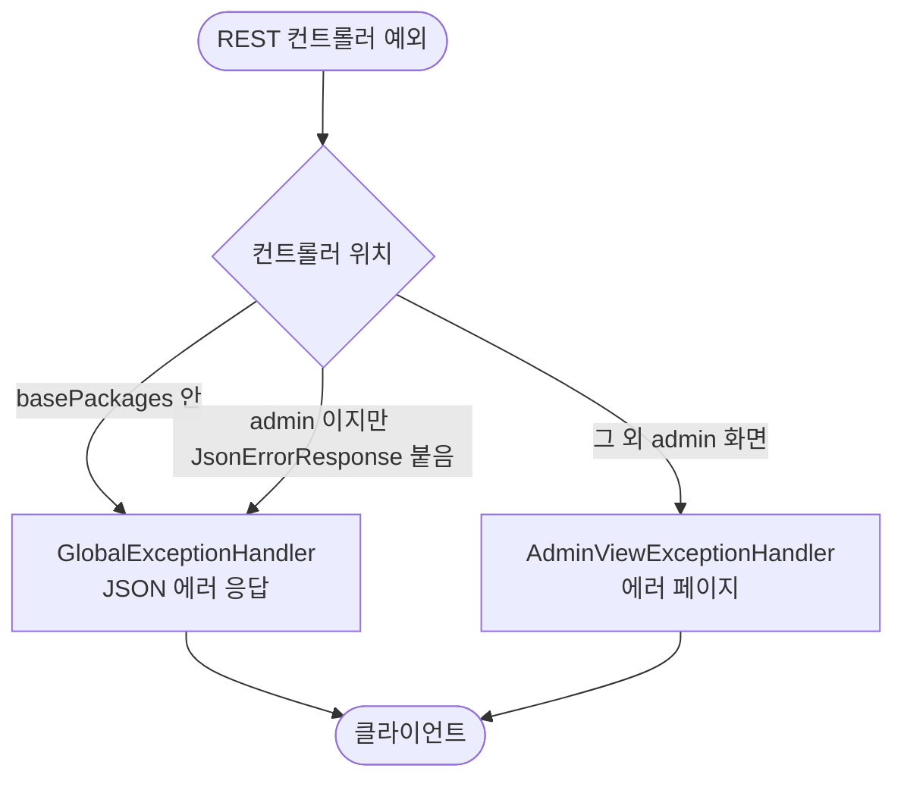

# common 패키지가 도메인을 거꾸로 의존하는 구조 정리

## 개요
모든 도메인이 쓰는 바닥 패키지 `common`이 7곳에서 도메인 패키지(admin·link·systemconfig)를 import하고 있었습니다. 이번에 이 역의존을 걷어냈습니다. 같은 문제가 다시 생기지 않도록 `ArchitectureRulesTest`로 규칙을 고정했고, 다른 도메인의 repository를 직접 쓰는 기존 54건은 동결 목록에 묶어 더 늘지 않게 했습니다.

운영 중인 서버이므로 API 경로, 응답 모양, 에러 코드, 트랜잭션은 그대로 두었습니다.

## 기능 흐름

## 변경 사항

### 예외 처리 범위
- `common/application/exception/JsonErrorResponse.java` (신규): JSON 에러를 받아야 하는 admin 컨트롤러에 붙이는 마커 애노테이션입니다.
- `common/application/exception/GlobalExceptionHandler.java`
  - admin 컨트롤러 두 개를 import하던 `assignableTypes`를 `annotations = JsonErrorResponse.class`로 바꿨습니다.
  - `basePackages`에 `systemconfig`를 더했습니다. `AppStatusController`가 그 패키지로 옮겨갔기 때문입니다.
- `admin/.../AdminPromptTestController.java`, `AdminLogApiController.java`: `@JsonErrorResponse`를 붙였습니다.

### 패키지 이동 (경로·동작 그대로)
- `link.core.LinkRole` → `common.infrastructure.jwt.LinkRole`: JWT 클레임 타입이라 JWT를 다루는 쪽으로 옮겼습니다.
- `common.application.controller.AppStatusController`(+Docs, `AppStatusResponse`) → `systemconfig.application.*`
- `common.infrastructure.security.MaintenanceModeFilter` → `systemconfig.infrastructure.security`
- `common.locale.EnabledLocales` → `systemconfig.application.service`
- 위 클래스의 테스트도 같은 패키지로 옮겼습니다.

### 규칙 고정
- `test/.../common/ArchitectureRulesTest.java` (신규)
  - common이 도메인을 import하면 실패합니다. 필터 체인을 조립하는 `SecurityConfig`만 예외입니다.
  - 다른 도메인의 `infrastructure.repository`를 import하는 곳이 동결 목록보다 늘거나, 목록에 사라진 줄이 남으면 실패합니다.
- `test/resources/architecture/cross-domain-repository-allowlist.txt` (신규): 현재 54건입니다.
- `test/.../common/ExceptionHandlerCoverageTest.java`: 마커가 붙은 컨트롤러도 범위 안으로 세도록 고치고, 두 admin 컨트롤러에 마커가 붙어 있는지 확인하는 시험을 더했습니다.

## 주요 구현 내용
- **systemconfig에 기대던 4개는 주인에게 돌려보냈습니다.** 점검 모드, 앱 상태, 켜진 언어는 시스템 설정이 정하는 기능입니다. 그래서 common에 설정 조회 인터페이스를 새로 만드는 대신 systemconfig로 옮겼습니다. 인터페이스를 새로 만들면 기존 테스트가 쓰는 `SystemConfigService` mock을 모두 바꿔야 해서 위험이 더 컸습니다.
- **`@RestControllerAdvice`의 `basePackages`·`assignableTypes`·`annotations`는 OR로 합쳐집니다.** 그래서 마커로 바꿔도 예외 처리 대상은 이전과 같습니다.
- **다른 도메인 repository 직접 사용 54건은 전환하지 않고 동결했습니다.** admin 외 30건은 대부분 회원 탈퇴처럼 여러 도메인의 표를 한 트랜잭션에서 지우는 쓰기 경로입니다. 운영 중에 이 트랜잭션 경계를 옮기는 것은 위험 대비 이득이 작다고 판단했습니다.

## 검증
- 서버 테스트 1545건 통과. 건너뛴 것 0건입니다.
- 실제 Spring 컨텍스트를 띄우는 리허설 통합 테스트 27건은 로컬 Postgres로 돌렸습니다. 옮긴 빈이 실제로 연결되는 것까지 확인했습니다.

## 주의사항
- 새 도메인 패키지를 만들면 `GlobalExceptionHandler.basePackages`에 더해야 합니다. 빠뜨리면 `ExceptionHandlerCoverageTest`가 실패합니다.
- 동결 목록은 줄을 지울 수만 있습니다. 서비스를 나누다 같은 사용이 다른 클래스로 옮겨가면 줄 이름만 바꿉니다(`#595`에서 그렇게 했습니다).
- 남은 일: 동결된 54건, 특히 회원 탈퇴 경로를 각 도메인 서비스로 전환하는 일입니다. 트랜잭션 전파를 하나씩 확인하며 진행해야 합니다.
