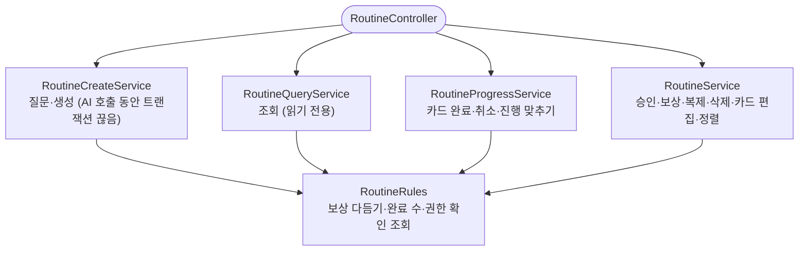

# RoutineService 책임별 분할

## 개요
1006줄짜리 `RoutineService`를 책임별로 나눴습니다.

- `RoutineCreateService`: 생성·질문
- `RoutineQueryService`: 조회
- `RoutineProgressService`: 진행
- `RoutineService`: 승인·편집·정렬·삭제

함께 쓰는 규칙은 `RoutineRules`로 모았습니다. API와 트랜잭션 경계는 그대로입니다.

## 기능 흐름

## 변경 사항

### 신규
- `routine/application/service/RoutineCreateService.java` (251줄): `generateQuestion`, `create`와 멱등 키·크레딧 반환 헬퍼
- `RoutineQueryService.java` (161줄): 최근 보상, 지난/임시저장/오늘/전체 일과, 추천, 카드 그림 조회
- `RoutineProgressService.java` (165줄): `completeStep`, `cancelStep`, `syncProgress`
- `RoutineRules.java` (61줄): `trimReward`, `countCompleted`, 권한 확인을 포함한 일과 조회 `routineFor`. 상태가 없어 정적 메서드로 두었습니다.

### 수정
- `RoutineService.java` (503줄): 편집 메서드만 남겼습니다.
- `RoutineController.java`: 나뉜 서비스를 주입받아 호출합니다. 엔드포인트는 그대로입니다.
- 테스트
  - `RoutineServiceTest`, `RoutineServiceCreditTest`: `@InjectMocks`를 서비스별로 두었습니다.
  - 권한 표 파라미터 테스트는 네 서비스를 담는 테스트용 `Services` 묶음으로 바꿨습니다. 검증 내용은 그대로입니다.
  - 컨트롤러 테스트 3개와 `ProfileHeaderWiringTest`: 새 서비스 mock을 넘깁니다.
- 동결 목록: `RoutineProgressService`가 같은 `member.ProfileRepository` 사용을 이어받아 줄을 하나 더했습니다.

## 주요 구현 내용
- **트랜잭션 의미가 같다는 근거**: public 메서드끼리 서로 부르지 않는다는 것을 호출 그래프로 확인했습니다. 그래서 클래스를 나눠도 자기 호출로 프록시가 빠지는 곳이 생기지 않습니다. 각 메서드의 `@Transactional`(`NOT_SUPPORTED` 포함)과 클래스 단위 `readOnly = true`를 그대로 옮겼습니다.
- **옮긴 코드가 같다는 근거**: 스크립트로 메서드를 바이트 그대로 옮긴 뒤, 원본의 모든 줄이 새 파일 중 한 곳에 그대로 있는지 대조했습니다. 다른 점은 정적 메서드로 바꾼 헬퍼 2개의 선언부뿐입니다.

## 검증
- 서버 테스트 1548건 통과
- 로컬 Postgres 리허설 통합 테스트 포함. 새 빈 4개가 실제 컨텍스트에서 순환 없이 연결되는 것을 확인했습니다.
- `ArchitectureRulesTest`가 분할 중에 옮겨간 repository 사용을 바로 잡아냈습니다.

## 주의사항
- 새 메서드를 넣을 때 그 메서드가 AI를 부르면 `@Transactional(propagation = NOT_SUPPORTED)`가 필요합니다. 클래스가 `readOnly` 트랜잭션이라, 빠뜨리면 AI를 기다리는 동안 DB 커넥션을 붙잡습니다.
- 한 서비스의 public 메서드에서 다른 서비스를 부르게 바꾸면 트랜잭션 전파가 달라집니다. 지금은 서로 부르지 않습니다.
