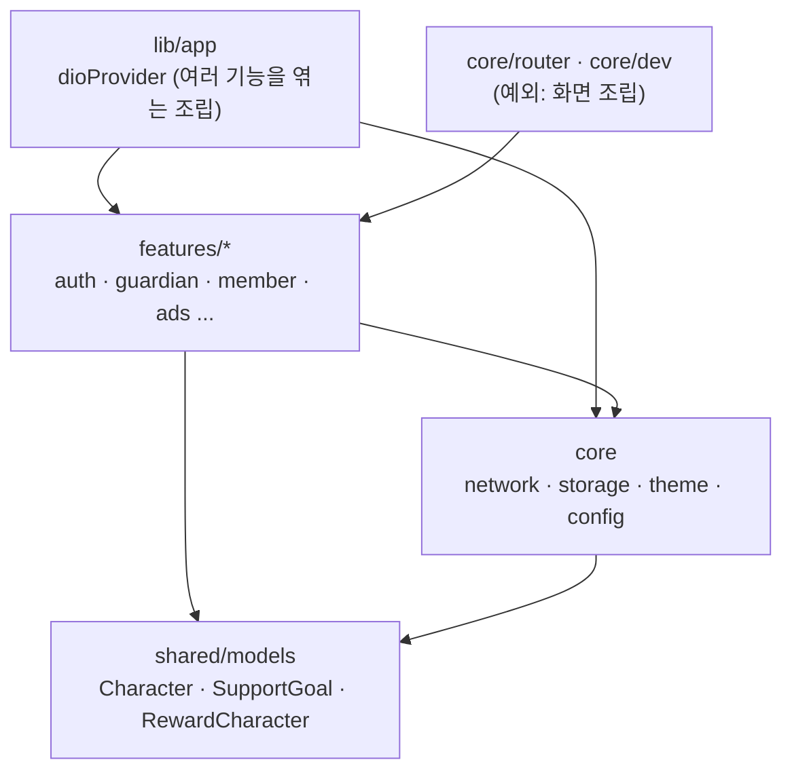

# core가 features를 거꾸로 의존하는 구조 정리

## 개요
바닥 계층 `core/`의 10개 파일이 `features/`를 59줄 import하고 있었습니다. 이 의존을 걷어냈습니다. 이제 남은 곳은 화면을 엮는 router와 개발자 도구뿐입니다. 규칙은 `tool/check_layer_imports.dart`와 시험으로 고정했고, 기능끼리 서로의 data·presentation을 import하는 기존 39건은 동결 목록에 묶었습니다. 이 동결 목록은 `#599`에서 32건으로 줄었습니다.

## 기능 흐름

## 변경 사항

### 옮긴 것
- `onboarding/domain/character.dart`, `support_goal.dart`, `child/domain/reward_character.dart` → `shared/models/`: 테마와 에셋이 쓰는 공용 도메인 타입입니다.
- `guardian/data/card_image_disk_cache.dart` → `core/storage/`: core 로거만 쓰는 디스크 캐시입니다.
- `localStorageProvider` (온보딩 notifier 안에 있었음) → `core/storage/local_storage.dart`
- `core/ads/*` → `features/ads/{data,application,presentation}`: 회원 정보를 보고 광고를 정하는 기능 모듈입니다.
  - `ad_ids.dart`는 import가 없는 설정 표라서 `core/config/`로 옮겼습니다.
- `guardian/data/member_repository.dart` → `features/member/data/`. 회원 provider 묶음(`memberProvider` 등)은 `routine_repository.dart`에서 꺼내 `features/member/application/member_providers.dart`로 옮겼습니다.
- `dioProvider` → `lib/app/dio_provider.dart`: 인증·프로필 세션·카드 캐시를 엮는 조립 코드라 앱 조립 계층에 둡니다. `core/network/dio_client.dart`에는 순수 `DioClient`만 남겼습니다.

### 규칙 고정
- `tool/check_layer_imports.dart` (신규)
  - core·shared가 features·app을 import하면 위반입니다.
  - 한 기능이 다른 기능의 data·presentation을 import하면 위반입니다.
- `test/tool/check_layer_imports_test.dart` (신규): CI의 `flutter test`가 이 시험으로 막습니다.
- `tool/layer_imports_allowed.txt` (신규): 동결 목록입니다.
- `test/ads/ad_boundary_test.dart`: 광고 모듈 경로가 바뀐 것에 맞추고, 상대 경로와 패키지 경로를 모두 잡게 했습니다.
- `client/CLAUDE.md`, `server/CLAUDE.md`: 계층 규칙과 동결 목록 위치를 적었습니다.

## 주요 구현 내용
- **경로는 도구로 다시 썼습니다.** 파일을 `git mv`로 옮긴 뒤 lib·test의 모든 import(상대·패키지)를 새 위치로 다시 계산했습니다. 그 뒤 analyzer가 짚은 안 쓰는 import만 지웠습니다. 바뀐 파일은 179개입니다.
- **옮긴 provider 코드는 바이트 그대로입니다.** `dart format`이 한 줄짜리 `if`를 여러 줄로 바꿔 lint에 걸린 것을 보고, 원본 블록으로 되돌렸습니다.
- **router는 예외로 남겼습니다.** 경로를 만들려면 모든 화면을 알아야 하는 조립 지점이기 때문입니다.

## 검증
- 앱 테스트 3023건 통과. 실패 1건은 develop에 이미 있는 영어 ARB 잔여 키입니다.
- `flutter analyze` 0건, 한글 리터럴 0줄, 계층 검사 새 위반 0건

## 주의사항
- 여러 기능을 엮는 provider를 새로 만들면 `core`가 아니라 `lib/app/`에 둡니다.
- 동결 목록은 줄을 지울 수만 있습니다. 시험이 사라진 줄도 잡으므로, 위반을 고치면 목록에서 그 줄을 지워야 통과합니다.
