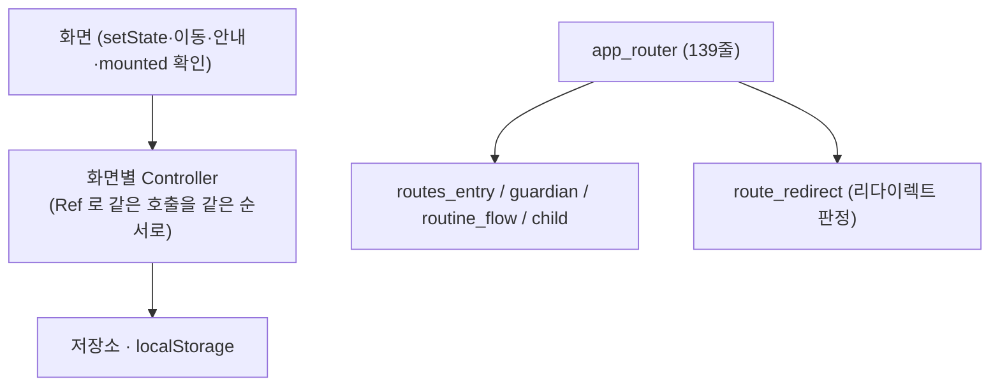

# 큰 파일 분할과 화면 Controller 계층 도입

## 개요
책임이 섞인 큰 파일을 나누고, 화면이 저장소·localStorage 를 직접 부르던 곳을 화면별 컨트롤러로 옮겼다. 위치만 옮기고 호출 순서·mounted 확인·라우트 순서·저장 키는 그대로다.

## 기능 흐름

## 변경 사항

### 파일 분할
- `core/storage/local_storage.dart` 784줄을 셋으로 나눴다.
  - `local_storage.dart`: 인터페이스와 provider (194줄)
  - `shared_prefs_storage.dart` (362줄)
  - `in_memory_storage.dart` (244줄)
- `guardian/data/routine_repository.dart` 968줄을 넷으로 나눴다.
  - 인터페이스 (137줄)
  - `routine_repository_impl.dart`
  - `application/routine_providers.dart`: provider와 목록 갱신 확장
  - `domain/local_dlp.dart`
- `core/router/app_router.dart` 633줄을 나눴다.
  - `app_router.dart` 139줄
  - `routes.dart`: 경로 상수
  - `route_redirect.dart`
  - 영역별 라우트 4개. 라우트는 호출할 때마다 새로 만들고, 원래 순서대로 이어 붙인다.
- `core/dev/dev_tools_overlay.dart` 946줄은 part 파일 4개로 나눴다. 비공개 접근이 그대로다.
- `guardian/application/routine_notifier.dart`의 상태 클래스를 `routine_flow_state.dart`로 옮겼다(697줄 + 139줄).

### 화면 Controller
- 컨트롤러 19개: 로그인, 약관, 역할 선택, 화면 전환, PIN 변경, 보호자 홈, 임시저장, 보상 설정, 카드 사진, 보호자 목록, 초대 발급, 초대 입력, 시작, 이름, 연결 입력·발급·상태, 이룸이 설정, 인증 세션
- 위젯 밖에서 쓰도록 `forgetPreviousAccountRoutines`의 `Ref` 확장을 더했다.

## 주요 구현 내용
- 일과 provider가 `application`으로 옮겨가고 인증 통로(`AuthSessionController`)를 두면서, 기능 간 data import 동결 목록이 39건에서 28건으로 줄었다.
- OAuth 제공자 표시 이름은 로그에만 쓰여 화면에 나가지 않는다. 그래서 ARB로 옮기지 않았다.

## 검증
- 앱 시험 3035건 통과, analyze 0건
- iOS 시뮬레이터 E2E: 보호자 홈, 일과 상세 시트, 설정, 연결 상태, 함께하는 사람이 정상이다.

## 주의사항
- 다음은 위험 대비 이득이 작아 이번에 하지 않았다.
  - `routine_notifier`를 여러 Notifier로 나누는 것: 화면들이 함께 쓰는 상태가 갈라진다.
  - mixin 분리: 생성용 비공개 필드를 공유해야 한다.
  - `LocalStorage`를 역할별 인터페이스로 나누는 것
- `child_home_screen`의 `ref.watch(localStorageProvider)`는 그대로 두었다. 컨트롤러로 옮기면 `read`가 되어 리빌드 의존이 달라지기 때문이다.
- PIN이 없는 휴대폰에서 비밀암호 변경을 누르면 로그인으로 간다. 기존 설계(보호자 재인증 후 만들기) 그대로이며, 실기기에서 확인했다.
