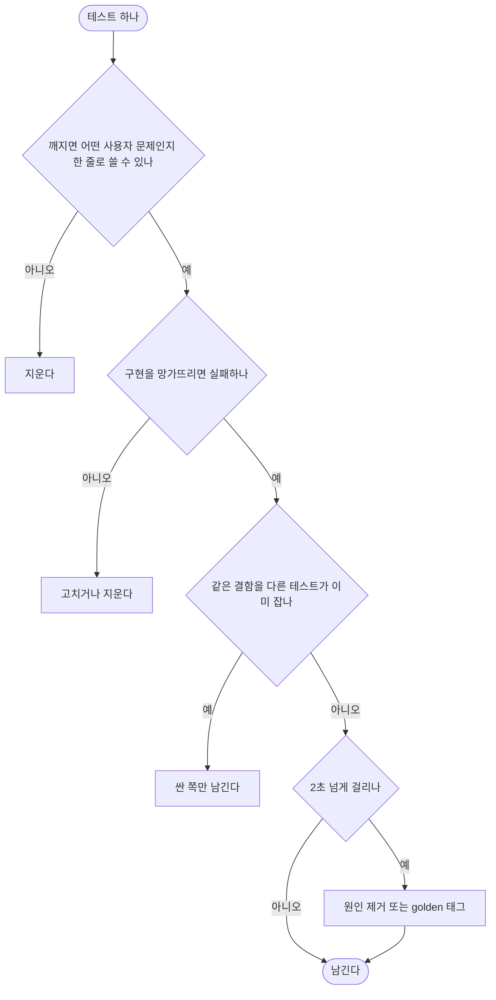

# 테스트 정리와 테스트 설계 가이드라인 수립

## 개요

클라이언트 테스트 281개 파일을 시간으로 재고 전부 가치로 분류했다. 결함을 잡지 못하는 테스트를 덜어내고, 느린 테스트를 고쳤다.
전체 실행은 **234초에서 166초로 29% 줄었다.** 앞으로 유의미한 테스트를 설계하는 기준은 `docs/testing-guidelines.md`에 세웠다.
루트, 클라이언트, 서버 `CLAUDE.md`가 이 문서를 가리킨다.

## 기능 흐름

테스트 하나를 남길지 정하는 판단 순서다. 이번 정리에도 이 순서를 썼고, 가이드라인에도 같은 기준을 담았다.

## 측정 — 시간이 어디에 쓰였나

`flutter test --reporter json`으로 파일별, 테스트별 시간을 쟀다. 12코어 기준이다.

| | 정리 전 | 정리 후 |
|---|---|---|
| 전체 시간 | 234초 | **166초** |
| 파일 / 테스트 | 281 / 3072 | 278 / 2936 |
| CPU: 파일 로딩(컴파일) | 784초 | 571초 |
| CPU: 테스트 실행 | 603초 | 412초 |

전체 CPU의 **56%가 파일마다 따로 하는 컴파일**이었다. 파일 하나에 평균 2.8초가 든다.
그래서 가이드라인에 "새 파일보다 기존 파일에 케이스를 더한다"를 넣었다.

## 변경 사항

### 삭제
- `client/test/l10n/guardian_screens_wiring_test.dart`, `guardian_widgets_wiring_test.dart` (약 2800줄, 37초): 문구를 ARB로 옮길 때 "화면이 키를 읽는지" 확인하던 테스트다. 지금은 `test/tool/check_hangul_literals_lib_test.dart`가 lib에 한글 리터럴 0줄을 정적으로 막고 있어서, 같은 보장이 이미 있다.
- `client/test/pin_change_screen_golden_test.dart`와 골든 4장: `pin_change_conformance_test`가 같은 네 상태를 찍고 시안 대조에도 쓰인다.

### 정리 (문구 복사만 덜어냄)
- `client/test/l10n/*_messages_ko_test.dart` 11개, `child_wiring_test.dart`: 로직 없이 문구를 그대로 베낀 단언을 지웠다. 화면을 띄워 "ARB를 읽는다", "ko로 떨어진다"만 보던 위젯 테스트도 지웠다.
  남긴 것은 조사 처리, 숫자·이름·에러 코드 끼워넣기, `N일간` 분기, enum `apiValue` 계약, 실패별 안내와 에러 코드, 휴대폰 역할별 빈 상태다.
- `client/test/pictogram/pictogram_card_test.dart`: 시간을 `print`로만 찍던 부분을 지웠다. 단언은 유지했다.

### 옮김
- `client/test/pin_screen_test.dart`: "PIN 불일치 안내가 설명 자리에 떴다가, 다시 입력하면 걷힌다" 테스트를 l10n 테스트에서 이리로 옮겼다. 문구가 아니라 상태 전이라서 남길 가치가 있다.

### 속도
- `client/test/dev_log_file_test.dart`: 2MB 상한 테스트 두 개가 1KB 줄을 2500번 덧붙이느라 각각 14초씩 걸렸다. 50KB 줄을 50번 덧붙이도록 바꿔, 같은 동작을 1초 안에 검증한다.

### 문서
- `docs/testing-guidelines.md` (신규): 설계 절차, 층 고르기, 단언할 것과 안 할 것, 퇴역 규칙, 실행 예산, 리뷰 체크리스트.
- `CLAUDE.md`, `client/CLAUDE.md` §6, `server/CLAUDE.md`: 가이드라인을 가리키게 했다. 서버 문서가 가리키던 `.claude/rules/30-testing-and-verification.md`는 없는 파일이라 이번에 교체했다.
- `docs/superpowers/specs/2026-10-10-test-cleanup-design.md`: 판단 근거와 결정을 기록했다.

## 주요 구현 내용

- **분류**: 470개 파일(클라이언트 281, 서버 189)을 "구현을 망가뜨리면 사용자 문제를 알리며 실패하는가"로 분류했다. 삭제·정리 후보는 diff를 직접 대조했다.
- **분류 판정을 그대로 따르지 않은 것**:
  - 시안 좌표, 모서리, 그림자 단언은 남겼다. 디자인이 어긋나는 것도 사용자 결함이다.
  - `card_review_badge_test`("가린다" 배지가 없다)는 남겼다. AI 개인정보를 가린다고 말하지 않는다는 원칙을 지키는 테스트다.
  - 골든은 지우지 않았다. 이미 `golden` 태그가 붙어 있어 CI에서 빠지고, 평소에는 `--exclude-tags golden`으로 뺀다.
  - 서버 테스트는 손대지 않았다. Spring 컨텍스트가 2~3개뿐이라 느리지 않다. 후보도 메서드 몇 개뿐이라, 운영 중인 API 계약을 건드릴 위험이 이득보다 크다. 레코드 JSON 직렬화 테스트는 필드명 계약이라 반드시 남긴다.
- **정리한 테스트가 실제로 결함을 잡는지 확인**: `dev_log_file`의 "깨진 첫 줄 버리기" 한 줄을 일부러 지우자 테스트가 실패했다. 확인 후 앱 코드는 원래대로 되돌렸다.

## 검증

- `flutter analyze`: 0건
- `flutter test` 전체: 2936개 중 실패 1건 (`server_error_sync_test`)
  - 정리 전에도 있던 실패다. 서버에 로그 관리 에러 코드 5개(`INVALID_LOG_PATH` 등)가 새로 생겼는데 앱 enum에 없다. 이 작업과는 무관하다.

## 주의사항

- **`server_error_sync_test` 실패는 별도 작업이 필요하다.** 서버 에러 코드 5개를 앱 enum에 추가해야 한다.
- **문구를 바꿔도 테스트가 깨지지 않는 쪽으로 옮겼다.** 대신 문구의 정확성은 시안 대조와 사람이 확인하는 몫이다. 법적 문구(약관)처럼 정확히 고정해야 하는 문장은 앞으로도 테스트로 고정한다.
- **wiring 테스트를 지운 대신 정적 검사가 유일한 방어선이다.** `tool/check_hangul_literals.dart`의 건너뛰기 목록을 넓히면 그만큼 보장이 약해진다.
- **남은 개선 여지**: 파일 로딩이 여전히 CPU의 58%다. 같은 영역의 작은 단위 테스트 파일을 합치면 더 줄일 수 있다. 다만 파일 사이 정적 상태가 섞일 위험이 있어 이번에는 하지 않았다.
