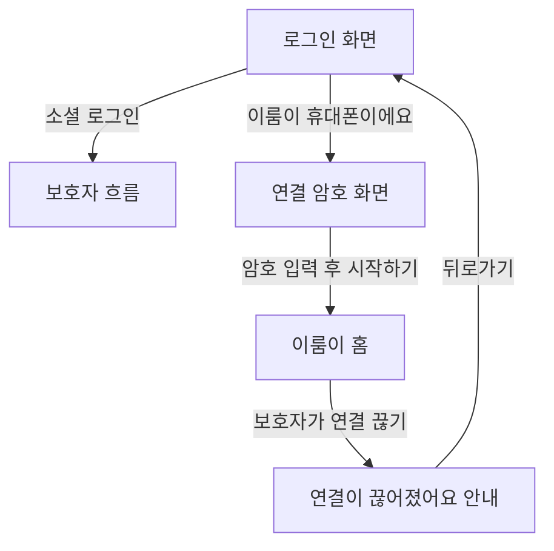

## 구현 보고서: 이룸이 휴대폰 연결 입구

### 무엇이 문제였나
- 이룸이 휴대폰은 소셜 로그인 → 약관 → 역할 선택 "이룸이"를 거쳐야 연결 암호 화면에 닿았다.
- 온보딩을 마친 계정(부모·교사)으로 로그인하면 역할 선택을 건너뛰고 보호자 화면으로 가서(`resolveDestination`), 자기 계정으로는 학생 휴대폰을 이룸이 휴대폰으로 만들 수 없었다.
- 연결이 끊긴 휴대폰에서 뒤로가기를 누르면 로그인 화면으로 떨어지고 돌아올 길이 없었다.

### 바꾼 것
- 로그인 화면 소셜 버튼 아래에 밑줄 링크 **"이룸이 휴대폰이에요 · 연결 암호 넣기"**를 넣었다. 누르면 로그인 없이 연결 암호 화면으로 간다(`login_screen.dart`, ARB `loginElumiLink`).
- 온보딩 이름 화면의 "초대 코드가 있어요"와 같은 부품을 썼다. 새 시각 요소는 만들지 않았다.
- 서버 `POST /api/device-links/redeem`은 원래 인증 없이 받으므로 서버는 그대로다.

### 왜 이 방식인가
- 역할 선택을 다시 열면 이미 가입한 보호자가 매번 역할을 다시 고르게 된다. 입구를 로그인 화면에 두면 기존 보호자 흐름을 건드리지 않고 이룸이 휴대폰만 새 길로 간다.
- 연결 암호는 로그인한 보호자가 만들고 약관도 그 계정이 받는다. 기존 "역할 선택 → 이룸이" 경로와 같은 구조라 약관 면에서 느슨해지지 않는다.

### 검증
- 로그인 골든 2장 갱신, 목적지 테스트 통과.
- 실기기(iOS 시뮬레이터): 로그인 화면에서 링크를 눌러 로그인 없이 연결 화면 진입, 연결 성공까지 확인.

 

### 주의사항
- 이 입구로 연결 시도가 쉬워졌다. 무작위 대입은 IP당 분당 10회 제한과 암호당 5회 실패 폐기(#634)에 기댄다. 이 둘을 약하게 바꾸면 안 된다.
