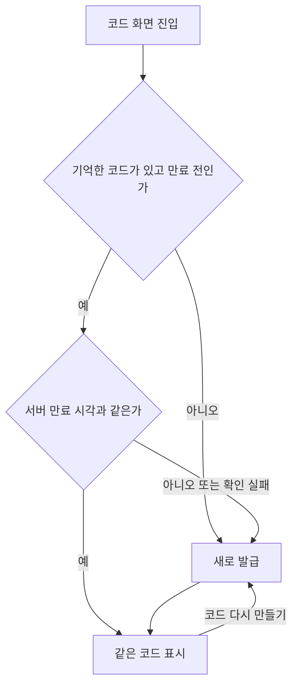

## 구현 보고서: 초대 코드와 연결 암호 화면 통일

### 바꾼 것
- 두 화면이 같은 구조다: 코드 → 남은 시간 → **코드 다시 만들기** → "다시 만들면 이전 코드는 쓸 수 없어요" → 안내 → **링크로 보내기 / 코드 복사하기**.
- 연결 암호도 링크로 보낸다: `elum://link?code=`와 웹 `https://twin-fang.github.io/elum/link/#code=`(gh-pages 게시). 이룸이 휴대폰에서 열면 로그인 없이 연결 화면에 암호가 채워진다(자동 전송 없음).
- **다시 들어와도 코드 유지**: 발급한 코드를 앱 메모리에 기억해 두고, 들어올 때 서버에 아직 살아 있는지만 묻는다. 연결 암호는 기존 `pendingExpiresAt`, 초대 코드는 새 `GET /api/profiles/{id}/invites/pending`으로 확인한다. "코드 다시 만들기"를 누를 때만 새로 만든다.

### 왜 이 방식인가
- 서버는 코드를 해시로만 저장해 원문을 돌려줄 수 없다. 그래서 원문은 앱이 기억하고 서버는 살아 있는지만 알려 준다. 디스크에는 저장하지 않는다.
- 명세(multi-guardian E9)는 "다시 발급하면 이전 미사용 코드 폐기"만 정했다. 들어올 때마다 발급하던 것은 앱 구현이었고, 명세는 바꾸지 않았다.

### 검증
- 실기기: 초대·연결 화면 모양, 코드 복사(클립보드 확인), 연결 암호는 나갔다 들어와도 같은 코드, 끊긴 이룸이 휴대폰에서 연결 암호 링크를 열어 암호가 채워지고 연결 성공.
- 초대 코드 유지는 새 서버 API가 필요해 배포 후 확인한다.

  

### 남은 것 / 주의사항
- 설정 진입 연결 화면이 시안(1027:4617)과 달라졌다(버튼 두 개, 안내 두 줄). 디자이너 확인 대상.
- 온보딩 연결 화면에는 공유·복사를 넣지 않았다(시작하기·나중에 할게요로 하단이 차 있다).
- 기억한 코드는 앱을 완전히 끄면 사라진다. 그때는 새로 발급한다(의도).
