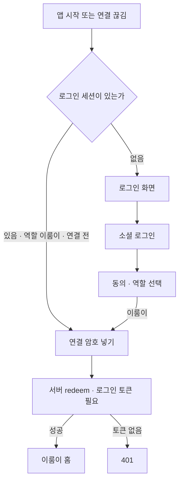

# 로그인 없이 이룸이 휴대폰을 연결하던 길을 없앴다 (#629 후속)

## 개요

어제 #629 수정으로 로그인 화면 아래에 "이룸이 휴대폰이에요 · 연결 암호 넣기" 링크를 넣었다. 버그를 고치는 대신
**로그인 없이 연결 암호만으로 이룸이 화면에 들어가는 길**을 새로 만든 것이라 명세가 바뀌었다. 이룸이 휴대폰도
회원가입·로그인을 거쳐야 한다는 결정에 따라 링크를 되돌리고, 앱과 서버 양쪽에서 로그인 없는 연결을 막았다.

## 바뀐 흐름

## 변경 사항

### 앱
- **로그인 화면 링크 제거**: `login_screen.dart`, ARB `loginElumiLink`(5개 언어), 로그인 골든 2장을 #629 이전으로 되돌렸다. 링크 전용 시험 `login_elumi_entry_test.dart`는 기능과 함께 지웠다.
- **연결 화면은 로그인 뒤에만** (`route_redirect.dart`): `Routes.linkEnter`를 가입 절차(동의·역할 선택)와 같은 묶음에 넣어 세션이 없으면 로그인으로 보낸다. 세션 없는 이룸이 휴대폰도 연결 화면이 아니라 로그인으로 간다.
- **시작 자리** (`app_destination.dart`): 세션이 없으면 누구든 로그인.
- **연결이 끊겼을 때** (`link_reset.dart`): 로컬을 비운 뒤 로그인으로 보낸다.
- **"연결이 끊어졌어요" 안내 유지** (`auth_repository.dart`): 로그인할 때 이 표식을 지우지 않는다. 로그인 → 역할 선택(이룸이) 뒤 연결 화면이 그 말을 한다. 다시 연결하면 내려간다.
- **연결 암호 링크** (`link_code_intake.dart`, `app.dart`): 링크가 화면을 열지 않고 코드만 맡겨 둔다. 가입 중(동의·역할 선택·암호 넣기)이 아닌 로그인된 보호자 휴대폰에서는 "이룸이 휴대폰에서 열기" 안내만 한다.

### 서버
- `SecurityConfig`: `POST /api/device-links/redeem`의 `permitAll`을 뺐다. catch-all 규칙(보호자 권한)에 걸려 토큰이 없으면 401, 이미 연결된 이룸이 토큰이면 403이다.
- API 문서: "인증 불필요" → "로그인 필요", 401 응답 추가.
- 앱은 로그인 뒤에만 연결 화면에 닿으므로 `AuthInterceptor`가 토큰을 붙여 보낸다. 앱 쪽 추가 수정은 없다.

## 주의사항
- **옛 앱(2.29.0 이하)의 로그인 없는 재연결이 끊긴다.** 연결이 끊긴 옛 앱 이룸이 휴대폰은 업데이트해야 다시 연결할 수 있다. 사용자가 적은 시점이라 받아들였다(사용자 결정).
- 이미 연결된 이룸이 휴대폰은 영향이 없다 — 토큰 갱신(`/api/auth/**`)은 그대로 열려 있다.
- 보호자 온보딩을 마친 계정은 역할 선택을 건너뛰므로 그 계정으로는 이룸이 휴대폰을 연결할 수 없다. 이룸이 휴대폰은 **자기 계정으로 가입**해 연결한다는 것이 이번 결정이다.
- 연결 화면 가드를 풀면 로그인 없는 연결이 다시 열린다. `router_redirect_test`의 "연결 암호 넣기 화면도 로그인 없이는 열리지 않는다"와 서버 `DeviceLinkSecurityTest`의 401 시험이 이를 지킨다.

## 검증
- 앱: 바뀐 시험 파일만 실행 — 라우터·연결 끊김·로그인·인증 시험 296건 통과, `flutter analyze lib` 0건.
- 서버: `DeviceLinkSecurityTest` 6건 통과(토큰 없이 redeem → 401 추가).
- 운영 배포 뒤 실측은 후속 댓글로 남긴다.

## 함께 처리한 운영 장애
- 2026-10-14 06:14 NAS 재기동 뒤 프록시는 blue 포트(8085)를, 떠 있는 컨테이너는 green이라 API 전체가 502였다(로그인 실패 `E-AUTH-API/502`).
- `elum-server-cicd`를 수동 실행해 green을 새로 띄우고 프록시를 맞췄다. 09:16부터 `/healthz` 200.
