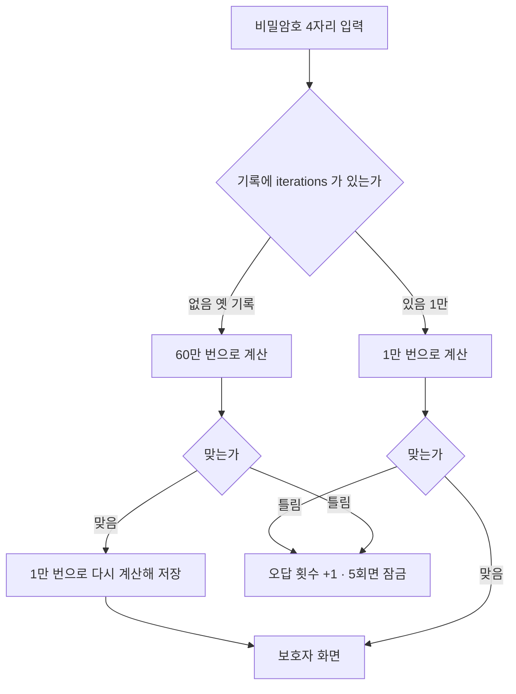

# 보호자 화면으로 갈 때 비밀암호 확인이 4초 걸리던 문제 (#640)

## 원인

이룸이 화면 → 보호자 화면 비밀암호 확인은 **서버를 거치지 않는다.** 휴대폰 안 보안 저장소(iOS 키체인)의 기록과
비교한다. 그 기록이 PBKDF2-SHA256 **60만 번** 반복이었고, `cryptography` 패키지의 순수 Dart 구현이라 확인할 때마다
약 4초 동안 화면이 멈춘 것처럼 보였다.

암호가 숫자 4자리(1만 가지)라 반복 횟수는 막는 힘을 거의 늘리지 않는다. 기록이 새면 반복이 많아도 1만 개를 다
맞춰 볼 수 있다. 실제 방어는 오답 5회 → 5분 잠금이다.

## 변경 (`client/lib/core/storage/guardian_lock_store.dart`)

- 반복을 `iterations = 10000` 으로 줄였다. 계산량이 60분의 1이다.
- 기록에 `iterations` 를 남긴다. 없는 옛 기록은 `legacyIterations = 600000` 으로 확인하고, 맞으면 새 횟수로 다시 저장한다.
  업데이트 뒤 **처음 한 번만** 예전 속도이고 그다음부터 빠르다. 기존 비밀암호는 그대로 쓴다.
- 오답 잠금·설치 표식 확인·저장 실패 시 통과시키지 않는 규칙은 그대로다.

## 주의사항

- `legacyIterations` 를 지우면 업데이트 전에 비밀암호를 만든 보호자가 보호자 화면에 못 들어간다. 모든 기록이 바뀌었다고 확신할 수 없으므로 남겨 둔다.
- 반복을 다시 늘리고 싶으면 `iterations` 만 바꾸면 된다. 기록에 횟수가 있어 옛 값도 확인된다(다음 확인 때 새 값으로 바뀐다).

## 검증

- `guardian_lock_legacy_test.dart`(신규 1건): 60만 번 옛 기록이 원래 암호로 열리고 1만 번으로 바뀌며, 틀린 암호는 거절된다.
- `local_storage_test.dart` 포함 11건 통과, `flutter analyze lib/core/storage` 0건.
- 실기기 체감 속도는 배포 뒤 확인한다.

## 배포

- 배포 PR #641 → v2.29.2. iOS는 심사 대기 중이던 2.29.1 제출을 취소하고 2.29.2로 다시 제출, Android는 프로덕션 심사 제출(store_submit).
