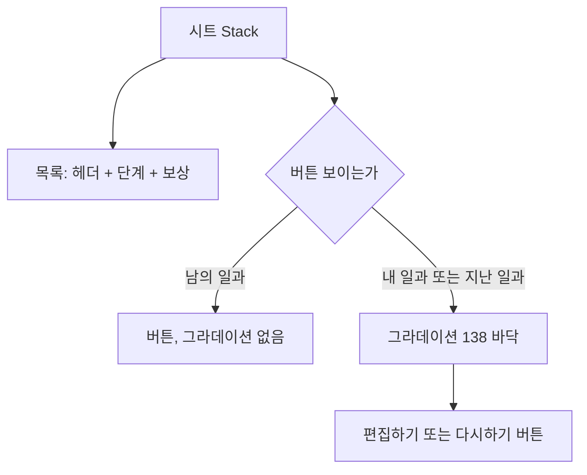

### 📌 작업 개요
일과 시트에서 단계가 많아 목록이 떠 있는 `편집하기`·`일과 다시하기` 버튼 뒤로 지나갈 때, 버튼 위아래로 단계 글자가 겹쳐 읽혔다. 디자이너가 시안 1274:8038 에 버튼 뒤 배경 레이어(`background`, 1274:8309)를 추가해 이를 앱에 반영했다.

커밋: cdc8f79f

### 🔍 문제 분석
- 시안 덤프상 `background` 는 393×138, 시트 바닥에 붙는 세로 선형 그라데이션(위 투명 `#F7F2EF` → 아래 `#F7F2EF`)이다. 버튼(시트 y 492~558)을 위 16, 아래 56 감싼다.
- 하지만 시안 레이어 순서가 `background → 편집하기 버튼 → 행동단계 목록`이라 목록이 그라데이션을 덮는다. 내보낸 PNG 에서 버튼 아래 카드 픽셀이 `238,233,230` 그대로라 효과가 보이지 않는다. 디자이너에게 순서 수정을 요청했다.
- 코드에는 예전 시안 기준으로 "흐리게 가리는 처리는 넣지 않는다 — 시안에 없다"는 주석이 남아 있었다.

### ✅ 구현 내용

#### 버튼 뒤 그라데이션
- **파일**: `client/lib/features/guardian/presentation/widgets/routine_detail_sheet.dart`
- **변경**: 시트 `Stack` 에서 목록 위, 버튼 아래에 `Positioned(bottom: 0, height: 138.h)` 그라데이션을 깔았다. 높이는 상수 `_buttonFadeHeight`(시안 1274:8309)로 두었다.
- **이유**
  - 끝 색은 시트 배경 토큰 `colors.background` 를 그대로 쓴다. 시트 배경이 바뀌면 함께 바뀌어야 하는 값이라 새 토큰을 만들지 않았다.
  - `IgnorePointer` 로 감싸 버튼 아래로 지나간 단계도 스크롤·순서 바꾸기가 그대로 된다.
  - 버튼과 같은 조건(`isPast || isEditableByMe`)으로 묶어, 버튼이 없는 남의 일과 시트에는 그라데이션도 없다.
  - 낡은 "넣지 않는다" 주석을 지웠다.

#### 대조 렌더
- **파일**: `client/test/figma_conformance_test.dart`, `client/test/figma/sheet_long_1274-8038.png`(신규), `client/test/figma/past_sheet_980-4777.png`(갱신)
- **변경**: 단계 8개 오늘 일과 시트(1274:8038) 대조 렌더를 추가했다. 지난 일과 시트도 단계가 많아 버튼 뒤로 목록이 지나가므로 골든이 바뀌었다.
- **이유**: 그라데이션이 빠지면 이 골든이 깨진다. 단계 4개 시트(956:4084)는 스크롤이 없어 그라데이션이 빈 배경 위에 깔리므로 골든이 그대로다 — 지금 화면과 똑같이 보인다는 확인이 된다.

### 🔧 주요 변경사항 상세

그리는 순서가 곧 겹침 순서다. 목록 → 그라데이션 → 버튼 순이라 목록만 흐려지고 버튼은 또렷하다.

**주의사항**
- 그라데이션을 목록보다 먼저 두면 시안의 실수와 똑같이 보이지 않게 된다. 순서를 바꾸지 않는다.
- `IgnorePointer` 를 빼면 버튼 근처 단계의 끌기·스크롤이 막힌다.

### 🧪 테스트 및 검증
- 기존 / 수정 / 시안 비교 이미지는 이슈 본문에 있다. 수정 렌더에서 7번 단계가 시트 배경으로 흐려지는 것을 확인했다.
- 앱 테스트 2947건 통과 (골든 포함), `flutter analyze` 0건.
- 실기기 확인은 아직 하지 않았다.

### 📌 참고사항
- 디자이너가 Figma 레이어 순서를 고치면 시안 export 와 다시 맞대 본다. 그때까지 이슈는 열어 둔다.
