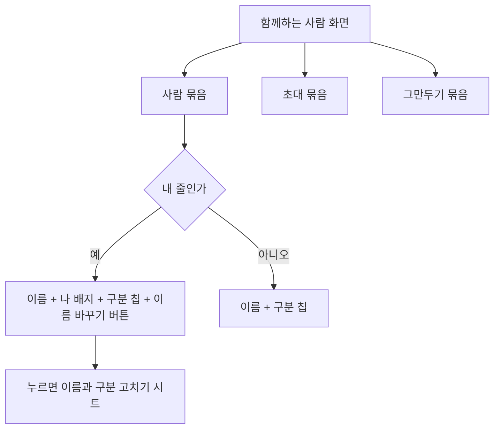

### 📌 작업 개요
다중 보호자 시안 없이 설정 줄 모양을 빌려 만든 함께하는 사람 화면이, 여럿이 함께할 때 누가 누구인지·무엇을 누를 수 있는지 구분되지 않았다. 디자인 요청(#644) B안에 `이름 바꾸기` 버튼을 더한 모양으로 먼저 적용했다.

커밋: 7f83c643 (develop)

### 🔍 문제 분석
- 사람 줄과 메뉴 줄이 같은 `SettingsTile` 모양이고 살색 배경 위에 바로 놓여 경계가 없었다.
- 이름이 없는 사람은 구분 이름(`보호자`·`센터 선생님`)이 이름 자리에 들어가 이름인지 구분인지 알 수 없었다.
- 내 줄 오른쪽 `보호자 >`가 이름 고치기라는 뜻으로 읽히지 않았다.
- 꺾쇠가 안쪽에 선 원인: 한 줄 `Row`에서 `Flexible`(이름)과 `Spacer`가 남은 폭을 반씩 나눠 가져 오른쪽 글자가 끝까지 가지 못했다.

### ✅ 구현 내용

#### 흰 묶음 카드 공통 위젯
- **파일**: `client/lib/core/widgets/settings_group.dart` (신규)
- **변경**: 머리 글 > 흰 둥근 카드(줄 사이 가는 선) > 꼬리 설명. 줄은 기존 `SettingsTile`을 그대로 넣는다.
- **이유**: 다른 설정 화면도 같은 모양으로 옮길 예정(#646)이라 화면에 직접 그리지 않고 한 곳에 뒀다.

#### 함께하는 사람 화면
- **파일**: `client/lib/features/profile/presentation/guardians_screen.dart`
- **변경**
  - `함께 돌보는 사람 N명` · `초대` · `그만두기` 세 묶음으로 나눴다.
  - 사람 줄은 이름 · `나` 배지 · 구분 칩 순서다. 이름이 길면 이름만 줄이고 칩은 지킨다.
  - 이름이 없으면 회색 `이름 없음`으로 적는다.
  - 내 줄에만 `이름 바꾸기` 버튼을 둔다. 줄 자체는 누르지 않는다. 버튼 터치 영역은 44 이상이다.
  - 저장 중에는 버튼 자리에 스피너가 돈다.
- **이유**: 할 수 있는 일을 버튼 모양으로만 보여 줘야 무엇을 누를 수 있는지 읽힌다.

#### 색 토큰 · 문구
- **파일**: `client/lib/core/theme/app_colors.dart`, `client/lib/l10n/app_ko.arb`, `app_en.arb`
- **변경**
  - 묶음 카드 바탕과 구분선, 칩 세 종류의 바탕과 글자 토큰을 더했다. 칩 글자색은 바탕 위 대비 4.5 이상으로 짙게 뒀다.
  - 문구 4개(`함께 돌보는 사람 {count}명`, `초대`, `이름 바꾸기`, `이름 없음`)를 더하고, 쓰지 않게 된 `이름을 넣어보세요`를 지웠다.

### 🔧 주요 변경사항 상세

**주의사항**
- 사람 줄의 바깥 `Row` 안에 `Expanded` 하나만 둔다. `Flexible`과 `Spacer`를 나란히 두면 꺾쇠가 안쪽에 서던 문제가 다시 생긴다.
- 보호자와 센터 선생님에는 권한 차이가 없다. 칩 색을 위계처럼 보이게 바꾸지 않는다.

### 🧪 테스트 및 검증
- 화면 테스트를 새 모양에 맞췄다. 이름 바꾸기 버튼이 내 줄에만 있는지, 남의 줄은 눌러도 고치지 못하는지, 이름이 없을 때 `이름 없음`과 칩이 따로 보이는지를 본다.
- 관련 테스트 43건 통과(함께하는 사람, 글자 크기, 번역 키 일치). `flutter analyze` 0건.
- 위젯 렌더로 3명, 5명에 긴 이름, 글자 1.3배, 불러오기 실패 상태를 확인했다. **실기기 확인은 아직이다.**

### 📌 참고사항
- 다른 설정 화면을 묶음 카드로 옮기는 작업은 간격을 정해야 해서 디자인 요청(#646)으로 넘겼다.
- 시안(#644)이 나오면 이 화면을 다시 맞춘다.
