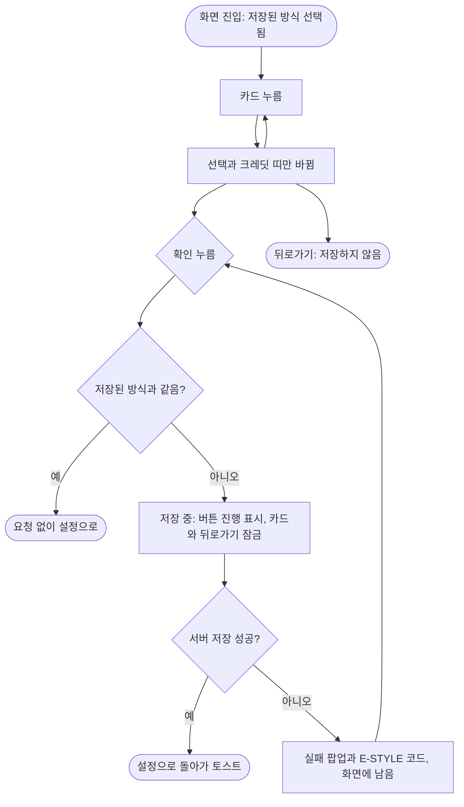

# 🚀[기능개선][클라][설정] 그림 방식 설정에서 카드를 누르면 바로 저장되지 않고 확인 버튼으로 저장

## 개요
보호자 설정의 그림 방식 화면은 카드를 누르는 즉시 서버에 저장하고 설정으로 돌아갔다. 목록 위 크레딧 띠가 고른 방식의 비용(일과 1개, 그림 한 장 1개)을 보여 주는데, 누르자마자 화면이 닫혀 비용을 확인할 수 없었다. 이제 카드는 선택과 크레딧 띠만 바꾸고, 아래 `확인` 버튼을 눌러야 저장하고 돌아간다. 온보딩 그림 방식 화면(고르고 `다음`)과 동작도 같아졌다.

## 기능 흐름

## 변경 사항

### 화면
- `client/lib/features/guardian/presentation/image_style_settings_screen.dart`: 화면 안에 고른 방식(`_pickedStyle`)을 따로 들고, 카드 누름은 이 값만 바꾼다. 크레딧 띠도 이 값을 따른다. 하단에 `확인`(`ElumButton`, 진행 중 `loading`)을 두고 저장은 `_confirm`에서만 한다. 카드 위 스피너와 `_unsynced`(같은 카드를 다시 눌러 재시도하던 장치)는 없앴다.

### 테스트
- `client/test/image_style_settings_test.dart`: 카드를 눌러도 저장하지 않고 화면에 남는지, 확인을 누르면 저장하고 돌아가는지, 고르다가 뒤로 가면 저장하지 않는지, 실패한 뒤 확인을 다시 누르면 다시 요청하는지 확인한다.

## 주요 구현 내용
- **재시도 장치를 단순하게 바꿈**: 예전에는 실패 후 같은 카드를 다시 눌러야 재시도되어 `_unsynced`로 따로 기억했다. 지금은 `changeImageStyle`이 실패하면 저장값을 이전으로 되돌리고, 화면의 `_pickedStyle`은 고른 방식 그대로 남는다. 그래서 `확인`을 다시 누르면 자연스럽게 다시 저장한다.
- **저장 중 잠금**: `BusyStateMixin.runBusy`로 버튼을 진행 중으로 바꾸고, 카드 선택 변경은 `busy`일 때 무시한다. 저장 도중 다른 방식으로 바뀌어 화면과 서버가 어긋나는 일을 막는다.
- **저장 중 제목줄 유지**: 처음에는 저장 중 뒤로가기를 막으려고 `onBack`을 null로 넘겼다. 그러면 공통 틀이 제목줄을 통째로 빼서 내용이 위로 튀었다. 이 화면은 누름만 무시하게 고쳤고, 같은 문제가 있는 나머지 8곳은 #667에서 공통 틀로 함께 정리했다.

## 검증
- `image_style_settings_test.dart` 5건 통과, `flutter analyze` 0건
- 전체 1172건 중 1건 실패: `consent_document_golden_test` 약관 골든 0.10%. develop에 원래 있던 실패이고 이번 변경과 관계없다
- 화면 흐름 캡처(위젯 테스트 렌더)는 이 이슈의 앞 댓글에 있다. 실기기 확인은 아직 하지 않았다

## 주의사항
- 설정 화면 자체의 시안은 아직 없다. 버튼 문구 `확인`과 위치는 온보딩 하단 버튼 자리를 따랐다. 시안이 나오면 다시 맞춰야 한다
- `changeImageStyle`은 실패하면 저장값을 이전 값으로 되돌린다는 가정에 기대고 있다. 이 복원을 없애면 화면은 고른 값, 저장값은 실패한 값으로 남아 `확인`이 "바뀐 것 없음"으로 판단해 그냥 돌아가 버린다
- develop 반영 완료(1a25de36). 운영 배포는 아직이다
