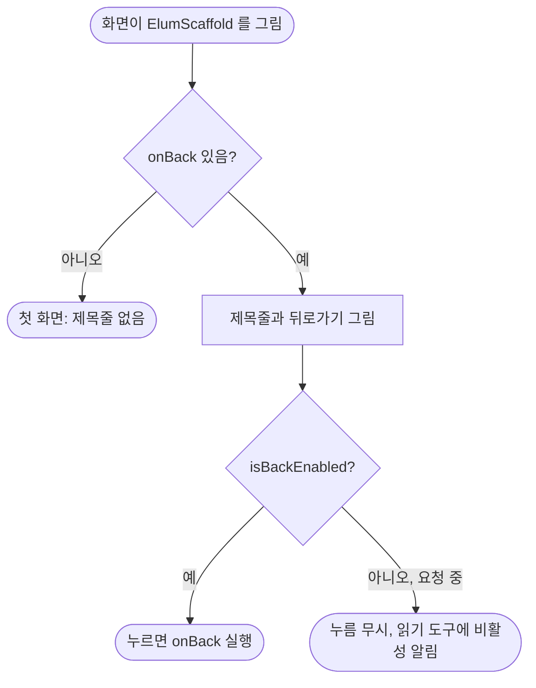

# ❗[버그][클라][공통] 서버 요청 중에 제목줄과 뒤로가기가 사라져 화면 내용이 위로 튐

## 개요
서버 요청 중에 뒤로가기를 막으려고 화면들이 `onBack`을 null로 넘겼다. 공통 화면 틀 `ElumScaffold`는 `onBack`이 null이면 "뒤로갈 곳이 없는 첫 화면"으로 보고 제목줄 자체를 그리지 않는다. 그래서 요청하는 동안 제목줄이 사라지고, 본문이 그 높이만큼 위로 튀었다가 요청이 끝나면 다시 내려왔다. `ElumScaffold`에 `isBackEnabled`를 더해 제목줄은 그대로 두고 누름만 막게 했고, 영향받던 9개 화면을 모두 이 방식으로 바꿨다.

| 고치기 전 (요청 중) | 고친 뒤 (요청 중) |
|---|---|
|  |  |
| 제목줄이 빠져 카드가 위로 올라감 | 제목줄과 카드 위치 그대로, 뒤로가기만 눌리지 않음 |

## 기능 흐름

## 변경 사항

### 공통 화면 틀
- `client/lib/core/widgets/elum_scaffold.dart`: `isBackEnabled`(기본 true)를 추가했다. false면 뒤로가기 `onTap`을 빼고 `Semantics(enabled: false)`로 알린다. 제목줄과 본문 위치 계산(`consumedTop`)은 `onBack` 유무만 보므로 그대로다.

### 화면 9곳 (`onBack: 진행중 ? null : 동작` → `onBack: 동작, isBackEnabled: !진행중`)
- `client/lib/features/feedback/presentation/feedback_screen.dart`: 의견 보내기
- `client/lib/features/link/presentation/link_status_screen.dart`: 이룸이 휴대폰 연결 상태
- `client/lib/features/link/presentation/link_enter_screen.dart`: 연결 암호 입력
- `client/lib/features/link/presentation/elumi_settings_screen.dart`: 이룸이 설정
- `client/lib/features/profile/presentation/invite_enter_screen.dart`: 초대 암호 입력
- `client/lib/features/profile/presentation/profile_switch_screen.dart`: 이룸이 바꾸기
- `client/lib/features/profile/presentation/guardians_screen.dart`: 함께하는 사람
- `client/lib/features/guardian/presentation/guardian_settings_screen.dart`: 보호자 설정
- `client/lib/features/guardian/presentation/image_style_settings_screen.dart`: 그림 방식 (#666에서 임시로 넣은 클로저 처리를 공통 방식으로 바꿈)

### 테스트
- `client/test/elum_scaffold_back_disabled_test.dart`
  - 뒤로가기를 막아도 제목과 뒤로가기가 남고, 본문 위치가 막지 않았을 때와 같으며, 눌러도 `onBack`이 불리지 않는지 확인한다
  - 규칙 테스트: `lib` 아래 화면 코드에 `onBack: 플래그 ? null :` 패턴이 없어야 한다. 고치기 전 develop에서 이 패턴이 8곳 잡히는 것을 확인했다

## 검증
- 새 테스트 2건 통과, `flutter analyze` 0건
- 전체 1174건 중 1건 실패: `consent_document_golden_test` 약관 골든 0.10%. develop에 원래 있던 실패이고 이번 변경과 관계없다
- 위 캡처는 위젯 테스트 렌더다. 실기기 확인은 아직 하지 않았다

## 주의사항
- `onBack: null`은 계속 "제목줄 없는 첫 화면"이라는 뜻이다. 진행 중 잠금에는 반드시 `isBackEnabled`를 쓴다. 규칙 테스트가 `플래그 ? null :` 형태를 막지만, `if`로 나눠 null을 넘기는 식으로 우회하면 잡지 못한다
- `role_select_screen.dart`의 `context.canPop() ? ... : null`은 첫 화면 판정이라 의도된 null이다. 규칙 테스트 대상이 아니다
- 일과 만들기 흐름의 `RoutineFlowScaffold`는 다른 틀이라 이번 범위에 넣지 않았다
- 이 변경은 시스템 뒤로가기(안드로이드 뒤로 버튼, iOS 밀어서 뒤로가기)는 막지 않는다. 화면의 뒤로가기 버튼과 같은 범위만 다룬다
- develop 반영 완료(1d8763b8). 운영 배포는 아직이다
