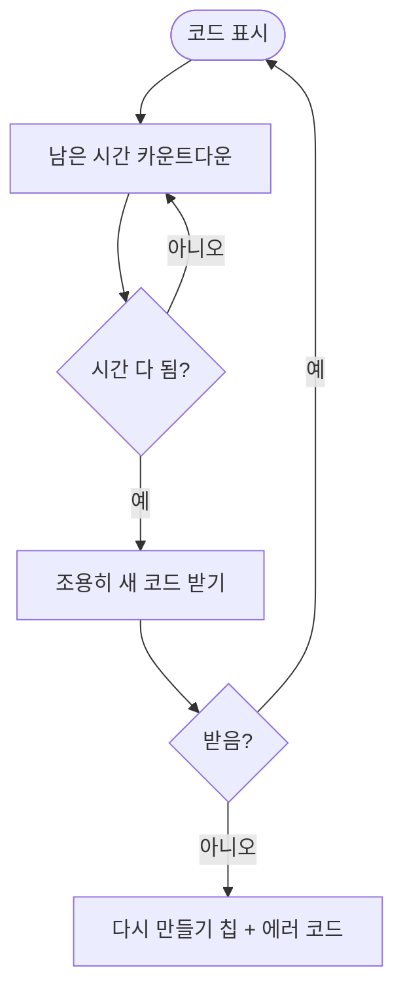

# 이룸이 휴대폰 연결과 다른 보호자 초대 화면을 새 시안에 맞춘다

## 개요
설정에서 들어가는 두 화면(Figma `1532:6671`, `1579:8206`)을 시안대로 맞췄다. 코드 아래에 `코드 복사하기` 알약과 `09:59 뒤에 코드가 바껴요`, 하단에 `링크로 보내기` 버튼 하나만 둔다. 사용자 결정에 따라 `만료됐어요` 표시는 없애고 시간이 다 되면 저절로 새 코드로 바뀐다.

## 기능 흐름

## 변경 사항
- `issued_code_panel.dart`: 코드 > 복사 알약 > 타이머 문구 한 모양으로 정리. 만료 문구와 다시 만들기 칩 순서 제거, 새 코드로 바꾸는 중에는 옛 코드를 그대로 둠
- `link_code_screen.dart` · `invite_code_screen.dart`: 하단 버튼을 `링크로 보내기` 하나로, 안내 문구 둘과 임시 시안 표기 제거, 시간이 다 되면 자동 교체 (실패하면 `E-LINK-NEW` · `E-INV-NEW`)
- `issued_code_actions.dart`: 쓰는 곳이 없어져 제거
- l10n: 안 쓰게 된 키 5개 제거, 초대 설명을 시안 문구(`코드를 받은 분이 …`)로

## 검증
- 관련 시험 6개 파일 통과, 시안 대조 골든 두 건 추가
- 시안과 맞대면 색 · 자리 일치, 덩어리는 글자 안티에일리어싱뿐

## 주의사항
- 새 코드를 받지 못했을 때만 `다시 만들기` 칩이 나온다. 초대 화면의 실패는 기존 오류 화면(`E-INV-NEW`)을 그대로 쓴다. 시안에 없는 상태라 디자이너 확인이 필요하다.
- 시안의 이룸이 이름은 `하늘이`로 고정이고 앱은 실제 이름을 쓴다.
- 코드 글자 간격은 기존 값(20/40)이고 시안 글자별 x와 정확히 같지 않다. 맞대기에서 도형 어긋남은 없었다.

## 배포
- 릴리스 PR #697 머지. 앱 빌드(테스트 배포)는 워크플로우가 진행한다.
