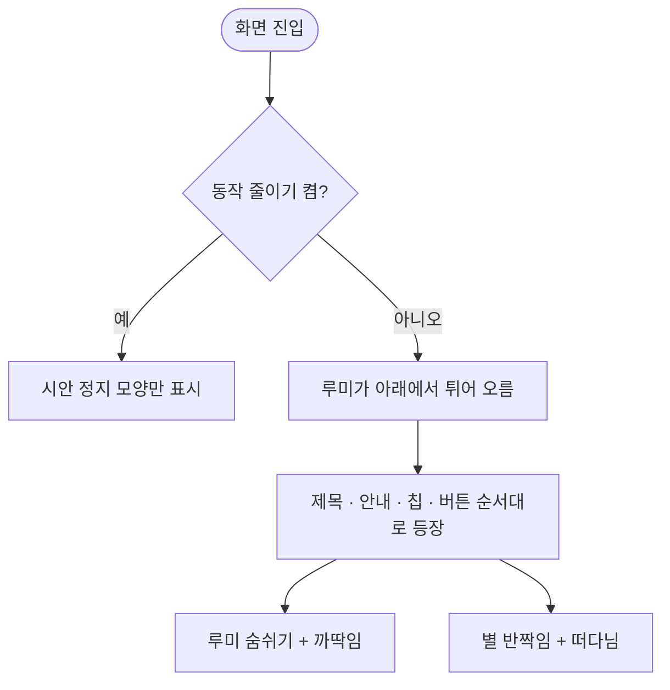

# 일과 완료 화면을 새 시안에 맞추고 캐릭터가 움직이게 한다

## 개요
Figma `1274:9831` 새 시안으로 일과 완료 화면을 바꾸고, 정지해 있던 캐릭터와 별에 움직임을 더했다.

## 기능 흐름

## 변경 사항
- `routine_done_screen.dart`: 배경 끝 색 `#574D2B`, 제목 y395, 이룸이 이름이 들어가는 안내 문구, 333×72 칩, 버튼 문구 `해냈어요!`
- `routine_done_lumi_motion.dart`(신규): 캐릭터와 별 움직임
- `app_motion.dart`: 등장 700ms, 반복 12초 토큰
- 에셋: 루미와 별 5개 교체. 별 번짐 색이 별마다 달라졌는데 옛 에셋은 초록 번짐이 섞여 있었다

## 주요 구현 내용
- 등장: 아래 160px에서 오버슛으로 튀어 오름. 대기: 숨쉬기 ±4px(2초), 6초 주기 앞 30% 구간 기울기. 별: 크기 0.9~1.1, 밝기, 반경 3px 떠다님
- 반복은 컨트롤러 하나(12초)가 맡고 요소마다 정수 횟수라 이음매가 튀지 않는다
- 시스템 동작 줄이기 또는 `isMotionEnabled=false`면 컨트롤러를 멈추고 정지 모양만 보인다

## 검증
- 움직임 시험 3건(끔, 시스템 동작 줄이기, 켬) 통과, 앱 전체 1228건 통과
- 시안과 맞대어 별 5개 중심이 1px 안쪽, 남은 덩어리는 글자 자리

## 주의사항
- 눈 깜빡임과 입 모양은 에셋이 분리돼 있지 않아 하지 않았다. 분리 에셋을 받으면 더 살릴 수 있다.
- 실기기에서 움직임 세기는 배포 뒤 확인한다. 약하면 숫자만 조정하면 된다.

## 배포
- 릴리스 PR #697 머지. 움직임의 실기기 확인은 빌드가 올라온 뒤 한다.
