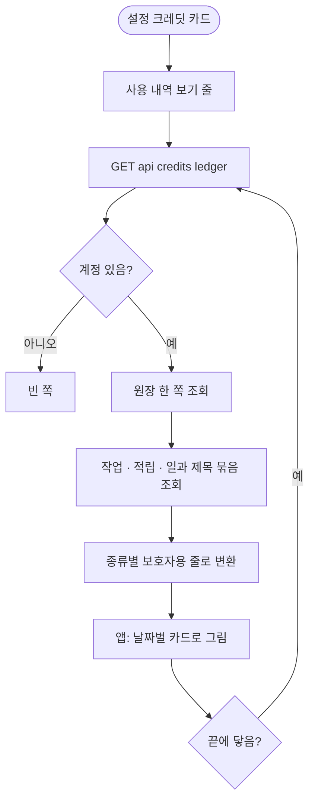

# 사용자가 AI 크레딧 사용 내역을 볼 수 있게 (서버 API + 앱 화면)

## 개요
설정 크레딧 카드에서 `크레딧 사용 내역 보기`로 들어가 언제 · 얼마나 · 무엇에 썼는지 볼 수 있다. 서버는 원장을 보호자용 내역으로 바꿔 한 쪽씩 내려주고, 앱은 Figma `1589:8359` 시안대로 날짜별 흰 카드 목록을 그린다.

## 기능 흐름

## 변경 사항

### 서버
- `CreditController` · `CreditControllerDocs`: `GET /api/credits/ledger?page=&size=` 추가 (본인 계정만, 쪽 크기 1~50 기본 30)
- `CreditHistoryService`: 원장 한 쪽 > 작업·적립·일과 제목을 한 번에 모아 > 보호자 말로 변환. 보이는 원장 종류는 사용 · 지급 · 만료 · 조정, 예약 · 반환 · 초과는 숨김
- `CreditHistoryKind` · `CreditHistoryResponse`: 종류(`ROUTINE_TEXT` `CARD_IMAGES` `WEEKLY_GRANT` `AD_REWARD` …)와 응답 모양. 내부 사유 글은 내려주지 않음
- `AiCreditLedgerRepository`: 총 개수를 세지 않는 쪽 조회(Slice)
- `RoutineQueryService.findTitlesByIds`: 다른 도메인 repository 직접 사용을 막는 구조 규칙 때문에 일과 제목 조회를 서비스로 열었다

### 앱
- `credit_history.dart` · `credit_repository.dart` · `credit_history_notifier.dart`: 응답 읽기(깨진 줄만 건너뜀, 모르는 종류는 부호로 문구), 쪽 이어 받기(겹친 줄 한 번만)
- `credit_history_screen.dart` · `credit_history_day_card.dart`: 시안 화면. 불러오는 중 / 0건 / 실패(다시 하기 + 에러 코드) / 목록, 다음 쪽 실패는 받은 내역을 두고 다시 하기
- `credit_history_link.dart` · `ai_credit_card.dart`: 카드 맨 아래 줄. 글자 24, 누름 영역 48
- 디자인 토큰 `creditHistoryMutedText` · 글자 3종, 문구 20여 개 (ko, en)

## 주요 구현 내용
- 일과 생성은 정산이 한 줄로 차감하므로 시작 단가로 **글 몫과 그림 몫 두 줄**로 나눈다. 잔액이 모자라 덜 차감되면 글 몫을 먼저 채운다. 시안이 두 줄로 그려져 있다.
- 지급은 적립 출처(주간, 광고, 운영 보너스)로 종류가 갈린다.
- 시각은 서버 시각과 오프셋 포함 값을 함께 주고 앱은 오프셋 값을 기기 시간대로 바꾼다 (#421과 같은 이유).

## 검증
- 서버 전체 1820건 통과 (신규 6건: 글·그림 분리, 모자란 잔액, 지워진 일과, 지급 출처, 계정 없음, 쪽 크기)
- 앱 신규 시험(응답 읽기, 날짜 묶음, 화면 네 상태, 다음 쪽 실패) 통과, 앱 전체 1228건 통과 (실패 1건은 develop에 이미 있던 개인정보 처리방침 골든)
- 시안과 맞대기: 모든 덩어리가 글자 자리이고 카드·줄·간격은 일치

## 주의사항
- **시안에 없는 종류의 문구는 임시다.** 광고 보상 · 운영 보너스 · 만료 · 조정 줄은 디자인 요청 #685 첫째 후보를 썼다. 시안이 나오면 바꾼다. 광고 보상 시안은 #695.
- 원장 조회 쿼리는 `(account_id, created_at)` 인덱스를 탄다. 쪽을 깊게 넘기면 느려질 수 있어 쪽 크기를 50으로 막았다.
- 다음 쪽은 끝에서 320px 남았을 때 자동으로 받는다. 시안에 없는 안내는 실패할 때의 한 줄뿐이다.
- 실기기에서 실제 내역은 배포 뒤 확인한다.

## 배포
- 릴리스 PR #697 머지, 서버 배포 워크플로우 성공. 운영 OpenAPI 문서에 `/api/credits/ledger` 가 올라온 것을 확인했다.
- 로그인 토큰 없이는 응답 모양을 직접 볼 수 없어 **인증이 필요한 실제 응답은 확인하지 못했다.** 인증 없이 부르면 `/api/credits/me` 와 같이 401을 돌려준다.
