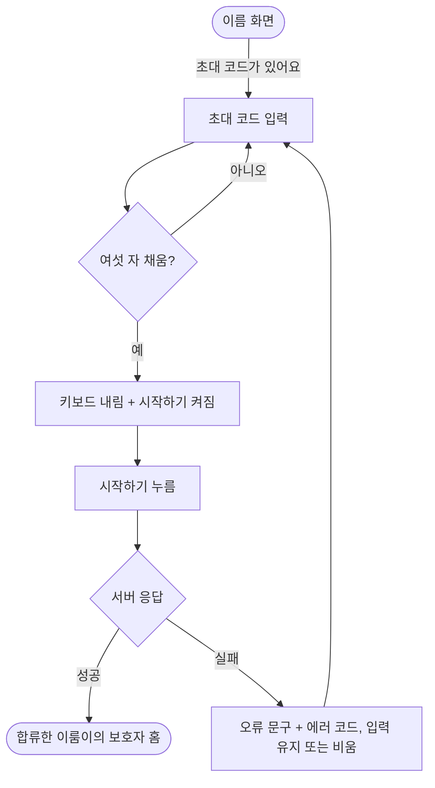
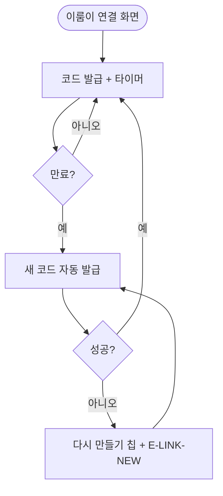

# 이름, 초대 코드, 이룸이 연결 화면을 새 시안에 맞춘다

## 개요

디자이너가 고친 온보딩 시안 세 장(이름 `204:991`, 초대 코드 입력 `1532:7114`, 이룸이 연결 `732:5334`)을 앱에 맞췄다. 경로(라우팅)는 달라진 게 없고 화면 구성만 바뀌었다. 이름 화면은 이미 시안과 같아 주석만 정리했고, 나머지 두 화면은 구조를 바꿨다. 구현 커밋 `5b88ebb2`는 배포 PR #679로 `main`에 나갔고, 실기기 확인 중 찾은 키보드 문제는 커밋 `df64167b`로 고쳐 `develop` 반영과 재배포를 기다린다.

## 기능 흐름

## 변경 사항

### 초대 코드 입력
- `client/lib/features/profile/presentation/invite_enter_screen.dart`: 제목 `초대 코드를 입력해주세요`, 안내 카드 3줄을 설명 2줄(`설정 → 함께하는 사람`에 밑줄)로 교체, 하단 `시작하기` 버튼 추가. 여섯 자를 채워도 자동 제출하지 않고, 채우면 키보드를 내린다. 링크로 받은 코드의 `함께하기`는 `시작하기`로 합쳤다. 머리 영역 높이를 220으로 고정해 여섯 칸이 시안 자리(y=339)에 온다.
- `client/lib/l10n/app_ko.arb`, `app_en.arb`: 제목·설명·`시작하기` 문구 교체, 안내 카드용 문구 3개 삭제.

### 이룸이 연결 (온보딩 진입)
- `client/lib/features/link/presentation/link_code_screen.dart`: `링크로 보내기` 보조 버튼 추가(`시작하기` 위 16), 코드 아래에 `코드 복사하기` 알약, 타이머 문구 `09:59 뒤에 코드가 바껴요`. 만료되면 새 코드를 자동으로 받는다. 설정에서 들어오는 연결 화면은 모양을 바꾸지 않았다.
- `client/lib/features/link/presentation/widgets/issued_code_panel.dart`: 복사 알약 > 남은 시간 순서와 남은 시간 옆 안내를 선택 옵션으로 추가.
- `client/lib/features/link/presentation/widgets/issued_code_actions.dart`: 공유 버튼과 복사 동작을 따로 꺼내(`IssuedCodeShareButton`, `copyIssuedCode`) 설정 화면과 온보딩 화면이 함께 쓴다.
- `client/lib/features/link/presentation/widgets/link_code_text.dart`: 칩 이름을 `LinkActionChip`으로 바꿨다(다시 만들기와 복사하기를 함께 담는다).

### 이름
- `client/lib/features/onboarding/presentation/name_screen.dart`: `초대 코드가 있어요` 링크 자리가 시안과 같아 "임시 시안" 표시만 정리했다.

### 시험
- `invite_enter_conformance_test.dart`(새 골든), `invite_enter_screen_test.dart`, `invite_enter_link_test.dart`, `invite_link_flow_test.dart`, `link_code_screen_test.dart`, `link_code_golden_test.dart`와 골든 이미지 갱신.

## 주요 구현 내용

- **자동 제출을 없앴다.** 틀린 시도를 서버가 세고 한도를 넘으면 잠긴다. 여섯 번째 글자를 잘못 눌러도 곧바로 시도 1회가 사라진다. 시안에도 `시작하기` 버튼이 그려져 있고, 같은 모양의 연결 암호 화면은 이미 이 방식이다.
- **만료 자동 갱신.** 시안에서 `다시 만들기` 칩이 빠지고 `뒤에 코드가 바껴요`라는 문구가 들어와, 코드를 새로 받는 길을 자동 갱신으로 두었다. 새 코드를 받는 동안 스피너를 띄우지 않아 화면이 깜빡이지 않는다. 받지 못하면 다시 만들기 칩과 `E-LINK-NEW`가 나온다.

## 검증

| 구분 | 결과 |
|---|---|
| 정적 분석 | 0건 |
| 전체 시험 | 1203건 중 1건 실패. `개인정보 처리방침` 골든이며 변경 전 `develop`에도 있던 실패 |
| 시안 대조 | 세 프레임을 `figma_diff`로 대조: 글자 부분 말고 어긋남 없음 |
| iOS 시뮬레이터 | 이름 > 초대 코드 입력(빈 칸, 입력, 오류 문구) > 이룸이 연결(복사하기 토스트, 만료 뒤 코드 자동 갱신)을 Maestro로 밟음 |

왼쪽 위부터 이름, 초대 코드 빈 칸, 여섯 자 입력(키보드 내려감), 오류 문구, 이룸이 연결, 복사하기 토스트. 아래는 12초 뒤 만료된 `5NJ280`이 `K7M3QX`로 갱신된 화면이다.

시험은 서버 없이 가짜 저장소로 앱 화면만 띄워 확인했다(서버 응답은 가정한 값).

## 주의사항

- **실기기에서 찾은 문제.** 위젯 시험과 골든은 키보드가 없어서 못 잡았다. 초대 코드 입력에서 여섯 자를 채워도 키보드가 `시작하기`를 가렸다. 여섯 자가 차면 키보드를 내리게 고쳤고(`df64167b`), 이 수정은 아직 `main`에 나가지 않았다. 배포된 버전(#679)에는 이 문제가 있다.
- **디자이너 확인이 필요한 것.**
  - 시안에서 `코드 다시 만들기` 칩이 빠졌다. 레이어 이름만 남고 글자는 `코드 복사하기`다. 만료 자동 갱신으로 해석했다.
  - 초대 코드 입력의 `시작하기`는 여섯 자를 채우면 켜지고, 자동 제출은 하지 않는다.
- 이번 배포(#679)에는 #675(카드 음성 미리 만들기, 서버 마이그레이션 V37 포함), #615(안드로이드 TTS 엔진)도 함께 나갔다.
- 앞으로 이 화면의 안내 문구를 바꿀 때 `inviteEnterDescriptionPath`는 `inviteEnterDescriptionManual` 안에 그대로 들어 있어야 밑줄이 그어진다.
