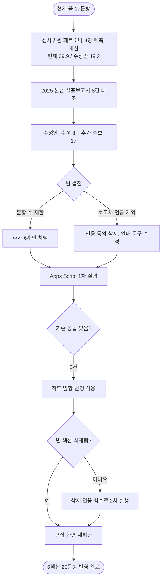

# 🔍[시험요청][클라][실증] 실증 설문 검토와 구글 폼 개편

## 개요

서울 ABA연구소 테스터 보호자 7명에게 보낼 실증 설문(구글 폼)을 대회 심사기준으로 검토했다. 그 결과를 바탕으로 폼을 6섹션 20문항으로 개편했다. 현재 폼은 "얼마나 썼는지"와 "처음에 어디서 막혔는지"를 묻지 않아서, 사용량이 적었던 1주 원격 실증의 결과를 해석할 수 없었다. 이 두 가지를 묻는 문항을 넣고, 이중질문·척도 방향·오타·필수 설정을 바로잡았다. 법적 동의 문항도 추가했다. 반영은 Google Apps Script로 한 번에 실행했고, 반영 후 편집 화면을 다시 읽어 확인했다.

## 기능 흐름

## 변경 사항

### 구글 폼 「이룸(ELUM) 서비스 사용 경험 설문조사」

- 새로 추가 (7): 개인정보 수집·이용 동의(거부하면 바로 제출), 일주일 사용 일수, 이룸 전 가장 힘들었던 점(선택), 카드를 볼 때 필요한 도움 정도, 말로 알려 주는 횟수 변화, 처음 설치와 휴대폰 연결, 덜 쓴 이유(선택)
- 수정 (7): 안내 문구 2곳("실증 결과 분석" > "사용 경험 분석"), "반복 설명하거나 직접 도와주는" 이중질문 정리, "긍적적" 오타 수정과 "특별히 없었다" 보기 추가, 사용 편리성 척도 방향 통일(1 어려웠다 ~ 5 쉬웠다), 서술형 2개 필수 해제
- 묶음 (1): 기능별 만족도 4문항 > 객관식 그리드 1개
- 삭제 (6): AI 행동 단계 적절성(그리드와 중복), 기능별 개별 4문항, 빈 섹션 7

### 문서 (develop)

- `docs/hackathon/제출물/실증_설문_피드백_및_현재상황.md`: 현재 상황(실증 트랙 3개, 팀 결정), 예측 채점 결과, 2025 대조, 수정안 A~Q, 스토리라인과 슬라이드 연결, 설문 밖에서 채울 것, 남은 할 일
- `docs/projectops/issue/20261018_709_실증_설문_검토와_구글_폼_개편.md`: 이슈 본문 사본

## 주요 구현 내용

**왜 문항을 이렇게 골랐나**
- 채점한 심사위원 4명이 모두 같은 결함 두 가지를 짚었다. 사용량을 묻지 않아 적게 쓴 사람의 만족도를 걸러낼 수 없고, 처음에 막힌 점과 덜 쓴 이유를 묻지 않는다. 그래서 "사용 일수"와 "처음 연결", "덜 쓴 이유"를 넣었다. 사용량이 적었던 약점이 고칠 목록으로 바뀐다.
- "도움 정도" 선택지는 행동분석의 촉구 단계(혼자 / 말 / 가리킴 / 몸으로)를 쉬운 말로 옮겼다. 대면 실증 관찰지와 같은 척도로 맞추면 보호자 응답과 팀 관찰을 나란히 비교할 수 있다.
- "말로 알려 주는 횟수"에는 "비슷했다"와 "늘었다" 보기를 함께 둬서 유도 질문으로 읽히지 않게 했다.
- 2025 본선 8팀은 모두 5점 리커트와 자유기술 두 개였다. 사용 전후 비교, 도움 없이 한 정도, 반복 사용은 아무도 재지 않았다.

**팀 결정 반영**
- 문항 수는 중도 이탈을 줄이려고 20개로 제한했다(추가 후보 17개 중 6개).
- 설문 안에서는 보고서·발표 활용을 언급하지 않는다. 인용 동의 문항도 넣지 않았다.
- 동의 문항에는 법적 필수 항목만 넣었다: 수집 항목, 민감정보(장애유형·장애 정도), 이용 목적, 보관 기간 2026년 12월 31일, 거부 권리, 법정대리인(만 14세 미만).

**왜 Apps Script였나**
- 폼 편집기는 문항을 하나씩 펼쳐야 수정되는 구조라, 화면 클릭으로 20여 곳을 고치면 느리고 엉뚱한 문항을 건드릴 위험이 컸다.
- FormApp으로 수정 내용을 코드로 만들고, 문항은 순서가 아니라 **제목 일부로 찾아** 고쳤다. 실행 순서에 따라 위치가 바뀌어도 대상이 어긋나지 않는다.
- 기존 응답이 있으면 척도 방향을 바꾸지 않도록 조건을 걸었다. 실행 결과 응답은 0건이라 적용됐다.

**검증**
- 반영 후 편집 화면을 새로 고쳐 전 문항을 다시 읽었다. 섹션 표시가 "6 중 N 섹션"이고, 추가·수정·삭제가 모두 반영됐다.
- 수정 전후 화면 12장을 이슈 본문에 첨부했다.

## 주의사항

- **같은 스크립트를 다시 실행하면 문항이 중복으로 추가된다.** 스크립트는 한 번만 실행하는 구조다(멱등 아님). 추가 수정은 해당 문항만 고치는 별도 함수로 한다.
- **Apps Script 실행 함수 선택이 코드 교체 뒤에도 이전 함수로 남는다.** 코드를 바꾼 직후 실행하면 옛 함수가 돌 수 있다. 이번에는 저장 완료 → 새로 고침 → 코드와 선택 함수가 모두 새 것인지 확인한 뒤에만 실행해서 중복을 막았다.
- **빈 섹션의 제목이 빈 문자열이 아니었다.** 화면에 보이던 "제목 없는 섹션"이 실제 제목으로 저장돼 있어서, 제목이 비었는지로 판단한 1차 실행이 이 섹션을 지우지 못했다. 섹션을 지울 때는 제목이 아니라 "맨 끝 항목이 섹션인지"로 판단해야 한다.
- **폼이 "링크가 있으면 로그인 없이 편집 가능"으로 공유돼 있다.** 폼 ID나 편집 링크가 공개되면 누구나 문항을 바꿀 수 있다. 그래서 스크립트 원문과 폼 ID가 보이는 화면은 이 이슈에 올리지 않았다. 편집 권한을 팀원 계정으로 좁혀야 한다.
- 실행에 쓴 Apps Script 프로젝트("제목 없는 프로젝트")가 폼 소유 계정 드라이브에 남아 있다.
- 사용 전후 비교 문항은 보호자 회상이다. 결과를 쓸 때 "회상 기준"이라는 한계와 분모("7명 중 □명")를 함께 적는다.

**남은 일**
- 테스터 7명에게 발송
- 폼에서 뺀 후보 문항(AI 카드 오류, 글 없이 따라가기 등)은 10/20 가정 대면 인터뷰 질문으로 쓴다
- 폼 편집 권한 좁히기
