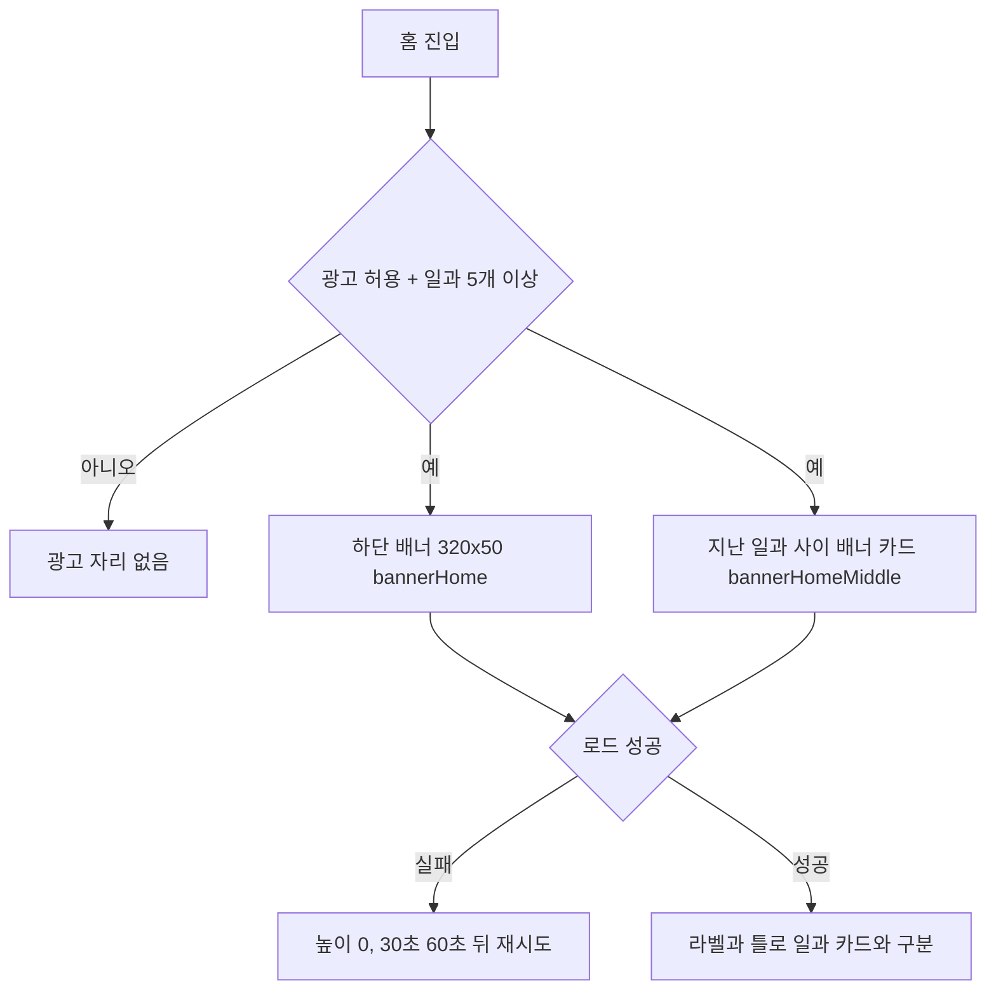

# 보호자 앱 광고를 얇은 배너 한 줄로 통일 (#741)

## 한 줄 요약
하단 배너를 표준 320x50으로 고정하고, 지난 일과 사이의 네이티브 광고(360dp 영상 카드)를 `광고` 라벨이 붙은 배너 카드로 바꿨다. AdMob 콘솔 작업은 없다.

## 선택한 설계와 이유

| 안 | 근거 | 판정 |
|---|---|---|
| 네이티브 small 템플릿 | 미디어가 120x120 미만이라 영상 광고 검증기 경고(#571) | 탈락 |
| 네이티브 medium을 줄여 크롭 | 광고 에셋 가공 금지 정책 위반 소지 | 탈락 |
| `bannerHomeMiddle` 배너로 교체 | 단위가 이미 배너 형식(`.env.example`에 `BANNER_HOME_MIDDLE` 키, 테스트 ID도 배너) | 선택 |

- 광고 단위 형식을 바꾸지 않으므로 콘솔에서 새 단위를 만들 필요가 없다. 운영 `.env`의 `ELUM_ADMOB_*_BANNER_HOME_MIDDLE` 값이 이미 채워져 있으면 그대로 쓰이고, 비어 있으면 그 자리에는 광고가 안 뜬다(기존 동작).
- 하단 배너는 적응형 앵커 배너(기기 폭에 따라 높이가 커지고 상품 썸네일 캐러셀이 올라옴) 대신 `AdSize.banner`(320x50)로 고정했다.

## 변경
- `ad_banner_loader.dart`: 폭 인자 제거, `AdSize.banner` 고정.
- `ad_banner_slot.dart`: `AdBannerStyle.bottomStrip`(본문과 같은 배경 + 윗선) / `inlineCard`(`광고` 라벨 + 테두리 틀, 높이 약 90dp = 배너의 두 배 안쪽).
- `past_routine_section.dart`: `AdNativeSlot` → `AdBannerSlot(bannerHomeMiddle, inlineCard)`.
- 제거: 네이티브 슬롯·로더, `AdPlacement.nativeHomePast`, `.env.example`의 `NATIVE_HOME_PAST` 두 줄.
- 테스트: 배너 슬롯(두 모양)·사이 배너·경계(표준 크기 고정, `NativeAd` 사용 금지) 갱신.

## 검증
- `flutter analyze` 0건, `flutter test --exclude-tags golden` 통과(계층 import 동결 목록만 갱신 필요했음), 홈 골든 통과.
- iOS 시뮬레이터(iPhone 16 Pro, iOS 18.3)와 Android 에뮬레이터(API 36.1)에 실제 AdMob 테스트 광고를 띄워 확인했다. 임시 진입점(가짜 일과 8개)을 썼고 커밋하지 않았다.
- 이 앱에는 다크 테마가 없다(`AppTheme.light`만 있음). 기기 다크 모드로 바꿔도 화면이 같아 라이트·다크 캡처가 동일하다.

| 플랫폼 | 라이트 | 기기 다크 모드 |
|---|---|---|
| iOS |  |  |
| Android |  |  |

## 주의사항
- 계층 import 동결 목록(`tool/layer_imports_allowed.txt`)의 native 줄을 banner 줄로 **바꿨다**. 줄 수는 늘지 않았고 기존 두 화면(홈·임시저장)과 같은 예외다.
- 약관·개인정보처리방침 본문(`consent_documents.dart`)에는 아직 "네이티브" 광고 표기가 남아 있다. 법적 문구라 임의로 고치지 않았다. 광고 형태를 줄이는 방향이라 거짓은 아니지만, 정리하려면 별도 확인이 필요하다.
- 사이 배너 카드 높이는 라벨 포함 약 90dp이며, 광고 소재는 SDK가 그린다(가공 없음).
