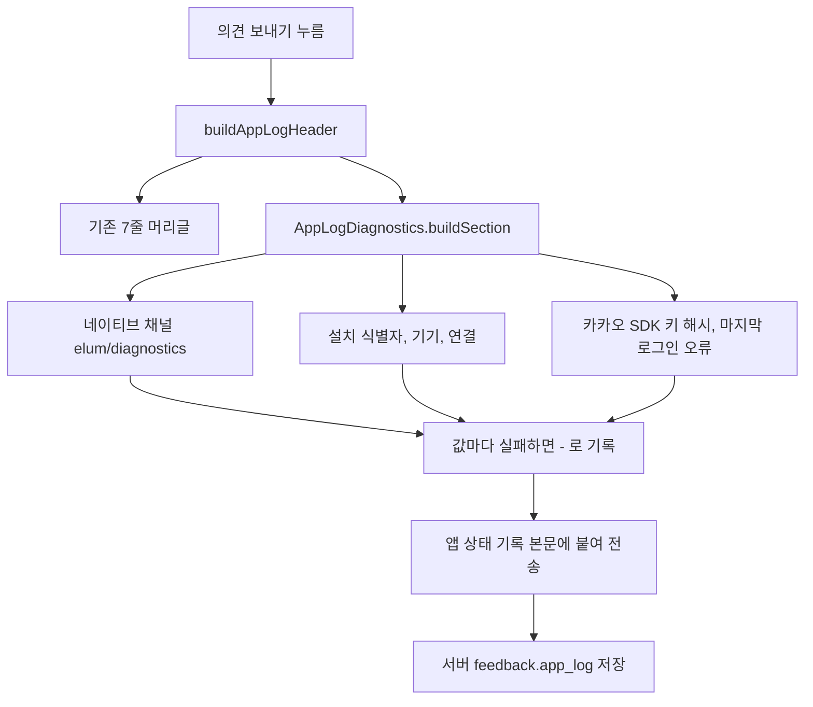

# 의견 보내기 진단 정보 확장 (#772) 구현 보고서

## 배경

2026-10-19 안드로이드 카카오 로그인 실패(#771)를 조사하는 중, 폰이 보낸 의견으로 원인을 확정하지 못했다.
의견에는 앱 버전과 OS 문자열뿐이라 **설치 경로와 앱 서명 해시**를 알 수 없었고, 그 결과 "스토어 설치본이라 Play 서명 키 해시가 빠졌다"는 추정이 두 번 틀렸다.
의견 한 건으로 환경 의존 문제를 판별하도록 진단 정보를 늘렸다.

## 구현 내용

| 구분 | 변경 |
| --- | --- |
| 첨부 머리글 | `app_log_header.dart`에 진단 구역을 붙이고, 값 읽기는 `app_log_diagnostics.dart`로 분리 |
| 안드로이드 네이티브 | `AppDiagnosticsChannel.kt`(`elum/diagnostics`)가 설치 경로, 서명 해시, 카카오톡 버전, 저전력 여부, 남은 저장 공간을 읽음 |
| 카카오 | SDK가 서버에 보내는 키 해시(`KakaoSdk.platformInfo.origin`)와 마지막 소셜 로그인 오류를 기록 |
| 화면 | 의견 화면 체크 문구를 "앱 상태 기록과 휴대폰 정보 보내기"로 변경 |
| 방침 | 앱 번들, 서버 시딩 `privacy.txt`, 운영 DB, 공개 페이지에 휴대폰 정보 수집 항목과 탈퇴 시 파기를 추가. 10월 19일 공고, 10월 26일 시행 |

수집하지 않는 것: IMEI, 시리얼, 광고 ID, 위치, 연락처, 설치된 앱 목록 (안드로이드 10 이상에서 일반 앱은 읽을 수 없고 Play 정책과 서비스 원칙에도 어긋남). 대신 설치 때 만든 무작위 번호(설치 식별자)로 같은 폰의 의견을 연결한다.

## 왜 이렇게 했는가

- **서버는 바꾸지 않는다.** 머리글은 이미 `app_log` 본문 안에 들어가 저장되므로 스키마·API 변경이 필요 없다.
- **값마다 실패를 삼킨다.** 진단을 읽다가 의견 전송이 막히면 본말이 뒤집힌다. 읽지 못한 값은 `-`로 남기고, 구역 생성이 통째로 실패해도 기존 머리글은 보낸다.
- **서명 해시와 카카오 SDK 해시를 둘 다 남긴다.** 두 값이 다르면 앱이 읽는 값과 카카오가 보는 값의 불일치를 바로 알 수 있다.
- **방침 본문만 바꾸고 버전은 그대로 둔다.** 번들 버전을 올리면 전체 재동의가 걸린다. 이전 방침 변경(#366)과 같이 재동의 없이 공지로 알린다.

## 검증

- 앱 전체 테스트 1267건 통과(새 시험 6건 포함), 방침 관련 시험 통과, 서버 약관·방침 시험 통과
- 안드로이드 디버그 APK 빌드 성공
- **에뮬레이터(Android 16)에서 임시 진입점으로 머리글을 실제 실행**: 설치 경로, 서명 해시, 설치 식별자, 기기, 시간대, 연결, 빌드, 저전력, 저장 공간, 카카오톡, 카카오 SDK 키 해시가 모두 채워졌고, 서명 해시와 SDK 해시가 같은 값으로 나옴 (임시 진입점은 커밋하지 않음)
- 운영 DB: 갱신 전 본문이 이전 시딩본과 글자까지 같음을 확인하고 본문만 갱신, 갱신 후 새 본문과 같음을 확인 (백업 보관)
- 공개 페이지: `check_public_pages` 대조 통과, 게시 후 "휴대폰 정보" 문구 확인

## 배포

- PR #773 머지(develop) > main 버전 커밋 동기화 > 릴리스 PR #775 automerge 완료
- 워크플로우: 버전 관리, 공개 페이지 검사, 서버 배포, Play 내부 테스트, Firebase 앱 배포, TestFlight 모두 성공

## 주의사항

- 새 진단 줄은 **새 빌드를 설치한 폰에서만** 나온다. 기존에 설치된 2.33.x 같은 옛 버전은 머리글이 예전 그대로다.
- 방침 시행일은 10월 26일이다. 공지사항은 사용자가 직접 게시한다 (공고 7일 전 원칙).
- 안드로이드 전용 값(설치 경로, 서명 해시, 카카오톡 버전)은 iOS에서 `-`로 나온다.
- 권한 허용 여부는 권한 조회 플러그인이 없어 이번에 수집하지 않았다.
- 한글 브랜치명이 길면 git이 이름 중간을 잘라 깨진 원격 브랜치가 생겼다(바로 삭제함). 원격 브랜치는 영문 이름으로 올렸다.

## 남은 일

- #771: 카카오 로그인 원인은 아직 확정되지 않았다. 새 빌드를 폰에 설치하고 의견을 다시 보내면 설치 경로와 서명 해시로 판별할 수 있다.
- 공지사항 게시 (사용자)
- 권한 허용 여부 수집은 후속
