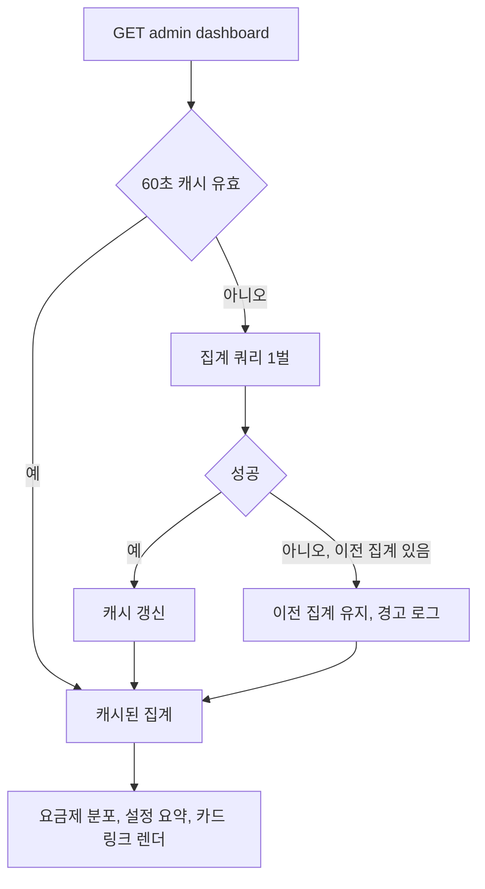

## 개요

관리자 대시보드에 요금제 분포와 적용 중 설정 요약을 더하고, 사이드바를 그룹화하고, 모바일 가로 넘침을 고치고, 공통 목록 규칙을 규칙 테스트로 봉인했다. 마이그레이션 없음, 서버만 변경.

## 변경 사항

- 대시보드: `AdminDashboardService` 가 회원·유효 Pro·일과·오늘 AI·설정 요약을 한 번에 집계, 60초 메모리 캐시(`SystemConfigService` 와 같은 방식, 새 의존성 없음). 재집계 실패 시 이전 집계 유지.
- 요금제 분포: Pro 는 `SubscriptionRepository.countEffectiveMembersByPlan` (ACTIVE, 만료 전, 탈퇴 제외 = `effectivePlan` 조건), Free 는 전체에서 뺀 값. 회원 목록 `plan` 필터와 같은 기준이며 각각 `/admin/members?plan=` 링크.
- 지금 적용 중 설정: `SystemConfigOverviewService.buildRows/buildOverview` 재사용(중복 구현 없음). 기본값과 다른 설정 수와 이벤트·점검 등 항목을 설정 화면 링크로 표시.
- 숫자 카드를 회원·일과(상태별)·모니터링 목록 링크로 변경.
- 사이드바: 대시보드 / 운영(회원, 루틴, 크레딧, 의견) / 콘텐츠(공지, 약관, 프롬프트) / 시스템(설정, 모니터링, 서버 로그). 24h 오류 배지, 활성 표시, 접기 동작 유지.
- 모바일: 프롬프트 언어 탭(115px 넘침)과 크레딧 카드 설명(19px 넘침)을 고쳐 전 화면 페이지 가로 넘침 0. `admin.css` 재생성.
- 봉인(`AdminCommonRulesTest`): 검색·정렬·페이지 파라미터를 받는 admin 컨트롤러는 `AdminListQuery` 필수(예외: 크레딧 4탭, 서버 로그 API, 이유 명시, 낡은 예외 검출 포함), 템플릿 `<table>` 은 `overflow-x-auto` 안(예외 없음), `PageRequest.of` 에 페이지 크기 숫자 직접 사용 금지. 기존 `adminDoesNotDeclareOwnPageSize` 유지.

## 처리 흐름

## 주의사항

- 집계가 60초 캐시라 Pro 부여·설정 변경 직후 대시보드가 최대 60초 늦게 반영된다(화면에 집계 시각 표시). 목록·설정 화면은 즉시 반영.
- `AdminDashboardService` 가 `AiCallLogRepository.AiCallStats` 를 import 하면 도메인 간 repository 동결 목록 규칙에 걸려, 변환을 `AdminMonitoringService.getTodayStatsSummary` 로 옮겼다.
- 새 Tailwind 클래스를 쓰면 `server/tool/build-admin-css.sh` 를 돌려야 한다(이번에 재생성).

## 검증

- `./gradlew test` 전체 통과. 신규: `AdminDashboardServiceTest`(분포, 음수 방지, 설정 요약 재사용, 60초 내 재호출 시 집계 1회, 60초 후 재집계, 실패 시 이전 집계), `AdminDashboardTemplateTest`(분포, 링크, 설정 요약, 사이드바 그룹 순서), `AdminCommonRulesTest`(규칙 4개, 검사기 자체 시험, 예외 낡음 검출).
- 로컬 Postgres 16 컨테이너 + 서버로 `AdminMemberListQueryIT`(유효 Pro 집계: 만료·탈퇴 제외 포함) 통과, 15개 화면 데스크톱(1440)·모바일(390) 캡처: 모두 200, 페이지 가로 넘침 0px. 컨테이너·서버 정리 완료.

## 화면

