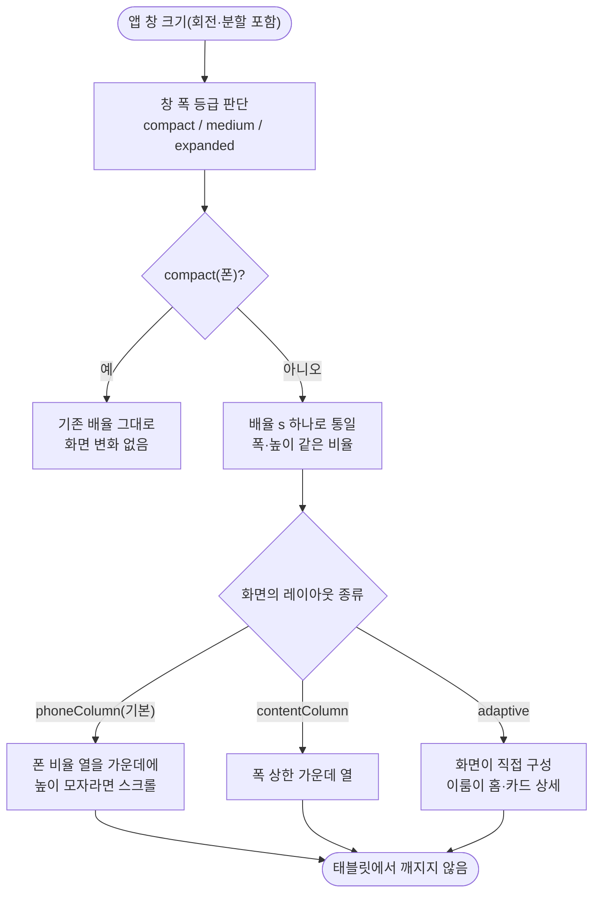

# 태블릿 지원 중간 보고 (P1 기반 완료 · P2 이룸이 화면 1차 완료)

## 개요

이룸이가 쓰는 기기는 휴대폰이 아니라 **태블릿**이라는 현장 실증 결과를 반영해, 아이패드·안드로이드 태블릿(가로·세로)에서 깨지지 않고 태블릿답게 쓰이도록 기반을 만들고 이룸이 화면부터 다시 구성했다.
폰 화면은 한 픽셀도 바뀌지 않는다(전체 테스트 1477개 통과, 골든 변경 0). 설계서와 구현 계획은 레포에 있다.

- 설계: `docs/superpowers/specs/2026-10-19-tablet-support-design.md`
- 계획: `docs/superpowers/plans/2026-10-19-tablet-support-p0-p1-foundation.md`

**아직 출시하지 않는다.** 사용자에게 열리는 네이티브 스위치(아이패드 지원, 안드로이드 세로 고정 해제)는 모든 단계가 끝난 뒤 한꺼번에 켠다. 지금은 `client/tool/apply_tablet_native.sh`로 로컬에서만 켜서 검증한다.

## 기능 흐름

## 변경 사항

### 기반 (`client/lib/core/layout/`)
- `app_layout.dart`, `window_size_class.dart`, `layout_metrics.dart`: 창 폭 등급(600/840dp)과 배율 `s = clamp(min(창폭/393, 창높이/852), 0.8, 1.3)`. 폭 상한 같은 숫자는 `AppLayout` 한 곳에만 둔다.
- `adaptive_screen_scale.dart`, `adaptive_scope.dart`, `layout_context_ext.dart`: 앱 루트가 창 크기에 맞춰 `ScreenUtil` 디자인 크기를 바꿔 `.w`와 `.h`가 같은 배율을 갖게 하고, 화면은 `context.sizeClass`·`context.isLandscape`로만 읽는다. `lib/app.dart`의 `ScreenUtilInit` 한 곳을 교체했다.
- `adaptive_page_frame.dart`, `screen_layout_kind.dart`: 라우트가 선언한 종류(`phoneColumn`·`contentColumn`·`adaptive`)대로 화면을 담는다. 선언이 없으면 `phoneColumn`이라 **새 화면도 자동으로 안전**하다. `slidePage`·`fadePage`가 감싸서 라우트 32개는 수정 없이 적용된다.
- `orientation_policy.dart`, `device_kind.dart`: 폰은 세로만, 태블릿은 네 방향.
- 시트·토스트는 폭 상한(560 x 배율)으로 가운데에 선다 (`elum_bottom_sheet.dart`, `elum_toast.dart`).

### 이룸이 화면 (`client/lib/features/child/presentation/`)
- 홈: 세로 태블릿은 가운데 열, 가로 태블릿은 왼쪽 인사말·캐릭터 + 오른쪽 일과 목록(`child_home_landscape_body.dart`).
- 카드 상세: 카드 넘기기 상자를 통째로 키워 카드가 크게 보이고, 체크 버튼은 가로에서는 오른쪽 가장자리(양손으로 쥘 때 엄지 자리), 세로에서는 카드 아래에 둔다(`child_routine_detail_tablet_body.dart`).
- 보상·일과완료·별: 밤하늘 배경을 폰 비율 열 바깥까지 전폭으로 깐다(`child_night_sky_backdrop.dart`).

### 도구·문서
- `client/tool/preview/tablet_preview_main.dart`: 로그인·서버 없이 실제 앱을 데모 데이터로 띄우는 진입점. 시뮬레이터 확인과 이후 스토어 스크린샷에 쓴다.
- `client/tool/apply_tablet_native.sh` + `tablet_native.patch`: 네이티브 스위치를 로컬에서만 켜고 끈다(멱등).
- `design-system.md`, `architecture.md`, `client/CLAUDE.md`에 레이아웃 규칙을 남겼다.

## 검증

| 항목 | 결과 |
|---|---|
| 전체 앱 테스트 | 1477 통과, 골든 변경 0 |
| 폰 회귀 | `AdaptiveScreenScale`이 폰 4종(393x852, 430x932, 320x568, 375x667)에서 기존 `ScreenUtilInit`과 같은 값 |
| 태블릿 매트릭스 | 창 13종(아이패드 mini·11·13 가로/세로, 안드로이드 10·8 가로/세로, 분할 보기 극단) x 글자 1배·2배 x 화면 9개, 오버플로·예외 0 |
| 규칙 테스트 | `1.sw`·`ScreenUtil()` 직접 호출, 숫자 breakpoint, 시트·팝업 직접 호출 금지, 모든 GoRoute가 프레임을 거침 |
| 아이패드 Pro 13 시뮬레이터 | 세로·가로 모두 이룸이 홈, 카드 상세, 보상 확인 (아래 화면) |

아이패드 13" 세로 홈 (가운데 열)

아이패드 13" 가로 홈 (왼쪽 인사말·캐릭터, 오른쪽 일과 목록)

아이패드 13" 가로 카드 상세 (카드 크게, 체크 버튼 오른쪽)

아이패드 13" 가로 보상 (밤하늘 전폭)

## 주요 구현 내용

- **창 하나에 배율 하나.** `ScreenUtil`은 전역 싱글턴이라 화면마다 다른 배율을 줄 수 없고, 전환 중에는 두 화면이 동시에 떠 있다. 그래서 배율은 창 크기로만 정한다. 폰은 지금과 같고, 태블릿은 폭·높이가 같은 비율로 커져 찌그러지지 않는다.
- **A와 B를 한 구조로.** 선언 없는 화면은 폰 비율 열(A, 안전망). 이룸이·보호자 핵심 화면은 `adaptive`(B)로 올려 태블릿 구성을 직접 가진다. B는 화면 단위로 올리는 작은 변경이다.
- **회전해도 상태 유지.** 프레임이 자식에 `GlobalKey`를 걸어, 폭 등급이 바뀌어 감싸는 구조가 달라져도 입력 글·스크롤이 남는다(테스트로 고정).

## 주의사항

- **테스트 기본 창(800x600)이 태블릿(medium)으로 판정된다.** 루트 스코프가 없는 위젯 테스트는 폰(compact)으로 보게 해 두었다. 태블릿 동작을 보는 테스트는 `test/helpers/adaptive_test_app.dart`의 `adaptiveTestApp`을 쓴다.
- `flutter_screenutil 5.9.3`의 `ScreenUtilInit`은 `useInheritedMediaQuery`를 무시하고 항상 실제 뷰를 읽는다. 그래서 MediaQuery를 덮어쓰는 방식이 아니라 `designSize`를 동적으로 넘기는 방식을 썼다(스파이크로 확인).
- 이 Mac의 Xcode가 16.2라 `connectivity_plus 7.3.x`(iOS 26 SDK 전용 API)가 빌드되지 않는다. 로컬 검증은 커밋하지 않는 `pubspec_overrides.yaml`로 7.0.0에 고정했다. CI의 Xcode 버전은 확인하지 못했다.
- 일과완료·카드 보상 화면은 시안 좌표로 고정돼 있어 **폰에서도 글자 2배가 넘친다**(기존 한계). 매트릭스는 글자 1배만 본다. 후속으로 시안 좌표 화면의 큰 글자 대응을 따로 다뤄야 한다.
- 가로 홈 레이아웃·카드 상세 배치는 디자인 시안이 없어 **제안안**이다. 디자이너 확인 후 필요하면 고친다.
- 이룸이 일과 타일의 고정 높이를 최소 높이로 바꿨다(큰 글자에서 넘침). 내용이 들어가면 크기는 그대로다.

## 남은 일

- [ ] 안드로이드 태블릿 에뮬레이터에서 같은 화면 확인
- [ ] 보호자 화면 적응형 구성(홈 2단, 카드 확인 2단, 폼은 가운데 열) — P3
- [ ] 나머지 화면, 문구 "휴대폰" → "기기"(62곳 전수), 광고 배너 폭, iPad 공유 위치 — P4
- [ ] 스토어 아이패드·태블릿 스크린샷, 심사 노트, 네이티브 스위치 켜기 — P5
- [ ] 디자이너(예람) 확인용 시안 요청 이슈 (`/pro-design-brief`)
