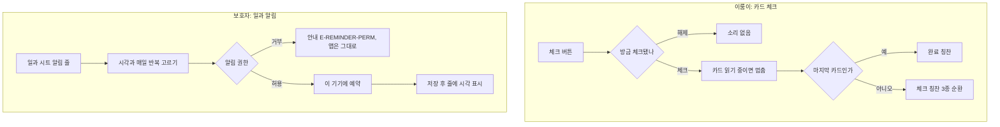

### 📌 작업 개요

2026-10-19 특수학교 실증 1차(보호자 2명, 교감)에서 나온 요구 중 **2차 실증(10/20, 이룸이와 보호자) 전에 바로 체감될 세 가지**를 넣었다. 서버 배포 없이 앱만으로 동작한다.

| 기능 | 현장 근거 |
| --- | --- |
| 체크 칭찬 소리 | 보호자 B: "잘했어, 최고야 소리가 나오고 반짝이면 좋겠다" (사회적 강화) |
| 일과별 알림 | 보호자 A·B 모두 가장 먼저 꼽음: "그거 할 시간이라고 알려주면" |
| 카테고리별 예시 일과 | "매일 새로 만들기보다 골격을 가져다 쓰고 싶다", 자조·학습·사회참여로 나눠 달라, 초심자용을 따로 |

근거 정리: #780 · 설계: `docs/superpowers/specs/2026-10-19-field-test-1-praise-reminder-template-design.md`

### 🔄 흐름

### 🛠️ 구현 내용

**1. 체크 칭찬 소리** (`core/sound/child_praise_sound.dart`)
- 효과음(반짝 아르페지오)과 칭찬 음성을 **한 파일로 합쳐** 미리 넣었다: `잘했어요!` `멋져요!` `최고예요!`(체크, 순환), `다 해냈어요! 정말 멋져요!`(완료). AAC 5개, 합계 약 80KB.
- 음성은 서버 TTS(Supertonic F1)로 한 번 만들고 앱에 넣었다. 체크할 때마다 서버를 부르면 네트워크가 없거나 느린 현장에서 소리가 늦거나 안 난다. 원본 생성 절차는 `client/tool/mix_praise_sounds.py`.
- **한국어 일과만 음성**, 그 밖의 언어는 효과음만 낸다(목소리가 한국어라).
- 보호자·이룸이 설정에 `카드 체크 칭찬 소리` 스위치를 추가했다. 진동 스위치와 같은 이유로 계정이 아니라 기기에 속하고 기본은 켜짐이다.
- 카드 읽기와 겹치면 알아들을 수 없어, 체크 순간 읽기를 먼저 멈춘다.

**2. 일과별 알림** (`features/reminder/` + 일과 상세 시트 알림 줄)
- `flutter_local_notifications` + `timezone`으로 **이 기기에만** 예약한다. 매일이면 시:분 반복이다.
- 권한은 **처음 켤 때만** 묻는다. 거부하면 이유와 우회 경로를 안내하고(`E-REMINDER-PERM`) 앱은 그대로 동작한다.
- 알림 id는 일과 id의 FNV 해시를 쓴다. `String.hashCode`는 실행마다 같다는 보장이 없어, 앱을 다시 켜면 끄기가 옛 알림을 못 지운다.
- 예약은 `ReminderScheduler` 인터페이스 뒤에 두었다. 보호자가 정한 알림을 이룸이 기기로 보내야 하면 서버 푸시(FCM) 구현체를 더하면 된다.
- Android: desugaring 활성화, 예약·재부팅 리시버와 `RECEIVE_BOOT_COMPLETED`. iOS: 알림 센터 대리자를 지정했다(앱이 떠 있을 때도 배너가 보이게).

**3. 카테고리별 예시 일과** (`guardian/domain/routine_template*.dart`, `routine_template_sheet.dart`)
- 일과 만들기 화면 `예시 일과 둘러보기` → 6개 분류(몸 돌보기·하루 흐름·집안일·밖에서 해 보기·공부·마음과 관계), 26개 항목.
- 고르면 **과제분석을 요청하는 문장**이 입력칸에 채워진다. 보호자가 이룸이에 맞게 고쳐서 보낸다. 실증에서 나온 예(옷 입기 순서, 밥 먹기 하위 활동, 감정 카드 꺼내기 등)를 문장에 반영했다.
- `처음이라면 추천` 항목을 분류 맨 앞에 둔다(초심자·숙련자를 나눠 달라는 요구).
- 문구는 `app_ko.arb`, 영어 번역 포함.

### ✅ 검증

| 항목 | 결과 |
| --- | --- |
| `flutter test` (develop 병합 후) | 1505건 통과 (새 시험 13건) |
| 골든 | 설정·일과 시트 2장·일과 만들기 3장, 의도한 변화(새 줄·버튼)만 확인 후 갱신 |
| iOS 시뮬레이터 | 빌드, 이룸이 카드 체크 시 칭찬 음성 재생(시스템 로그에 AAC 1채널 44.1kHz 재생 기록), 설정 스위치 노출 |
| Android | 디버그 APK 빌드 (desugaring·리시버 병합) |
| 보호자 화면 | 알림 시트, 알림을 켠 뒤의 줄 표시, 예시 일과 시트를 위젯 캡처로 확인. 시트 손잡이가 제목과 겹치던 것을 발견해 고침 |
| CI | PR #790 Flutter CI 통과 → develop 머지, 배포 PR #791 |

### ⚠️ 주의사항

- **실기기 알림 울림은 아직 확인하지 않았다.** iPhone 시뮬레이터가 이룸이 연결 기기라 보호자 화면을 실제 앱으로 띄우지 못했다. 2차 실증 전에 보호자 기기에서 1~2분 뒤로 알림을 걸어 확인해야 한다.
- 안드로이드는 정확한 알람이 허용된 기기만 정시에 울리고, 그 외에는 몇 분 늦을 수 있다(권한을 조르지 않는 선택).
- 예시 일과 목록은 **클라에 있다**. 서버 추천 일과(`RoutineSuggestionCatalog`)와 별개라, 서버로 옮기면 클라 목록을 지워야 한다(단일 원본).
- 칭찬 음성을 바꾸려면 서버 TTS로 다시 만든 뒤 `mix_praise_sounds.py` → `afconvert` 순서를 따른다. 파일명은 `AppAssets` 상수와 묶여 있다.
- 태블릿(#774) 병합에 따라 새 문구의 `휴대폰`을 `기기`로 맞췄다.

### 📎 후속 이슈

일과 묶기 #781 · 요일 반복과 주간 계획 #782 · 카드 보관함 #783 · 누적 보상 #784 · 교사 일괄 전달 #785 · 커뮤니티 #786 · 목소리 녹음 #787 · 가이드와 발견성 #788
