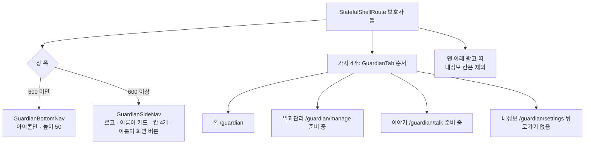

# 보호자 화면 하단 바 4칸 (홈 · 일과관리 · 이야기 · 내정보) 구현 보고서 (#798)

## 요약

보호자 화면을 칸 4개로 나눴다. 폰은 아이콘만 있는 얇은 하단 바, 태블릿은 왼쪽에 항상 펼쳐 둔 옆 메뉴다.
일과관리(#797)와 이야기(#786)가 들어올 자리를 먼저 열었고, 두 칸은 지금 준비 중 안내만 보인다.
시안은 #798 댓글의 폰 P1 · 태블릿 T3이다.

## 구조

## 바꾼 것

| 영역 | 내용 |
| --- | --- |
| 칸 정의 | `GuardianTab` 한 곳이 순서·경로·아이콘·이름·광고 허용을 가진다. 칸을 더하면 값 하나 + 라우터 가지 하나 + ARB 이름 하나 |
| 라우터 | `routes_guardian.dart` 에 `StatefulShellRoute.indexedStack`. 설정 하위 화면·일과 만들기 흐름은 가지 밖(바를 덮는 화면) |
| 틀 | `GuardianShell` 이 창 폭으로 하단 바·옆 메뉴를 고르고, 폰은 본문 > 하단 바 > 광고 띠 > 홈 표시줄 순서로 쌓는다 |
| 홈 | 머리 줄에서 설정 톱니를 뺐다(내정보 칸으로). 태블릿은 로고·이룸이 화면 입구가 옆 메뉴라 인사말만 그린다. 가로 홈의 병아리 장면은 빼고 자리를 비웠다(커뮤니티 #786) |
| 설정 | `isTabRoot` 로 칸 첫 화면일 때 뒤로가기 없이 `내정보` 제목. `ElumScaffold` 에 `isBackButtonVisible` 추가(제목 줄 위치는 그대로) |
| 코치마크 | 태블릿은 이룸이 화면 입구가 홈 밖(글자가 있는 옆 메뉴)이라 3단계를 건너뛴다 |
| 토큰 | `AppColors` 에 nav 색 5개(바탕·구분선·고른/안 고른 아이콘·고른 칸 바탕) |
| 문구 | ARB 10개(ko·en). 하단 바는 글자 없이 화면 낭독 이름만 |

## 검증

- `flutter analyze` 0건, 한글 리터럴 0줄, 계층 import 새 위반 0건
- 전체 테스트 1,521건 통과 (새 `guardian_shell_test` 8건)
- 갱신한 골든: 홈 · 홈 코치마크 · 일과 시트 6종 (설정 톱니 제거와 하단 바가 보이는 의도한 변경)
- iPad Pro 13인치(M4) 시뮬레이터 실측, 세로·가로 모두 (전/후 이미지는 #798 댓글)

## 주의사항 (건드리면 위험한 것)

1. **광고 띠 표시 여부는 틀이 아니라 맨 끝 위젯(`_AdStripGate`)이 읽고, 값이 바뀌면 다음 프레임에 갱신한다.** 틀에서 바로 읽으면 흐름 화면에서 홈으로 돌아올 때 `markNeedsBuild() called during build` 가 난다.
2. **광고 모듈은 라우터가 틀에 넣어 준다.** 기능끼리 data·presentation 을 직접 import 하지 못하는 규칙(계층 검사) 때문이다. `ad_boundary_test` 허용 목록에 `routes_guardian.dart` 가 들어갔다.
3. **바를 덮어야 하는 화면은 가지 안에 두지 않는다.** 가지 안에 두면 하단 바가 그대로 남는다.
4. 내정보(설정) 칸에는 광고 띠를 두지 않는다(`회원탈퇴` 줄 오탭 방지).

## 남은 것

- **폰 시뮬레이터 실측**: 아이폰 시뮬레이터에 보호자 로그인 세션이 없어 하단 바를 시뮬레이터로 보지 못했다. 위젯 테스트와 골든으로만 확인했다.
- 일과관리 칸 내용(#797) · 이야기 칸 내용(#786)
- 디자이너 확인: 하단 바 아이콘 · 옆 메뉴 이룸이 카드

## 함께 한 것

- 새 worktree 에 로컬 전용 파일이 빠져 iOS 앱이 시작 직후 꺼지는 문제(`ios/Flutter/Secrets.xcconfig` 없음, AdMob 앱 ID)를 겪었다. `scripts/copy-worktree-local-files.sh` 와 CLAUDE.md 안내를 추가했다.
