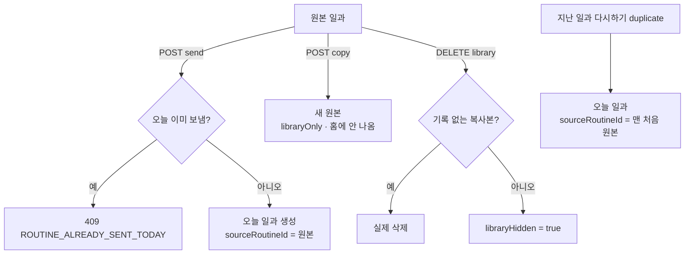

# 일과 원본 구분과 일과관리 목록·보내기·복사 API 구현 보고서 (#804)

## 요약

일과관리 칸(#805)이 쓸 서버를 만들었다. 일과는 지금까지 날짜가 붙은 한 번짜리였는데, 이제 **보관해 둔 원본**과 **원본에서 보낸 그날의 일과**를 구분한다. 홈 오늘·지난 목록은 그대로 동작한다.

## 데이터 (V42)

| 컬럼 | 뜻 |
| --- | --- |
| `source_routine_id` (null 가능, 인덱스) | 보내기·다시하기로 만든 일과가 가리키는 **맨 처음 원본**. 원본이면 null |
| `library_only` (기본 false) | 일과관리 `복사하기`로 만든 원본. 홈(오늘·지난·전체)에 나오지 않는다 |
| `library_hidden` (기본 false) | 일과관리에서 지운 원본. 수행 기록을 지키려 실제로는 숨기기만 한다 |

기존 행은 모두 원본으로 남는다(마이그레이션이 값을 바꾸지 않는다).

## API

| 메서드·경로 | 결과 | 거절 |
| --- | --- | --- |
| `GET /api/routines/library` | 원본(source 없음 · 숨기지 않음 · CONFIRMED/COMPLETED) 최신순 | 프로필 권한 |
| `POST /api/routines/{id}/send` | 오늘 일과 생성(`sourceRoutineId` = 원본) | 409 `ROUTINE_ALREADY_SENT_TODAY`(오늘 이미 보냄) · 409 `ROUTINE_INVALID_STATUS`(보낸 일과·임시저장) |
| `POST /api/routines/{id}/copy` | 새 원본 `○○ 복사`(일과 언어를 따름, `library_only`) | 409 `ROUTINE_INVALID_STATUS` |
| `DELETE /api/routines/{id}/library` | 204. 기록·보낸 일과가 없는 복사본은 실제 삭제, 나머지는 숨김 | 403 `ROUTINE_NOT_CREATOR` |
| `PATCH /api/routines/{id}/title` | 이름 바꾸기(1~30자, 그 일과만) | 400 `INVALID_INPUT_VALUE` · 403 |

## 결정과 이유

- **원본 + 보낼 때마다 그날 일과 생성** (#797 §6): 이룸이 수행 기록·별·진행률이 날짜별 일과에 묶여 있어, 원본을 재사용하면 기록이 섞인다. 복제는 기존 `duplicate`(AI 없이 카드 복사)를 공통 메서드로 뽑아 재사용했다.
- **지우기는 숨기기**: 원본에서 보낸 일과·수행 기록이 원본을 가리키므로 실제로 지우면 기록이 끊긴다.
- **다시하기도 원본을 가리킨다**: 하지 않으면 지난 일과 다시하기로 만든 복제본이 일과관리에 원본처럼 쌓인다.

## 검증

- `./gradlew test --tests '*Routine*' '*Message*' '*Locale*' '*Architecture*' '*Swagger*' '*Docs*' '*Migration*'` — 97개 클래스 725건 통과
- 새 `RoutineLibraryServiceTest` 7건 + `duplicate_pointsAtFirstOriginal`
- 운영 배포 후 앱에서 목록·보내기·두 번 보내기·복사·이름·지우기를 실제로 밟았다 (#805 E2E 댓글)

## 주의사항

1. 홈 목록 쿼리 3곳(오늘 `findTodayOrdered`·지난·전체)은 `library_only` 를 걸러야 한다. 새 목록 쿼리를 더하면 같은 조건을 넣는다.
2. 이번 배포 전에 다시하기로 만든 복제본은 `source_routine_id` 가 비어 있어 일과관리에 원본처럼 보인다(데이터 보정 안 함).
3. 보내기·복사는 기존 `duplicate` 처럼 보유 일과 한도를 검사하지 않는다(만든 일과 수에는 잡힌다).
