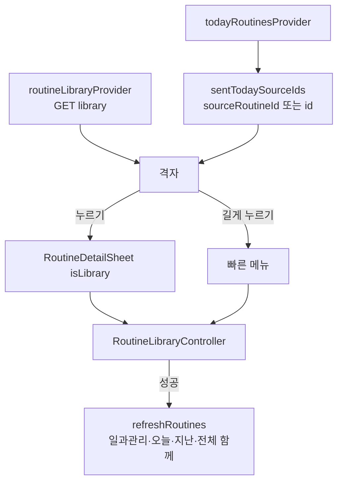

# 일과관리 칸: 원본 일과 격자·상세·보내기·복사·지우기 구현 보고서 (#805)

## 요약

하단 바(#798)의 일과관리 칸에 만들어 둔 원본 일과를 바탕화면 아이콘처럼 모았다(설계 #797). 서버는 #804.
배포 후 운영 서버로 E2E 를 돌려 결함 7건을 찾아 고쳤다(#805 E2E 댓글).

## 화면 동작

| 동작 | 결과 |
| --- | --- |
| 일과 누르기 | 상세 시트 — 내 원본은 `카드 고치기`(검토 화면) + `오늘 보내기`, 남의 원본은 `오늘 보내기`만. 예전 수행 체크는 숨김 |
| 길게 누르기 | 빠른 메뉴 — 오늘 보내기 · 이름 바꾸기 · 복사하기 · 지우기 (남의 원본은 보내기·복사만) |
| 오늘 보내기 | 이미 보냈으면 서버에 가지 않고 `오늘 이미 보낸 일과예요`, 다른 기기가 먼저 보냈으면 409 를 같은 안내로 |
| `+ 일과 만들기` | 홈과 같은 길(크레딧 확인 > 일과 만들기) — 홈의 시작 로직을 `continueRoutineStart` 로 뽑아 함께 쓴다 |
| 오늘 보낸 원본 | 칸 오른쪽 아래 민트 ✓ (낭독 이름에 `오늘 보냈어요`) |
| 실패 | 목록은 다시 시도 + 에러 코드(`E-LIB`), 동작은 실패 팝업(`E-LIB-SEND·COPY·RENAME·DEL`) |
| 빈 목록 | 빈 상태 안내 |

## 구조

| 층 | 파일 |
| --- | --- |
| data | `routine_library_api.dart` (목록·보내기·복사·이름·지우기, 모두 `Attempt`) |
| application | `routine_providers.dart`(`routineLibraryProvider`, `refreshRoutines` 가 일과관리도 함께), `routine_library_controller.dart` |
| presentation | `routine_manage_screen.dart`, `widgets/library_parts.dart` · `library_routine_tile.dart` · `library_quick_menu.dart` · `routine_rename_sheet.dart`, `routine_detail_sheet.dart`(일과관리 모드) |
| 공통 | `ElumTextField.isAutofocused`, `ServerErrorCode.routineAlreadySentToday`, `Routine.sourceRoutineId` |

## E2E 에서 찾아 고친 것

| 심각도 | 결함 |
| --- | --- |
| 높음 | 태블릿 옆 메뉴가 화면 낭독기에서 사라짐(#798 회귀) — 본문을 따로 낭독 묶음으로 가둠 |
| 보통 | 알림이 옆 메뉴·`+ 일과 만들기` 를 덮음 — 칸 본문에 알림 자리, 버튼은 떠 있는 버튼 자리 |
| 보통 | 이름 바꾸기 입력칸에 커서 없음 · 상세에 예전 체크 표시 |
| 낮음 | 그림 받는 동안 빈 칸 · 안내 줄바꿈 · 가로에서 격자가 가운데에 갇힘 |

## 검증

- 테스트 1,528건 통과 (새 `routine_manage_screen_test` 7건, `guardian_shell_test` 에 낭독 이름 단언)
- iPad Pro 13인치 시뮬레이터 + 운영 서버 E2E: 목록 · 상세 · 메뉴(남/내) · 복사 · 이름 · 보내기 · 두 번 보내기 · 지우기 · 홈에 보낸 일과 남음 · 이야기 · 내정보 · 가로/세로 (테스트 데이터는 정리함)

## 주의사항

1. **칸 화면의 알림은 칸 본문 안의 `ScaffoldMessenger` 가 띄운다.** 가지 밖(루트)으로 `push` 한 화면은 루트 알림 자리를 쓴다.
2. **옆 메뉴 낭독 정보는 `_ContentSemanticsScope` 가 지킨다.** 이 감싸기를 빼면 옆 메뉴가 낭독기에서 다시 사라진다(`guardian_shell_test` 가 잡는다).
3. 오늘 보냄 ✓ 는 오늘 목록에서 계산한다 — 오늘 목록을 못 받으면 표시만 빠지고 두 번 보내기는 서버가 막는다.
4. 폰 하단 바 실기기 확인은 남았다(시뮬레이터 보호자 로그인 없음).
