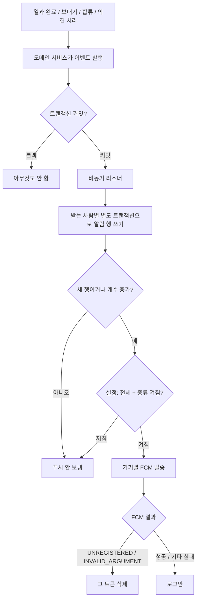

# 알림 기록 저장과 푸시 발송, 알림 목록 API (#827)

## 개요
보호자에게 갈 알림 5종을 서버에 기록하고 FCM으로 푸시를 보낸다. 앱 안 알림 목록·안 읽음 요약·읽음 처리·알림 설정·공지 탭 API를 함께 열었다. develop 병합 커밋 `10e901cb`.

설계: `docs/superpowers/specs/2026-10-19-notifications-design.md` / 계획: `docs/superpowers/plans/2026-10-19-notifications-server.md`

## 알림 5종과 보내는 시점
| 종류 | 언제 | 받는 사람 | 묶기 |
|---|---|---|---|
| 일과 완료 `ROUTINE_COMPLETED` | 마지막 카드 체크(`completeStep`) 또는 오프라인 반영(`syncProgress`)으로 **새로** 완료됐을 때 | 그 이룸이의 보호자 전원(요청한 보호자 제외) | 이룸이·날짜별 1줄, 서로 다른 일과 수만 셈 |
| 다른 보호자가 일과를 보냄 | 승인(`confirm`), 일과관리 보내기, 다시하기, 묶음째 보내기(묶음당 1건) | 보낸 사람 뺀 보호자 | 없음 |
| 새 보호자 합류 | 초대 암호 합류 성공 | 합류한 사람 뺀 기존 보호자 | 없음 |
| 크레딧 다시 채움 | 월요일 09:00(KST) 스케줄러 | 지난 주 실제 사용(CONSUME·OVERAGE)으로 잔액 0이 된 보호자 | 주당 1건 |
| 의견 처리 완료 | 관리자가 상태를 `처리 완료`로 바꿈 | 의견을 보낸 보호자 | 의견당 1건 |

## 처리 흐름

## 주요 변경
- **저장 (V47)**: `notification`, `push_device`, `notification_setting`, `notice_seen` 4개 표 + `app_notice.revised_at`. 받는 사람+묶음 키 유일 제약. 탈퇴·완전 삭제·이룸이 삭제 시 함께 정리.
- **기록기**: 받는 사람마다 `REQUIRES_NEW` + 묶음 행 비관적 잠금 조회, 동시 삽입 충돌은 1회 재시도. 한 명 실패가 다른 사람을 막지 않음.
- **이벤트 기반**: `@TransactionalEventListener(AFTER_COMMIT)` + 알림 전용 스레드 풀(`CallerRunsPolicy`, 종료 시 대기). 알림·푸시 실패가 본래 요청을 실패시키지 않음.
- **푸시**: Firebase Admin 9.4.3. 키 파일이 없거나 초기화 실패면 빈 발송기로 대체(서버는 정상 기동). 문구는 `i18n/push-messages_{ko,en,ja,zh,es}`. 푸시 제목·본문·데이터에 일과 제목·이룸이 이름 원문을 넣지 않음.
- **API**: `PUT/DELETE /api/push-devices`, `GET/PUT /api/notification-settings`, `GET /api/notifications`(키셋 커서), `GET /api/notifications/unread-summary`, `POST /api/notifications/{id}/read`, `POST /api/notifications/read-all`, `GET /api/notices/history`, `POST /api/notices/seen`. 모두 보호자 전용(이룸이 기기 403).
- **스케줄러**: 크레딧 알림(묶음 단위 예외 격리), 90일 지난 알림 일괄 삭제.
- **CI·설정**: 서버 CI의 `firebase-adminsdk.json` 생성 단계를 살렸다. 키 경로 기본값 `firebase-adminsdk.json`(클래스패스 → 파일 경로 순). GitHub Secret `FIREBASE_ADMINSDK_JSON` 등록.

## 왜 이렇게 했는가
- **요청한 사람 빼기는 보호자 기기 요청에만** 적용한다. 이룸이 기기 토큰의 `memberId`는 그 기기를 연결해 준 보호자라, 그대로 빼면 그 보호자가 일과 완료 알림을 못 받는다.
- **알림 행은 설정과 무관하게 항상 쓴다.** 설정은 푸시만 막는다. 푸시를 꺼 둔 보호자도 앱 안 목록에서는 다시 볼 수 있어야 한다.
- **안 읽음 요약의 공지 판정은 트랜잭션 프록시를 넘기 전에 platform을 검증**한다. 잘못된 값이 프록시를 지나가면 공유 트랜잭션이 rollback-only로 표시돼 잡아도 500이 난다(실서버에서 200 확인).
- **FCM 전송기를 `NetHttpTransport`로 지정**했다. 기본 전송기는 FCM 오류 응답(gzip)을 이중으로 풀다가 `ZipException`이 나서 `UNREGISTERED`를 구분하지 못했다.

## 실측 (로컬 Postgres + 실제 Firebase 키)
- V47 SQL 적용·재적용(idempotent) 확인, Spring 기동 시 모든 JPA 쿼리 검증 통과, 기동 로그 `[notification push] enabled : fcm`.
- 합류 이벤트 → 알림 행 → 목록·요약 응답(`isRead` 키) 확인. 읽음·전체 읽음, 남의 알림 404, URL 인코딩된 커서 페이징, 잘못된 platform 200 확인.
- 실측 중 발견해 고친 버그 2건: 데이터 맵의 null 값으로 메시지 생성 실패, `ApnsConfig`에 `aps` 누락(`aps must be specified`). 둘 다 **모든 푸시가 만들어지지 않던** 문제였다.
- 가짜 토큰 → `UNREGISTERED` → 토큰 삭제, 시뮬레이터의 진짜 토큰 → **실제 푸시 수신**(전경 배너·백그라운드 탭 이동) 확인.
- 서버 테스트(알림 관련 묶음) 478건 중 실패 2건은 develop 기존 실패(아래).

## 주의사항
- `NotificationRowWriter`의 잠금 조회(`findForUpdate…`)를 일반 조회로 바꾸면 같은 날 일과 두 개가 동시에 끝날 때 개수가 빠진다.
- `PushDispatcher.dispatch`에 트랜잭션을 다시 걸지 않는다. FCM 호출 동안 DB 연결을 잡고, 한 건 예외로 앞서 지운 무효 토큰까지 되돌려진다. 토큰 삭제만 `REQUIRES_NEW`.
- FCM은 메시지 형식이 틀려도 `INVALID_ARGUMENT`를 준다. 메시지 형식을 바꿀 때 회귀가 생기면 정상 토큰이 지워질 수 있다.
- `DELETE /api/push-devices/{token}`은 토큰이 경로에 있어 프록시 접근 로그에 남을 수 있다.

## 남은 것 · 확인할 것
- develop 기존 실패: `RoutineGroup`(일과 묶음)이 탈퇴 정리에서 빠져 `WithdrawCoversMemberReferencesTest` 2건이 실패한다. 이 작업과 무관하며 별도 이슈로 다뤄야 한다.
- 운영 `APPLICATION_PROD_YML`에 `firebase.service-account-key-path`가 없어도 기본값으로 동작한다. 배포 후 기동 로그 `[notification push] enabled : fcm`을 확인한다.
