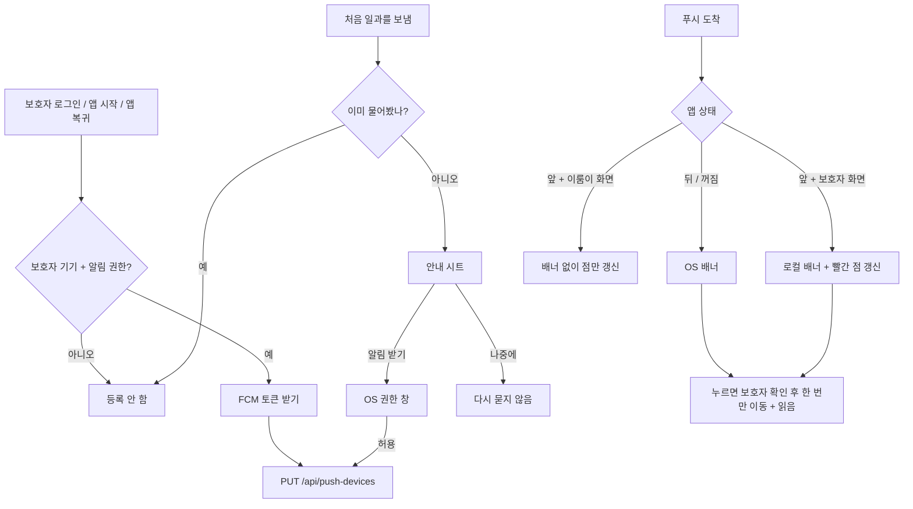

# 푸시 수신: 권한, 기기 토큰 등록, 알림 눌러 이동 (#828)

## 개요
보호자 기기가 FCM 토큰을 서버에 등록하고, 푸시를 받아 배너를 띄우고, 누르면 알림 화면과 같은 규칙으로 이동한다. develop 병합 커밋 `10e901cb`.

## 처리 흐름

## 주요 변경
- **Firebase**: `firebase_core 5.0.0`, `firebase_messaging 17.0.0`. Android google-services 플러그인과 기본 채널 `guardian_updates`, iOS `aps-environment`, `UIBackgroundModes: remote-notification`, `GoogleService-Info.plist`를 Runner 리소스로 등록. 초기화 실패는 기록만 하고 앱 시작을 막지 않는다.
- **설정 파일**: `google-services.json`, `GoogleService-Info.plist`는 커밋하지 않는다(.gitignore). 원본은 레포 밖 `~/.elum-secrets/firebase-elum-dd083/`. worktree 복사 목록에 추가. CI는 Secret(`GOOGLE_SERVICES_JSON`, 새로 등록한 `GOOGLE_SERVICE_INFO_PLIST`)으로 파일을 만든다.
- **토큰**: 보호자 기기만 등록, 이룸이 기기는 등록하지 않음. 로그아웃·회원 삭제·이룸이 기기 전환 **직전**에 서버 해제 후 토큰 삭제(각 5초 상한, 실패해도 다음 단계 진행). 동기화 때마다 서버 PUT을 다시 해서 세션 만료 뒤 다른 보호자가 로그인해도 토큰 주인이 바뀐다. 앱 복귀 때도 동기화해서 기기 설정에서 켠 권한이 바로 반영된다.
- **권한 시트**: 앱 첫 실행이 아니라 처음 일과를 이룸이에게 보낸 직후 한 번(일과 만들기 저장, 일과관리 오늘 보내기). 이미 거부된 기기는 시트 없이 넘어가고, 알림 설정의 버튼이 기기 설정을 연다.
- **수신·이동**: 앱이 앞에 있을 때는 FCM 표시를 끄고 로컬 배너 하나만 띄운다(중복 방지). 보호자 기기가 잠깐 이룸이 화면일 때는 배너 없이 점만 갱신. 누르면 로그인·라우터 준비를 기다려 #826의 `NotificationNavigator`로 한 번만 이동하고 읽음 처리. 로그인 전 누름은 버린다(로그인하면 홈). 모르는 종류는 알림 화면.
- **로컬 알림 통합**: 리마인더(#777)와 같은 플러그인 인스턴스·초기화를 쓴다. 리마인더 채널·권한 동작은 그대로이고, 배너 id는 음수 범위라 리마인더 id와 겹치지 않는다.

## 실측 (iOS 시뮬레이터 + 로컬 서버 + 실제 FCM)
- 알림 설정 화면의 "기기 설정 열기" → OS 권한 창 → 허용 → **실제 FCM 토큰(142자) 서버 등록**(`PUT /api/push-devices` 204).
- 다른 보호자 합류 → 서버가 FCM으로 발송 → **앱이 앞에 있을 때 배너 "이룸 · 새 보호자가 함께하기 시작했어요" 수신**.
- 앱을 뒤로 보낸 상태에서 다시 발송 → OS 배너를 누르면 앱이 열리며 함께하는 사람 화면으로 이동, 읽음 204.
- 로그아웃 → `DELETE /api/push-devices/{토큰}` 204가 `POST /api/auth/logout`보다 먼저 가고 서버 기기 목록 0.
- 테스트 빌드(`@projectops app build`): **Android APK 성공**.

## 실측 캡처
실제 FCM으로 받은 전경 배너(알림 설정 화면에서 권한 허용 직후):

## 주의사항
- `firebase_messaging` 17은 `getToken`·`onTokenRefresh`·`deleteToken`을 deprecated로 표시했지만, 서버가 보내는 대상은 FCM 토큰이라 그대로 쓴다(파일 단위 ignore와 이유 주석).
- `AppDelegate`의 알림 대리자 설정은 그대로 둬야 한다. firebase_messaging이 원래 대리자를 저장해 FCM이 아닌 알림(리마인더·로컬 배너)을 넘겨준다.
- 로그아웃은 토큰 해제 때문에 최대 약 15초 늦어질 수 있다(네트워크가 매우 느릴 때).

## 남은 것
- [ ] **iOS 테스트 빌드**: 댓글 빌드는 `main`의 워크플로우를 써서 아직 `GoogleService-Info.plist` 생성 단계가 없다(실패 원인: `Build input file cannot be found: GoogleService-Info.plist`). develop → main 배포 뒤 다시 확인한다. 배포 전에 Push가 켜진 프로비저닝 프로파일로 `APPLE_PROVISIONING_PROFILE_BASE64`가 갱신돼 있는지 확인한다(App ID에는 Push가 켜져 있다).
- [ ] **처음 일과를 보낸 직후의 권한 안내 시트**: 로컬 실측에서 AI 일과 생성을 돌리지 않아 시트 화면은 확인하지 못했다. 테스트 빌드에서 확인한다.
- [ ] `client/ios/Podfile.lock`에 Firebase pod가 아직 반영되지 않았다. 다음 iOS 빌드 뒤 함께 커밋한다.
