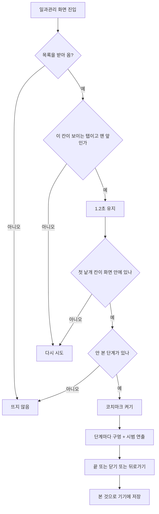

## 구현 보고서: 일과관리 처음 사용 안내 코치마크 (#832)

일과관리 칸에 처음 들어온 보호자에게 **누르기 · 길게 누르기 · 보낸 뒤 ✓ · 묶음 만들기**를 움직임으로 보여 주는 코치마크를 만들었다. 홈 코치마크의 `CoachMarkOverlay` 를 재사용하고, 단계에 시범 층(`demoBuilder`) 한 칸만 더했다. 설계는 `docs/superpowers/specs/2026-10-19-routine-manage-coach-mark-design.md` 에 있다.

### 상태
- 구현 · 관련 테스트(70개) · develop 병합 · 푸시 · 테스트 빌드 요청까지 끝났다.
- **실기기 확인은 아직이다.** 이슈는 닫지 않는다 (아래 "남은 일").

### 무엇이 바뀌었나

| 구분 | 내용 |
|---|---|
| 단계 | 기본 3단계(누르기 / 길게 누르기 / 보낸 뒤 ✓) + 묶음 2단계(끌어서 묶기 / `+ 일과 만들기`에서 새 묶음). 묶음 단계는 일과 2개 이상 + 묶음 0개일 때만 이어 붙는다 |
| 시작 조건 | 목록을 받아 옴 · 이 칸이 보이는 탭(TickerMode) · 화면이 맨 앞이고 전환이 끝남 · 1.2초 유지 · 가리킬 첫 낱개 칸이 화면 안에 있음 |
| 저장 | 기기별 "봤음" 2개(`coach.manageSeen`, `coach.groupSeen`). 읽기 실패면 봤다고 치고, 같은 실행에서 두 번 뜨지 않는다 |
| 다시 보기 | 설정에 `일과관리 사용법 다시 보기` 줄. 요청을 노티파이어에 남겨 두고 일과관리 화면이 목록을 받으면 켠다 |
| 시범 연출 | 손가락 탭 · 꾹 누르기 + 링 · 시트 미리보기 · ✓ 팝 · 끌어서 묶기. 한 주기 4초(`AppMotion.coachDemoLoop`). 동작 줄이기면 멈춘 마지막 장면 |
| 문구 | ARB 5개 + 설정 줄 1개 (해요체, 실제 시트·메뉴와 같은 문구 재사용) |

### 동작 흐름

### 왜 이렇게 했나
- **새 오버레이를 만들지 않았다.** 홈 코치마크가 이미 구멍 이동 · 건너뛰기 · 동작 줄이기 · 태블릿 막 처리를 갖고 있어서, 단계에 시범 층 한 칸(`demoBuilder`)만 더해 같은 동작을 쓴다. `demoBuilder` 가 없으면 홈은 이전과 같다.
- **시범은 그림만 그린다.** 실제 시트를 열어 보여 주면 시범 중에 보내기 · 묶기가 실제로 실행될 위험이 있고 일과가 없으면 시범이 안 된다. 시범 층은 서버 호출과 일과 데이터를 건드리지 않는다 (테스트로 서버 호출 0 확인).
- **#834 와 통합했다.** 다른 세션의 #834 가 같은 일과관리에 2단계 코치마크를 이미 넣어 둬서 그대로 합치면 연달아 두 번 뜬다. 그쪽 코치마크 코드 · 저장 키 · 문구는 걷어내고 이 코치마크 하나로 통일했다 (길게 누르기 · `+ 일과 만들기` 안내는 이쪽에 포함). #834 의 상세 시트 ⋯ 버튼 · 아래쪽 대상 겹침 수정 · 줄바꿈 수정은 그대로 살렸고, 탭이 안 보일 때 켜지 않는 `TickerMode` 조건은 #834 에서 가져왔다.

### 주의사항 (건드릴 때 위험한 곳)
- **"봤음"이 저장되는 경로**: 오버레이는 대상을 못 재면 그 단계를 건너뛰고, 마지막 단계까지 건너뛰면 닫힘으로 처리돼 "봤음"이 저장된다. 그래서 시작 전에 첫 칸이 화면 안에 있는지 확인한다. 이 확인을 지우면 화면 밖 칸에서 아무것도 안 보이고 본 것으로만 남는다.
- **TickerMode 조건**: 일과관리는 하단 바 탭이라 안 보이는 동안에도 살아 있다. 이 조건 없이 켜면 다른 탭 위에서 켜져 단계가 모두 건너뛰어진다.
- **시범 층 순서**: 구멍이 대상에 자리 잡은 뒤에만 그린다. 옮겨 가는 동안 그리면 어긋나 보인다.
- **`CoachMarkStep.demoBuilder` 는 `Positioned` 를 돌려줘야 한다** (오버레이가 `Stack` 안에 넣는다).
- **시범은 실제 시트와 따로 그린 미리보기**라서 실제 시트의 모양이 바뀌면 어긋날 수 있다. 문구는 같은 ARB 키를 써서 어긋나지 않는다.

### 검증
- 관련 테스트 6개 파일 **70개 통과, 실패 0** (노티파이어 · 저장 · 시범 층 · 화면 연결 · 설정 줄 · 홈 코치마크 회귀 · 막 번짐).
- 화면 테스트가 확인하는 것: 일과 1개에서 3단계 후 닫힘과 저장 / 서버 호출 0 / 이미 봤으면 안 뜸 / 목록 실패 · 0건 · 전부 묶음 안이면 안 뜸 / 일과 2개에서 묶음 단계 이어짐 / 뒤로가기로 닫아도 저장 / 도는 중 목록이 비어도 예외 없음 / 태블릿 폭 · 큰 글자 / 다시 보기 요청.
- `flutter analyze` 에러 · 경고 없음 (남은 info 는 이번 변경과 무관한 기존 것).
- **전체 테스트 스위트는 돌리지 않았다** (컴퓨터 부담 때문에 프로젝트 규칙상 관련 파일만). 골든 테스트도 돌리지 않았다.
- 최종 코드 검토(별도 검토자)에서 나온 지적 중 사용자에게 보이는 것(시트가 문구를 가림 · 토스트 겹침 · 화면 밖 칸에서 저장만 됨 · ✓ 위치 어긋남)은 고쳤다.

### 남은 일 · 알려진 한계
- **실기기 확인**: 아이폰 · 아이패드, 라이트 · 다크, 일과 1개 / 2개 / 묶음 있음 / 0개 / 목록 실패. 테스트 빌드는 이슈 댓글로 요청했다.
- 막이 하단 바(셸)를 덮지 않는다. 홈 코치마크와 같은 구조라 함께 셸 위로 올리는 후속 작업이 필요하다.
- 시범 시트가 가로 태블릿의 실제 옆 패널과 모양이 다르고, 길게 누르기 단계에서 아래 안내 문구(진행 점)를 가린다.
- 떠 있는 동안 목록이 바뀌어 첫 칸이 밀리면 다음 단계에서야 구멍을 다시 잰다.
- 로컬 `develop` 브랜치는 다른 세션의 추적 안 되는 파일과 겹쳐 최신화하지 못했다 (원격 `develop` 은 이 브랜치에 합쳤다).
- #834 세션이 코치마크를 다시 넣으면 충돌한다. 조율이 필요하다.
