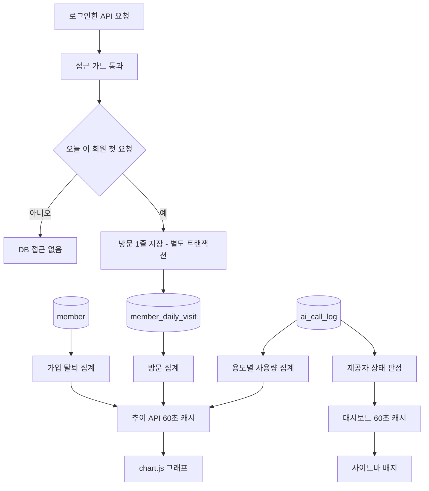

### 📌 작업 개요

관리자 대시보드를 "지금 상태 + 확인할 일" 화면으로 바꾸고, 가입·방문·AI 사용량 추이를 그래프(chart.js)로 보이게 했다.
자세한 추이와 필터는 회원 관리·AI 모니터링 화면에 따로 두었다. 가입과 방문은 서로 다른 카드·그래프로 나눴다.

- 설계 문서: `docs/superpowers/specs/2026-10-20-admin-dashboard-trends-design.md`
- 배포: PR #915(기능), PR #916(방문 그래프 점 표시 수정). 운영 서버 V51 적용 확인

### 🎯 구현 내용

**① 대시보드**
- **확인할 일**: 새 의견, 검토 대기 일과, AI 이상, 멈춘 크레딧 예약, 하루 AI 비용 상한 80% 이상. 0건인 항목은 숨기고, 각 항목은 걸러진 목록으로 연결한다. 모두 0건이면 "확인할 일이 없어요"
- **숫자 4개**: 지금 접속 중(최근 5분 활동), 오늘 방문(어제 대비), 오늘 신규 가입, 오늘 AI 호출·비용(USD + 원화 환산)
- **AI 상태**: 제공자별 카드(Gemini 글, OpenAI 그림 등)에 정상 / 오류 늘어남 / 크레딧 소진 의심 / 키 오류 / 호출 없음을 표시. 마지막 성공·실패 시각과 오류 문구를 함께 보여 준다
- **30일 그래프 3개**: 신규 가입, 방문, AI 사용(호출 수 ↔ 비용 전환). 축이 두 개인 겹친 그래프는 쓰지 않는다
- 기존 카드 유지: 요금제 분포, 지금 적용 중인 설정(비용 상한 사용률 추가), 24시간 서버 오류(재기동하면 0부터 센다는 안내 추가)

**② 회원 관리**
- 가입 추이(가입·탈퇴, 일별 90일 / 월별 12달, 기간 지정) 카드와 방문 추이 카드를 따로 둔다
- 가입 막대를 누르면 그 날(달) 가입자로 목록이 걸러진다
- 목록에 **가입일 기간 필터**를 추가했다

**③ AI 모니터링**
- 용도별(일과 생성·추가 질문·카드 그림·그림 문장 번역·픽토그램)로 쌓은 사용량 추이. 일별/월별 × 호출 수 / 비용(원) / 실패율(%)
- 이번 달 요약: 호출 수, 비용(USD·원), 일과 1개 평균 비용, 실패율
- 제공자별 비용 비율, 최근 24시간 실패 원인 표

**사이드바 배지**: 의견 관리(새 의견 수), 루틴 관리(검토 대기 수), AI 모니터링(이상 시 "주의")

**AI 상태 판정 — 결제 화면 없이 아는 방법**
제공자 잔액 API는 쓰지 않는다. 이미 쌓이는 AI 호출 실패 기록의 오류 문구로 판정한다. 분류 기준은 운영 DB의 실제 실패 문구에서 가져왔다.

| 분류 | 운영에서 실제로 본 문구 |
|---|---|
| 크레딧·결제 | `429 ... You have no credits remaining` (OpenAI 는 크레딧 소진도 429 로 보낸다) |
| 한도 초과 | `429 ... Rate limit reached` |
| 키·권한 | `401 Unauthorized` |
| 안전 필터 | `400 ... rejected by the safety system` |
| 제공자 장애 | `503 Service Unavailable` |

- 크레딧·키 오류는 최근 24시간 중 **가장 최근 호출**이 그 오류일 때 판정한다. 그래서 소진 뒤 호출이 끊겨도 놓치지 않는다
- 오류 늘어남은 최근 1시간에 3건 이상 호출됐고 그중 절반 이상이 실패했을 때다
- 판정 순서: 크레딧 소진 → 키 오류 → 오류 늘어남 → 호출 없음 → 정상

**방문 기록 (새 표 `member_daily_visit`, V51)**
- 회원별로 "마지막 활동 시각" 하나만 있어서 지난 날짜의 방문 수를 알 수 없었다. 그래서 (회원, 날짜) 한 줄짜리 표를 추가했다
- 로그인한 API 요청이 거치는 접근 가드에서 **그날 첫 요청일 때만** 1줄 저장한다. 인스턴스 메모리로 거르므로 같은 날 두 번째 요청부터는 DB 를 부르지 않는다
- 저장은 별도 트랜잭션에서 하고, 실패해도 요청은 그대로 통과한다
- V51 은 배포 당일 이미 활동한 회원으로 첫 줄을 채운다. 그 전 날짜는 그래프에서 빈칸이다(0 으로 거짓 표시하지 않음)
- 개인정보처리방침의 보관 항목이 아니므로 **탈퇴할 때 지운다**(완전 삭제 때도 한 번 더)

**설정 추가**: `USD_TO_KRW_RATE`(원화 환산 환율, 기본 1400). 표시 전용이며 한도·크레딧 계산에는 쓰지 않는다

### 🔧 주요 변경사항

- 서버
  - `admin/application/service/AdminStatsService` — 추이 조립. DB 는 기록 있는 칸만 주므로 빈 칸을 0 으로 채우고, 방문 기록 시작 전 칸은 null 로 둔다
  - `ai/application/service/AiCallStatsService`, `ai/core/AiFailureKind`·`AiProvider`·`AiProviderHealth` — 제공자 상태 판정
  - `member/application/service/MemberVisitRecorder`·`MemberStatsService`, `member_daily_visit` 엔티티·저장소, V51
  - `admin/application/controller/AdminStatsApiController` — `/admin/stats/api/{signups,visits,ai-usage,badges}`
  - `admin/application/list/AdminDateParameter` — 날짜 파라미터 해석이 네 곳에 복제돼 있어 하나로 모음
- 화면: `dashboard.html`·`members.html`·`monitoring.html`, 공통 부품 `fragments/admin-chart.html`·`admin-ai-health.html`, `static/admin/js/admin-charts.js`
- chart.js 4.4.4 를 `static/admin/vendor/` 에 동봉했다. CDN 은 쓰지 않는다(기존 admin.css 와 같은 이유)
- 그래프 색은 라이트·다크 각각 색각 이상 구분 검증을 통과한 팔레트다. 대비가 낮은 색을 보완하려고 카드마다 "표로 보기"를 붙였다

### 🧪 테스트 및 검증

- 서버 전체 테스트 1회: 2264건 중 1건 실패(탈퇴 규칙 테스트) → 방문 기록을 탈퇴 때 지우도록 고친 뒤 관련 테스트 재실행 통과
- 새 테스트(결함 하나씩)
  - 크레딧 소진 문구가 429 여도 "크레딧·결제"로 분류되는지
  - 크레딧 오류가 창 밖이어도 소진 의심으로 판정하고, 뒤에 성공이 있으면 풀리는지
  - 빈 날 0 채우기와 방문 기록 시작 전 null
  - 방문 저장이 회원당 하루 1번인지
  - 템플릿 렌더(확인할 일, AI 상태, 이번 달 요약)
- 로컬 Postgres 리허설
  - V51 을 표가 없는 DB 와 이미 있는 DB 에 각각 두 번씩 적용해 멱등 확인
  - 개발용 토큰으로 API 3회 호출 → 방문 1줄만 저장됨
- 응답 시간(로컬, 캐시가 데워진 뒤): 대시보드 약 50ms, 30일 AI 집계 쿼리 13ms
- 실패 경로: 방문 API 를 500 으로 바꿔치기하면 그 카드에만 "그래프를 불러오지 못했어요 (E-ADMIN-STATS)"와 다시 시도 버튼이 뜨고, 배지는 조용히 숨는다
- 운영 확인
  - Flyway v51 적용 로그
  - `member_daily_visit` 생성(컬럼 전부 NOT NULL)
  - 대시보드·모니터링·회원·통계 API 전부 200
  - 오늘 방문이 쌓이는 것 확인

| 화면 | 캡처 |
|---|---|
| 대시보드 라이트 (가짜 데이터) |  |
| 대시보드 다크 |  |
| 회원 관리 (가입·방문 추이, 가입일 필터) |  |
| AI 모니터링 |  |
| 모바일 390폭 (가로 스크롤 없음) |  |
| 방문 API 500 실패 경로 |  |
| 운영 대시보드 (배포 후) |  |

### 📌 참고사항

- **방문 추이는 2026-10-21부터 쌓인다.** 그 전 날짜는 빈칸이 정상이다
- **지금 접속 중은 근사값이다.** 활동 시각을 60초마다 갱신하므로 "최근 5분 안에 요청한 회원 수"다
- **AI 상태는 잔액을 보여 주지 않는다.** 판정은 실패 문구 기반이다. 제공자가 문구를 바꾸면 해당 분류가 "기타"로 떨어질 수 있다. 그러면 `AiFailureKind` 의 문구 목록과 `AiFailureKindTest` 를 함께 고친다
- **방문 기록을 탈퇴 때 남기도록 바꾸려면** 먼저 개인정보처리방침 보관 항목을 개정해야 한다. `WithdrawCoversMemberReferencesTest` 가 이 규칙을 지킨다
- 앱 변경이 없어 테스트 빌드는 돌리지 않았다
- 후속 이슈(조사에서 나온 관리자 제어·조회 빈칸)
  - #908 공동 보호자·초대 코드·기기 연결 조회
  - #909 비용 직결 운영 값을 시스템 설정으로 이전
  - #910 광고 보상·알림 조회
  - #911 목록 기간 필터·검색·CSV 내보내기
  - #912 시스템 설정 입력 검증
