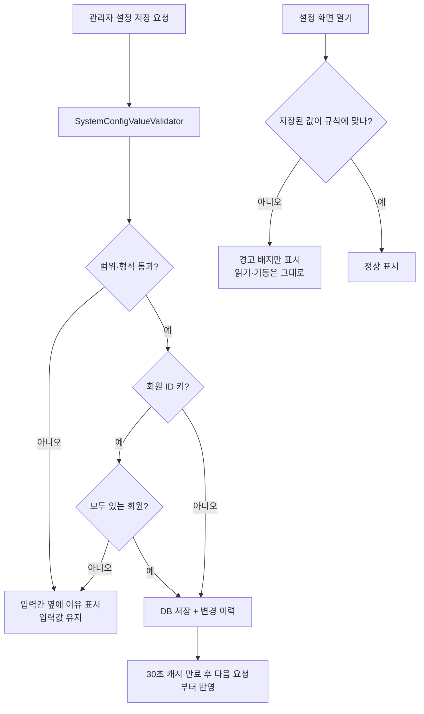

# 관리자 편의 기능 일괄 보강 (#908 · #909 · #910 · #911 · #912)

## 개요

#654 후속으로 등록된 관리자 편의 이슈 5건을 한 번에 구현해 운영 서버에 배포했다.
운영자가 "초대가 안 돼요", "광고를 봤는데 보상이 없어요", "알림이 안 와요" 같은 제보를 받았을 때
DB 를 열지 않고 관리자 화면에서 원인을 찾게 하고, 비용·남용 방지 값을 배포 없이 조정하게 하는 것이 목표다.

- develop 커밋: `30d602c2` (서버 147개 파일, +6,344 / -501), develop 병합 `14a9b222`
- 운영 배포: 서버만 먼저 내보내는 핫픽스 PR #935 (`93c0b878`) → v2.69.2, 앱 워크플로우는 돌지 않음
- 설계 기록: `docs/superpowers/specs/2026-10-21-admin-convenience-908-912-design.md`

## 이슈별 구현 내용

### #908 공동 보호자 · 초대 코드 · 기기 연결 조회

- 회원 상세가 첫 이룸이(`findFirst`)만 보던 것을 **모든 이룸이 카드**로 바꿨다. 카드 머리글에 요약 배지(보호자 수, 연결된 기기 없음, 쓸 수 있는 초대 코드, 막힌 코드)가 붙는다.
- 카드마다 네 가지를 보여 준다.
  - 공동 보호자: 역할, 합류일, 계정 상태, 그 보호자 상세 링크
  - 초대 코드: 상태 5종(사용 가능 · 사용됨 · 만료 · 시도 초과로 막힘 · 폐기), 발급·만료 시각, 틀린 횟수 (최근 10건)
  - 이룸이 기기 연결: 상태 6종, 기기명, 연결·끊김 시각, 마지막 접속(마지막 토큰 발급 시각)
  - 푸시 기기: 플랫폼, 언어, 토큰 앞 6자, 처음·마지막 등록. 30일 넘게 갱신이 없으면 경고
- **기기 연결 해제**를 붙였다. 기존 `DeviceLinkService.revoke` 를 그대로 불러 앱의 끊기와 같은 경로를 탄다(확인창 → POST + CSRF → 감사 로그 `[admin device unlink]`).
- 회원 상세 머리글에 그 회원의 알림 기록·광고 보상 화면 링크를 달았다.

### #909 비용 직결 운영 값을 시스템 설정으로 이전

시스템 설정에 `사용 한도·남용 방지` 묶음을 새로 두고 8개 값을 옮겼다. **기본값은 옮기기 전 코드 값과 같아** 배포만으로는 동작이 바뀌지 않는다.

| 키 | 기본값 | 허용 범위 |
|---|---|---|
| `ROUTINE_REQUEST_COOLDOWN_SECONDS` | 30 | 1~600 |
| `ROUTINE_STEP_IMAGE_LIMIT_PER_10_MINUTES` | 10 | 1~100 |
| `FEEDBACK_DAILY_LIMIT` | 20 | 1~200 |
| `PROFILE_INVITE_ISSUE_LIMIT_PER_10_MINUTES` | 10 | 1~100 |
| `PROFILE_INVITE_REDEEM_LIMIT_PER_10_MINUTES` | 10 | 1~30 |
| `LINK_REDEEM_LIMIT_PER_MINUTE` | 10 | 1~30 |
| `TTS_ON_DEMAND_MAX_CONCURRENT` | 2 | 1~4 |
| `TTS_FAILURE_COOLDOWN_MINUTES` | 30 | 1~1440 |

- 가드·제한기는 요청마다 `UsageLimitSettings` 로 읽는다(기존 30초 캐시라 DB 를 매번 치지 않음). 바꾸면 다음 요청부터 반영된다.
- TTS 동시 실행은 `Semaphore`(시작 시 크기 고정) 대신 카운터와 요청마다 읽는 상한으로 바꿔 재시작 없이 반영된다.
- 입력 한도 두 개(초대 코드·연결 암호)는 무작위 추측을 막는 장치라 상한을 30으로 낮게 잡았다.

### #910 광고 보상 · 알림 조회 화면

- `/admin/ad-rewards`: 광고 보상 세션 목록. 기간·회원·상태·거절 사유 필터, 오늘 요약 카드(전체·지급·거절·대기·만료·지급 크레딧, 누르면 그 상태만 걸러짐).
- `/admin/ad-rewards/{id}`: 세션 생성 → 콜백 수신 → 지급·거절·만료 흐름, nonce·거래 ID 앞 6자, 회원 상세·크레딧 원장 링크.
- `/admin/notifications`: 알림 기록 목록. 기간·회원·종류·읽음 필터. 회원을 지정하면 알림 설정(종류별 켜짐·꺼짐, 실제로 푸시가 나가는 종류 수) 카드가 위에 나오고, 지금 설정으로 푸시가 안 나가는 줄에는 "푸시 꺼짐" 배지가 붙는다.
- 사이드바 운영 묶음에 "광고 보상", "알림 기록" 메뉴를 넣었다.

### #911 목록 기간 필터 · 검색 · CSV 내보내기

- 회원(최근 활동 기간, 로그인 제공자, 이룸이·보호자 수·로그인 열), 일과(예정일, 보호자), 의견(보낸 날, 앱 버전, OS), 공지(상태, 대상 플랫폼, 게시 기간), AI 모니터링(오류 메시지, 모델명, 회원 아이디·닉네임·이메일 검색, 닉네임 표시)에 필터를 넣었다.
- 공통 필터 바를 고쳐 **입력칸 · 적용된 조건 칩 · 필터 초기화**를 이 틀을 쓰는 모든 목록에 한 번에 적용했다. 목록 정의에 입력 방식(TEXT/DATE)만 선언하면 칸이 그려진다.
- 회원·의견·AI 모니터링에 CSV 내보내기(`/export.csv`)를 붙였다. 화면 조건을 그대로 적용한다.

### #912 시스템 설정 입력 검증

- 키별 형식 검증: 앱 버전(`MIN_/LATEST_APP_VERSION_*`), 스토어 주소(`*_STORE_URL`), 광고 단위 목록(`AD_REWARD_ALLOWED_AD_UNITS`), 회원 ID 목록(`ADS_ALWAYS_SHOWN_MEMBER_IDS`, UUID + 실제로 있는 회원).
- 광고 상시 노출 회원은 손으로 ID 를 적는 대신 **검색해서 칩으로 고른다**(2글자 이상, 없는 회원은 빨간 칩).
- 실패하면 입력칸 바로 아래에 이유를 보여 주고 입력값은 그대로 둔다.
- 모델명 키: yml 이 DB 값을 덮는지 확인했더니 반대였다. **DB 값이 이기고**, yml 은 DB 가 비었을 때의 기본값이자 첫 기동 시딩 값이다. 화면 값이 곧 실제 적용 값이며 값의 출처(DB · yml · 코드 기본값)를 함께 표시한다.

## 처리 흐름



## 설계 결정과 이유

- **스키마 변경 없음.** 이번 범위는 조회·설정·검증이다. 저장하지 않는 값(광고 단위, 콜백 원문, 푸시 발송 결과, 초대 코드 원문)은 지어내지 않고 화면에 "저장하지 않아요"로 안내했다.
- **초대 코드 취소는 넣지 않았다.** 도메인에 코드 하나를 취소하는 공개 동작이 없다. 새로 만들면 보호자 쪽 흐름과 어긋날 수 있어 읽기 전용으로 두었다. 기기 연결 해제는 기존 동작이 있어 붙였다.
- **일과 최대 단계 수는 설정으로 옮기지 않았다.** 이 값은 앱 상수 · Gemini 스키마 `maxItems` · 프롬프트 · 오류 문구("10장까지") · 크레딧 응답에 모두 10으로 묶여 있다. 설정만 낮추면 앱은 추가 버튼을 보여 주는데 서버는 틀린 문구로 거절하고, AI 가 정상적으로 10단계를 만들어도 실패한다. 서버 안의 중복 두 곳만 `RoutineStepLimits.MAX_STEP_COUNT` 로 모았다.
- **검증 규칙은 한 곳.** `ConfigKey` 에 범위·형식을 선언하고 `SystemConfigValueValidator` 가 저장 거부와 기존 값 경고 양쪽에 같은 규칙을 쓴다. 이미 운영에 저장된 값이 새 규칙에 걸려도 서버가 죽거나 화면이 깨지지 않게, **저장할 때만 막고** 읽을 때는 경고 배지만 띄운다.
- **빈 값 허용 키를 명시했다.** 회원 ID 목록·버전·스토어 주소는 기본값이 빈 값인데 지금까지 빈 값 저장이 거부돼 "기본값으로 복원"이 실패하고 칩에서 마지막 회원을 뺄 수 없었다.
- **연결 조회는 별도 트랜잭션.** 회원 상세 안에서 연결 조회 예외를 잡으면 같은 트랜잭션이 롤백 표시돼 커밋 때 화면 전체가 깨진다. `AdminMemberConnectionService`(REQUIRES_NEW)로 떼어 실패해도 그 영역만 경고가 뜬다. 쿼리는 이룸이 수와 무관하게 5회로 고정했다.
- **CSV 는 공통 `AdminCsvExporter` 한 곳.** UTF-8 BOM(엑셀 한글), 수식 주입 방지(`= + - @ 탭 CR` 로 시작하면 앞에 `'`), 개인정보 최소 열(아이디·이룸이 호칭·도움 방식·프롬프트 원문 제외), 최대 10,000건(버튼 비활성 + 서버 재확인).
- **서버만 핫픽스로 배포.** develop → main 정식 배포에는 다른 세션의 앱 변경(165개 파일)이 함께 있어 앱 빌드가 같이 돈다. #870 과 같은 방식으로 origin/main 기준 브랜치에 이 변경만 옮겼다.

## 실패 경로

| 상황 | 동작 |
|---|---|
| 회원 상세 연결 조회 실패 | 본문은 열리고 그 영역만 경고 `E-ADM-CONN-001` |
| 이미 끊긴 기기 해제 · 남의 이룸이 기기 | 상세로 돌아와 `E-ADM-LINK-001` |
| 광고 보상 · 알림 요약 조회 실패 | 목록은 보이고 `ADMIN-AD-REWARD-SUMMARY` / `ADMIN-NOTIFICATION-SUMMARY` |
| 회원 고르기 검색 실패 | `E-CFG-MEM` 안내, ID 만으로 칩 표시 |
| 범위 밖 저장값 | 기본값으로 대신 동작 + 영어 경고 로그 |
| CSV 상한 초과 | 같은 조건 목록으로 돌아와 안내 |
| 잘못된 날짜 · 허용 밖 필터 값 | 보정 단계에서 버림(칩에도 안 남음) |

## 검증

- **develop 기준**: 관련 테스트 **1,096건 통과** (실패 0). 임시 Postgres 로 IT 8개를 함께 돌려 스프링 기동 시 새 JPQL 이 모두 검증됐다. 리뷰 반영분 재실행 41건 통과.
- **핫픽스 브랜치 기준**: 관련 테스트 **1,053건 통과**, IT 7개 통과.
- 코드 리뷰에서 나온 실제 버그 2건을 고쳤다.
  - 목록 페이지 링크에서 검색어의 `+` 가 공백으로 바뀌던 문제 → `%2B` 로 인코딩, 테스트 추가
  - 관리자 목록 회원 검색어의 `%`·`_` 가 와일드카드로 동작하고 건수 상한이 없던 문제 → 이스케이프 + 501건 상한
- **운영 배포**: `elum-server-cicd` 성공. 새 컨테이너가 정상 기동했고(`Started ElumServerApplication`), 사용 한도 키 8개가 기본값으로 생성된 로그를 확인했다.

  ```
  [SystemConfigInitializer] 시스템 설정 기본값 생성: ROUTINE_REQUEST_COOLDOWN_SECONDS=30
  ... (8개 동일)
  [SystemConfigInitializer] 시스템 설정 기본값 생성: TTS_FAILURE_COOLDOWN_MINUTES=30
  ```

  새 오류 로그 없음. `/admin/ad-rewards` 는 비로그인 시 로그인 화면으로 이동(302).
- **관리자 화면 캡처는 아직 없다.** 운영 관리자 로그인 후 라이트·다크 캡처를 후속 댓글로 남긴다.

## 주의사항

- **#913(이야기 칸)이 main 에 배포될 때**: 핫픽스에서는 main 에 없는 이야기 알림 종류 2개(`TALK_POST_*`)와 사이드바 이야기 메뉴를 뺐다. develop 에는 모두 들어 있어 정식 배포 때 자연히 합쳐진다. 다음 main → develop 병합에서 `MemberService.nicknamesOf` 가 양쪽에 같은 내용으로 있으니 develop 쪽으로 해소한다.
- **`TTS_ON_DEMAND_MAX_CONCURRENT` 상한 4는 `RoutineStepSpeechProvider.SYNTHESIS_THREAD_COUNT` 와 같아야 한다.** 스레드 풀을 상한 크기로 미리 잡아 두었기 때문이다. 한쪽만 올리면 설정을 올려도 줄을 선다.
- **일과 최대 단계 수 10 은 아직 사본이 남아 있다**: 클라이언트 `_maxSteps`, `CreditQueryService.MAX_CARDS_PER_ROUTINE`, `GeminiRoutineSchemas` 의 `maxItems`. 바꾸려면 함께 바꿔야 한다.
- **운영 DB 의 기존 설정값**이 새 형식 규칙(버전 · 광고 단위 · 회원 ID)에 어긋나는지는 설정 화면의 경고 배지로 확인해야 한다. 경고가 떠도 동작은 그대로다.
- 운영 서버 기동 로그에 Flyway 경고 `Schema "public" has a version (52) that is newer than the latest available migration (51)` 가 있다. 운영 DB 에 이미 #913 의 V52 가 적용돼 있어서 나는 경고이고 이번 변경과는 무관하다.
- 하지 않은 것: 의견 앱 버전 필터의 버전 경계 일치(`1.1` 이 `1.10` 도 잡는다), 회원 CSV 의 IN 목록 나누기, `AdminMemberService`(319줄) 분리.
