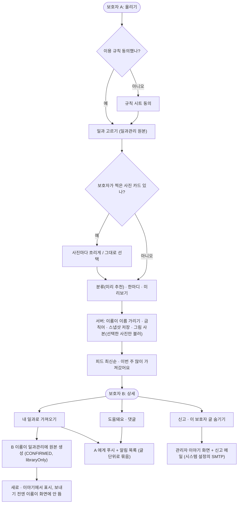

# ⚙️[기능추가][클라][이야기] 보호자끼리 일과를 나누고 일과관리로 가져가는 이야기 칸

## 개요

보호자 하단 바의 준비 중이던 `이야기` 칸을 실제 기능으로 열었다. 보호자가 일과관리 원본 일과를 "이렇게 했어요" 한마디·분류와 함께 올리면, 다른 보호자가 최신순 피드에서 보고 자기 이룸이의 **일과관리**로 가져간다(보내기 전에는 이룸이 화면에 뜨지 않음). 도움돼요·댓글·푸시 알림·신고(운영자 메일)·이 보호자 글 숨기기·이용 규칙 동의·관리자 화면·탈퇴 정리까지 포함한다. 설계 `docs/superpowers/specs/2026-10-20-guardian-talk-design.md`, 계획 `docs/superpowers/plans/2026-10-20-guardian-talk.md`.

## 기능 흐름

## 변경 사항

### 서버: 이야기 도메인 (`server/.../talk`)
- `infrastructure/entity`, `repository`: 글(스냅샷)·카드·댓글·도움돼요·가져감·신고·숨기기 표 7개. 외래키 없는 문자열 id.
- `db/migration/V52__create_talk_tables.sql`: 추가 전용. 원본 일과당 보이는 글 하나를 막는 부분 유니크 인덱스(`uk_talk_post_visible_source`), 조회·정리용 인덱스, `routine.talk_post_id`, `member.talk_rules_agreed_at`, 알림 설정 2칸.
- `TalkPostService`: 미리보기·올리기·고치기·내리기. 이룸이 호칭을 4곳(제목·카드 제목·카드 설명·한마디)에서 "이룸이"로 바꾸고, 남으면 문자열 치환 후 그래도 남으면 거절. 내리면 본문·카드·그림을 지우고 상태만 남김.
- `TalkFeedQueryService`, `TalkPostAccess`: 피드(커서·화면 언어·분류)·인기(7일 고유 보호자 수)·상세·그림. 숨긴 보호자·정지 회원 규칙을 조회·쓰기 모두 한 곳에서 판정.
- `TalkImportService`: 가져오기 → 일과관리 원본 생성 위임, 보호자당 1회 가져감 수(원자 증가).
- `TalkReactionService`: 도움돼요(멱등)·댓글(오래된 순, 300자, 금칙어).
- `TalkModerationService`, `mail/*`: 신고(자동 숨김 없음, 중복 거절)·숨기기·신고 메일(커밋 뒤 비동기, 실패해도 신고 저장 유지).
- `TalkAdminService` + `admin/.../AdminTalkController`, 템플릿 `talk*.html`: 글·신고 목록, 가리기·되돌리기, 사이드 메뉴 미처리 신고 배지.
- `TalkCleanupService`: 탈퇴 시 글·댓글·반응·신고·숨기기·가져감 삭제 후 남의 글 카운트 재계산.

### 서버: 기존 도메인 (추가만)
- `routine/.../RoutineShareService`: 공유용 스냅샷 뜨기, 일과관리로 넣기(맨 앞·묶음 맨 뒤), `RoutineResponse.talkPostId`(이룸이 응답에서는 제외).
- `member`: 이용 규칙 동의 API, 닉네임 조회, `NicknamePolicy.containsBlockedWord`(자유 글용, 2글자 이하 한글 금칙어 제외).
- `notification`: `TALK_POST_COMMENTED`, `TALK_POST_IMPORTED`, 푸시 문구 5개 언어, 알림 설정 2개(옛 앱은 null 이면 기존 값 유지).
- `systemconfig`: `신고 메일` 그룹 6개(켜기·받는 주소·SMTP 호스트·포트·계정·비밀번호 SECRET). 발송마다 설정을 읽어 재시작 없이 반영, STARTTLS 필수.

### 앱 (`client/lib/features/talk` 외)
- 피드(분류 칩·인기 줄·무한 스크롤·당겨서 새로고침·빈/필터 0건/실패 상태), 상세(카드·도움돼요·댓글·⋯ 메뉴·신고·숨기기·당겨서 새로고침·내려간 글), 올리기 3단계, 일과관리로 넣기 시트, 숨긴 보호자 목록.
- `guardian`: 일과관리 칸 "새로"·"이야기에서", 가져온 일과 상세 배너, 홈 끝낸 일과 "이야기에 공유해 보기", 일과관리 ⋯ "이야기에 공유하기/내 글 보기", `Routine.talkPostId`.
- `notification`: 알림 2종 문구·이동·설정.
- 분류 6개 이름 변경(생활 습관 · 하루 순서 · 집안일 · 바깥 활동 · 공부 · 감정·관계), 공통 위젯 이동(`shared/pictogram`, `core/widgets/elum_multiline_text_field.dart` 등), 계정 전환 시 이용 규칙 기억 초기화.
- 개인정보처리방침 사본(`consent_documents.dart`, `consent/privacy.txt`)을 운영 2026-10-20판과 일치(#906).
- `client/ios/fastlane/review_notes.txt`: 이야기 칸·신고 경로 설명 추가.

## 주요 구현 내용

- **이룸이 실명 보호**: AI 결과가 저장 시 실명으로 복원돼 있어 올릴 때 다시 가린다. 기존 `NicknamePlaceholder.mask` 는 예외를 삼키고 뒤에 한글이 붙은 이름을 건너뛰므로, 가린 뒤 남은 등장을 문자열로 한 번 더 바꾸고 그래도 남으면 거절한다.
- **그림은 사본**: 원본 일과 그림은 그 이룸이 보호자만 받을 수 있어 글 전용 저장소로 복사하고, 흐리게를 고른 보호자 사진만 사본에 블러한다. 가져갈 때는 가져간 쪽 저장소에 새 키(`talk-` 접두)로 복사해, 원래 글이 내려가도 가져간 일과는 멀쩡하다.
- **가져오기 = 일과관리 원본**: 임시저장은 찾아 들어가기 어려워(사용자 결정) 일과관리 "복사하기"와 같은 원본(`libraryOnly`)으로 만든다. 보내기 전에는 이룸이 화면에 뜨지 않아 보호자 확인 원칙이 지켜진다.
- **도메인 경계**: 다른 도메인 repository 를 import 하지 않는 규칙 때문에 일과 읽기·만들기는 `RoutineShareService` 공개 메서드 두 개로만 한다. 홈·일과관리 입구의 "이미 나눈 일과"는 일과 응답이 아니라 이야기 API(`/posts/mine/by-source-routine`)로 받는다(서비스 순환 방지).
- **동시성**: 카운트는 JPQL 원자 증감, `TalkPost` 는 `@DynamicUpdate` 로 바뀐 칼럼만 써서 고치기·가져가기가 도움돼요·댓글 수를 덮어쓰지 않는다. 중복 공유는 부분 유니크 인덱스로 막는다.

## 검증

- 서버 전체 테스트 2,528개 실패 0 (DB 환경 변수 게이트 IT 57개 건너뜀). 새 쿼리는 로컬 Postgres 임시 DB 에서 IT 로 모두 1회씩 실행(TalkQueryIT·TalkCleanupIT·TalkAdminQueryIT·TalkSchemaValidateIT).
- 앱 `flutter analyze` 기존 info 3건 외 없음, 한글 리터럴 0줄, 레이어 검사 talk 위반 0.
- 시뮬레이터 E2E 2회(로컬 서버 + 아이폰 시뮬레이터 2대, 운영 미사용·AI 미호출): 1회차 13단계 전 흐름 통과, 결함 D1~D5 발견. 수정 후 2회차 재확인 8항목 전부 통과(카드 번호, 분류 0건 화면, 분류 추천, 상세 새로고침·내려간 글, 관리자 한글 분류, 신고 메일 설정 화면, 기본 흐름). 2회차에서 본 "내려간 글 화면의 입력줄 잔존"도 수정.

## 주의사항

- **운영 배포 전에는 테스트 빌드의 이야기 칸이 오류 화면으로 보인다.** 테스트 빌드는 운영 서버에 붙고, 이야기 API 는 아직 운영에 없다.
- **신고 메일은 배포 뒤 관리자 시스템 설정 › 신고 메일에서 값을 넣고 켜야 나간다**(기본 꺼짐). 받는 주소·호스트·계정은 한 번 채우면 화면에서 비울 수 없다(기존 설정 화면 규칙) — 멈출 때는 "켜기"만 끈다.
- **V52 를 고쳐 왔다**: 이 브랜치 이전 버전 V52 를 적용한 로컬 DB 는 Flyway 체크섬 불일치로 기동이 실패하니 재생성한다. 빈 DB 에 V1~V52 연속 적용은 기존 V8(JPA 가 만드는 기본 표 전제) 때문에 원래 불가하다.
- **내린 글**은 본문·카드·그림을 지우고 상태 행만 남긴다(방침 "내리면 파기"와 일치). 관리자도 내린 글 내용은 못 본다. 그 글에 달린 남의 댓글은 남는다.
- **금칙어**: 2글자 이하 한글 금칙어는 자유 글 검사에서 뺐다("TV를 보지 않아요" 오탐 방지). 짧은 욕설은 신고로 걸러진다.
- **관리자 가린 글**도 작성자가 같은 일과로 다시 올릴 수 있다(정지로 대응).
- **영어 등 다른 언어 문구**(분류 이름 포함)는 아직 옛 문구 또는 한국어 폴백이다. 번역 단계에서 맞춘다.
- 앱에 다크 테마가 없어 다크 모드는 확인 대상이 아니었다. 분류 고르기 칸에는 시안이 없어 그림 없이 이름+예시만 둔다.
- 남은 일: 운영 배포(요청 시), 화면 문구 한 장씩 확인, 테스트 빌드 실기기 확인.
