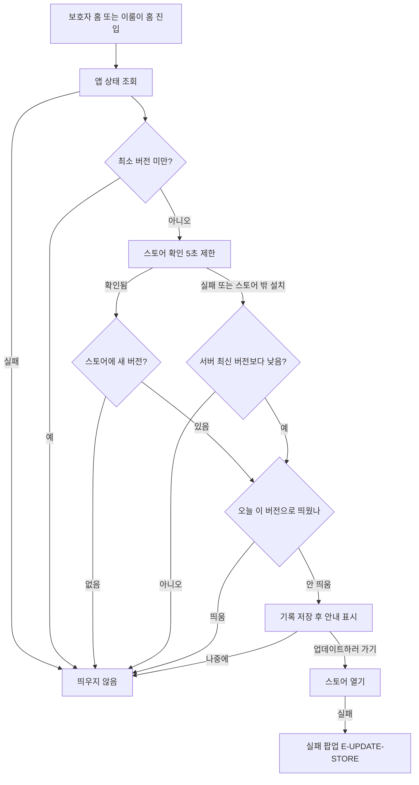

# 업데이트 권유: 스토어 버전 확인 + 루미 안내 구현 보고서

## 개요

#660의 업데이트 권유 팝업을 세 가지 면에서 고쳤어요.

1. 새 버전 판단 기준을 서버 `최신 버전`(관리자 수동 입력)에서 **스토어에 실제로 올라간 버전**으로 바꿨어요.
2. 글자뿐인 팝업을 **손 흔드는 루미 안내**로 바꿨어요. 폰은 바닥 시트, 태블릿은 가운데 카드예요.
3. 보호자 홈에 더해 **이룸이 홈**에서도 띄워요.

하루 한 번 주기와 문구(5개 언어)는 #660 그대로예요.

## 왜 스토어에 직접 묻나

- 서버 값은 사람이 올려야 해서, 새 버전을 내도 값을 안 올리면 아무도 몰라요.
- 배포 워크플로가 값을 올리게 하면 안 돼요. main 배포가 곧 심사 제출이라 **심사 중인 버전**을 권하게 돼요. 그러면 사용자가 스토어에 가도 받을 게 없어요.
- 스토어 조회는 이미 판매 중인 버전만 돌려주므로 이 문제가 없어요.

## 변경 사항

| 파일 | 내용 |
|---|---|
| `client/lib/core/app_status/store_update_check.dart` (새 파일) | iOS: App Store 공개 조회(`itunes.apple.com/lookup?id=…&country=kr`)의 `version`과 지금 버전 비교. Android: `in_app_update`의 `updateAvailability` 그대로 사용. 실패하면 null |
| `client/lib/core/app_status/update_suggestion.dart` | 판단을 `updateSuggestionTarget`(무엇을 권하나)과 `shouldSuggestUpdate`(오늘 띄웠나)로 나눔. 팝업 대신 새 안내 호출 |
| `client/lib/core/app_status/update_suggestion_prompt.dart` (새 파일) | 폰: 바닥 시트(루미 168, 제목·설명, 버튼 둘을 세로로). 태블릿: 가운데 카드(루미 180 왼쪽, 글과 버튼 둘 오른쪽) |
| `client/lib/core/app_status/update_suggestion_launcher.dart` (새 파일) | 이룸이 홈을 감싸 첫 프레임 뒤에 권유 호출 |
| `client/lib/core/router/routes_child.dart` | 이룸이 홈(`/child`) 자리만 런처로 감쌈 (일과 진행 화면에는 안 띄움) |
| `client/assets/images/update_suggestion_lumi.png` | 윙크하며 손 흔드는 루미 (768×768 투명 PNG) |
| `client/pubspec.yaml` · `pubspec.lock` | `in_app_update: ^4.2.5` |

## 판단 흐름

## 실패 경로

| 상황 | 결과 |
|---|---|
| 앱 상태 조회 실패 | 띄우지 않음 |
| 스토어 조회 실패·5초 초과·응답 형식 다름 | 서버 값으로 판단 |
| Play 밖 설치(테스트 APK) | `in_app_update` 예외 > 서버 값으로 판단 |
| 스토어를 기다리는 사이 다른 화면으로 넘어감 | 그 위에 띄우지 않음 (다음 진입에 다시 판단) |
| 스토어 주소 없음 | 띄우지 않음 |
| 스토어 열기 실패 | 공용 실패 팝업 + `E-UPDATE-STORE` |

## 주의사항

- **스토어가 "새 버전 없음"이라고 하면 서버 값이 더 높아도 권하지 않아요.** 서버 `최신 버전`은 스토어 확인이 안 될 때만 쓰는 비상용이에요. 서버 값을 올렸는데 안 뜬다면 스토어에 아직 안 풀린 거예요.
- **App Store 조회에는 서버용 Dio를 쓰지 않아요.** 서버용은 인증 토큰을 붙이므로, 쓰면 토큰이 Apple로 나가요. 새 Dio를 따로 만들어요.
- App Store 조회 결과는 출시 직후 몇 시간 늦게 바뀔 수 있어요.
- Android 기록 표시는 `build-{versionCode}`예요. Play가 버전 이름을 주지 않아서예요.
- 하루 한 번 기록은 보호자·이룸이 화면이 같은 키를 써요. 한 기기는 보통 한 화면만 쓰므로 문제없어요.
- `client/pubspec_overrides.yaml`(로컬 전용, connectivity_plus 7.0.0)이 있으면 `flutter pub add`가 lock에 내린 버전을 써요. lock은 오버라이드를 잠시 빼고 다시 만들어 커밋했어요.

## 검증

| 항목 | 결과 |
|---|---|
| `flutter analyze` (app_status, router, notice) | 통과 (병합 뒤 다시 확인) |
| 계층 import 검사 | 이번 변경분 위반 0건 (develop에 있던 `features/profile` 5건은 그대로) |
| 한글 하드코딩 검사 | 0줄 |
| 테스트 빌드 (iOS TestFlight `2.67.0(91402)`, Android APK) | 둘 다 성공 |
| 시뮬레이터 화면 실측 | **보류.** 미리보기 빌드가 시스템 메모리 부족으로 중단됨 |
| 앱 테스트 | 없음 (#848에서 앱 테스트 삭제) |

배포 PR #917 머지 (v2.69.0).

## 남은 확인

- 실제 기기에서 안내 모양 확인: 다음 버전이 스토어에 풀린 뒤 이번 버전 기기에서 보호자 홈·이룸이 홈에 들어가면 떠야 해요.
