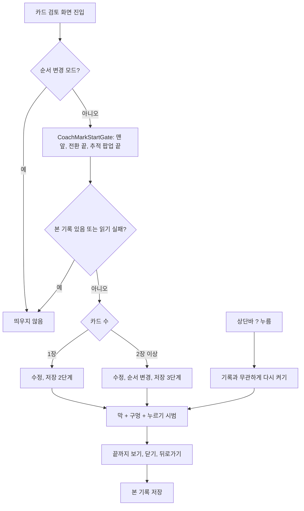

# 카드 검토 화면 사용법 코치마크와 다시 보기 버튼

## 개요

일과를 만든 보호자가 카드 검토 화면에서 `카드 저장하기`를 누르지 않고 나가 임시저장 일과가 쌓이고 있었다.
카드 검토 화면 첫 진입 때 3단계 코치마크(이 카드 수정 > 카드 순서 변경 > 카드 저장하기)를 한 번 띄우고, 상단바 `?` 로 다시 보게 했다.
작업 중 요청으로 일과관리 머리에도 `?` 를 넣고, 일과관리 코치마크 구멍이 실제 칸과 어긋나던 것을 맞췄다. 세 곳에 복사돼 있던 코치마크 시작 판단은 공통 mixin 으로 모았다.

시안은 없다. 기존 코치마크 모양(막 + 구멍 + 화살표 + 누르기 시범)을 그대로 썼다. 설계: `docs/superpowers/specs/2026-10-21-card-review-coach-mark-design.md`

## 변경 사항

### 카드 검토 코치마크
- `application/card_review_coach_notifier.dart` (신규): 단계 enum(`editCard`·`reorderCards`·`save`), 시작·다음·끝·다시 보기. 카드 1장이면 `stepsFor` 가 순서 변경을 뺀다. 저장소를 못 읽으면 봤다고 친다(닫을 수 없는 반복 방지).
- `presentation/widgets/card_review_coach_mark.dart` (신규): 루트 오버레이에 `CoachMarkOverlay` 를 그린다(홈 코치마크와 같은 방식). 가리킬 버튼 키는 `CardReviewCoachKeys` 로 화면에서 받는다. 화면이 사라지면 `finish()` 로 끝내 켜진 채 남지 않게 했다.
- `card_review_screen.dart`: 키 3개 연결, 순서 변경 모드에서는 시작하지 않음, `?` 로 다시 보기, 코치마크 중에는 스캐폴드가 시스템 뒤로가기를 무시(`shouldIgnoreSystemBack`).
- `routine_flow_scaffold.dart`·`routine_flow_top_bar.dart`: `onHelp`(상단바 `?`), `shouldIgnoreSystemBack` 선택 인자. 다른 흐름 화면은 넘기지 않아 그대로다.
- 저장소 3곳: `coach.cardReviewSeen` 기기 기록, `resetCoachMarks` 에 포함.
- 문구 ko·en: 코치마크 3개 + `coachHelpLabel`(사용법 보기). ja·zh·es 는 원래 거의 비어 있어 다른 코치마크처럼 비웠다.

### 공통화와 사용자 요청 반영
- `CoachMarkStartGate` (신규 mixin): 화면 맨 앞·전환 끝·추적 허용 팝업 끝·가려지면 0.5초 재시도. 홈·일과관리·카드 검토가 같은 코드를 복사해 쓰고 있었다. 홈의 "맨 앞에 1.2초 머물러야 시작"은 `coachMarkSettleDuration` 으로 남겼다.
- `CoachHelpButton` (신규): 자리 24 안에 물음표 원 20. 물음표 원은 테두리까지 꽉 찬 그림이라 24 로 그리면 옆 24 아이콘(뒤로·집)보다 커 보였다. 카드 검토 상단바와 일과관리 머리(제목 옆)가 함께 쓴다. 홈에는 넣지 않았다.
- `library_entry_grid_cells.dart`: 코치마크 키를 칸 자리(슬롯)가 아니라 그려진 칸(그림 + 이름)에 단다.

## 처리 흐름

## 주의사항

- **코치마크 중 뒤로가기는 PopScope 가 둘이다.** 오버레이(안내 닫기)와 `RoutineFlowScaffold`(나가기 확인)가 같은 라우트에 걸려 둘 다 불린다. 스캐폴드는 `onBack` 전에 `_mayLeave`(나가기 팝업)부터 띄우므로 `onBack` 분기로는 못 막는다. 그래서 `shouldIgnoreSystemBack` 을 코치 상태로 넘긴다. 이 값을 빼면 안내를 닫으려다 나가기 팝업이 뜬다.
- **일과관리 칸은 자리 왼쪽 위에 붙어 그려진다.** `LibraryArrangeShell` 의 Stack 이 자식을 topStart 로 둔다. 칸 자리(slotRect)에 키를 달면 구멍이 오른쪽으로 남는다. 시범 연출(✓ 배지·끌기 고스트)은 구멍 상자를 기준으로 그리므로, 구멍에 여백(holePadding)을 주면 시범 위치가 그만큼 어긋난다.
- **`CoachMarkStartGate` 를 쓰는 State 는 dispose 에서 super 를 불러야 한다.** mixin 이 재시도·지켜보기 타이머를 거기서 끊는다.
- **카드 검토 화면 파일이 497줄이다.** 원래 475줄이었고 이번에 코치 연결만 더했다. 500줄 기준에 가까워 다음 기능은 분리부터 검토한다.

## 검증

- `flutter analyze`: 새 경고 0 (남은 3건은 기존 `library_parts.dart` 안내 수준)
- 자동 테스트: 앱 테스트 코드가 #848 에서 지워져 돌리지 않음
- iOS 시뮬레이터(iPhone 16, iOS 18.3) 실측, 캡처는 위 댓글
  - 카드 검토 첫 진입 3단계, 다시 들어오면 안 뜸, `?` 로 다시 켜짐
  - 일과관리 머리 `?` 로 다시 켜짐, 1단계 구멍이 실제 칸과 일치
  - 홈·일과관리 코치마크가 공통화 뒤에도 그대로 뜸
- 확인 못 함: 카드 1장일 때 순서 변경 단계 빠짐(코드로만 확인), 코치마크 중 시스템 뒤로가기(iOS 는 이 화면에서 뒤로 스와이프가 꺼져 있어 Android 필요)
- 테스트 빌드(TestFlight·APK) 브랜치 기준으로 걸었고, develop 에 병합·푸시했다

## 별개 발견

- #927: 홈 일과 시트를 닫을 때 `reorder_finger_follow.dart` 의 `late final _settle` 이 dispose 에서 처음 만들어지며 예외가 난다. 이번 작업과 무관해 이슈로 남겼다.
