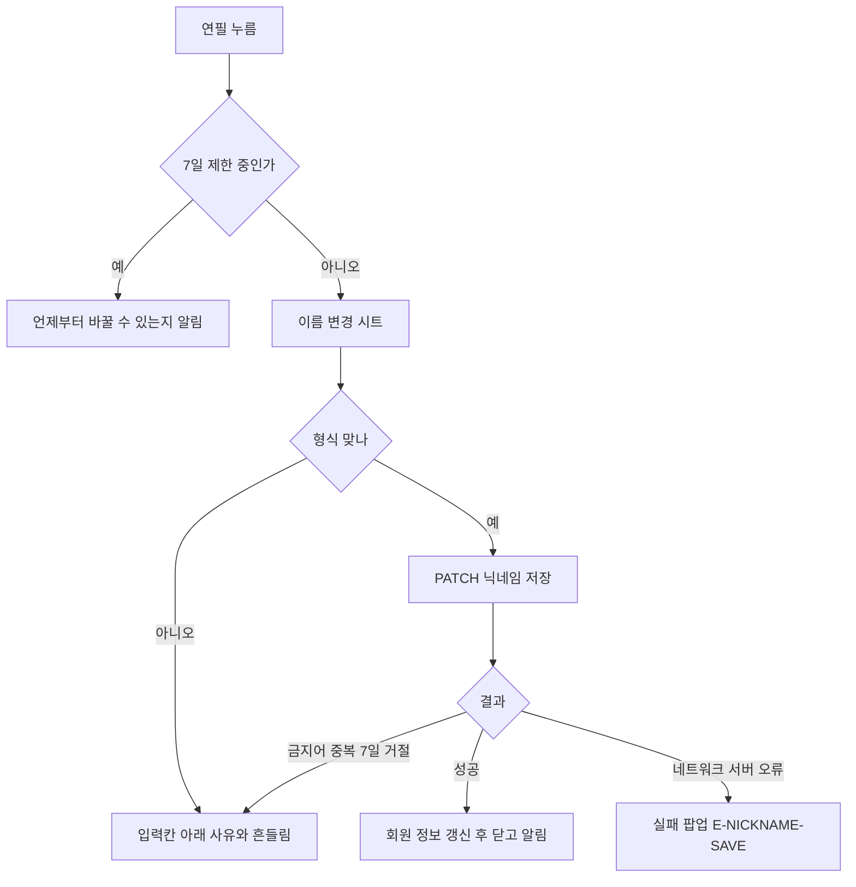
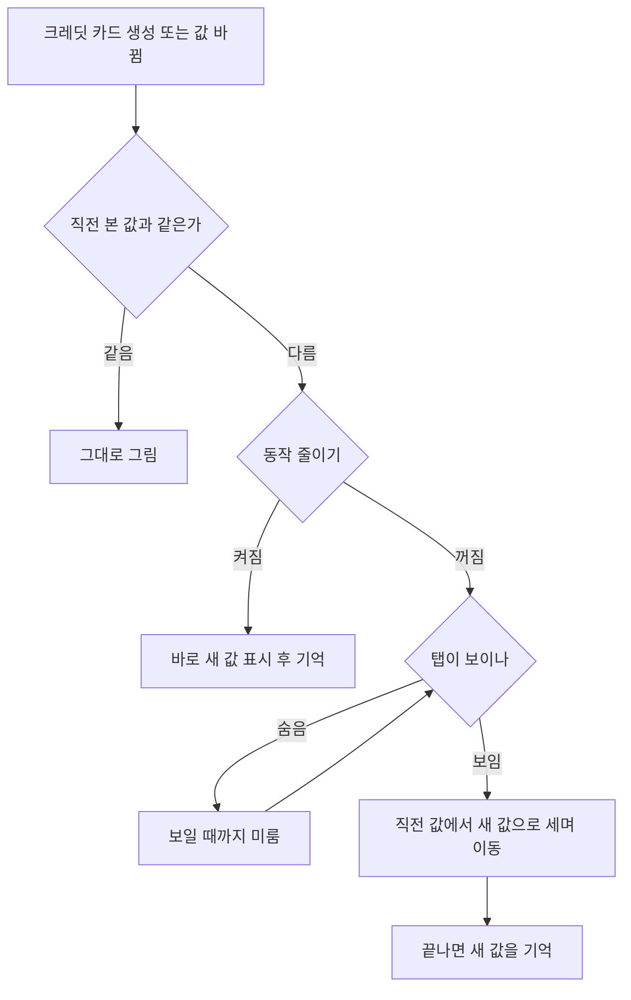

### 📌 작업 개요

내 정보 화면을 Figma 시안(`1736:8780`)대로 다시 짰다. 연필로 여는 **내 이름 변경하기 시트**(`1759:9649`)를 보호자 닉네임 변경 API에 연결했다. 카드가 위에서부터 차례로 나타나고, AI 크레딧 숫자와 막대는 **직전에 본 값에서 새 값으로 세며 줄어든다.**

- 커밋: `c4471cf2` (develop 에 반영)
- 설계: `docs/superpowers/specs/2026-10-21-my-info-redesign-design.md`

### 🖼️ 실측 (위젯 렌더, 393×852 @3x)

| 정착 화면 | 등장 300ms (아래 카드는 아직 흐림) | 이름 변경 시트 | 형식 거절 |
|---|---|---|---|
|  |  |  |  |

크레딧 세기 (직전 본 값 100 > 새 값 90, 0 · 250 · 350 · 500 · 700 · 1100ms):

> 렌더 화면이라 상태 표시줄 자리가 없다. 그래서 시안보다 전체가 위로 올라가 있다.

### 🔧 주요 변경사항

**화면 구성**
- `guardian_my_info_screen.dart`: 순서를 **AI 크레딧 > 닉네임 > 이룸이 > 바로가기**로 바꿨다. 제목은 탭 제목 글꼴(22/800), 톱니는 시안 SVG를 `#74757D`로 칠했다. 묶음마다 `AppFadeSlideIn`을 70ms 간격으로 늦춰 위에서부터 나타나게 했다.
- `my_info_nickname_card.dart` (새 파일): 닉네임(18/600) + 보호자 칩 + 연필(16, 누름 44) > 가입 배지 + 가린 이메일 > 달력 + 가입일(`2026. 10. 11 가입`). 닉네임이 바뀌면 `AnimatedSwitcher`로 겹쳐 바뀐다.
- `my_info_elumi_group.dart`: 머리글 묶음 대신 이룸이마다 단독 카드를 둔다(캐릭터 48 + 이름 16/600 + `>`). **누르면 이룸이 정보 고치기**로 간다. 이룸이가 여럿이면 `보는 중` 표시와 카드 아래 `이룸이 바꾸기` 줄을 둔다.
- `sign_in_provider_badge.dart`: 18 원형을 **24 둥근 네모(모서리 4)** + 로고 14로 바꿨다. 구글은 시안에 없어 같은 네모에 화면 바탕색을 깐다.

**닉네임 변경**
- `member_repository.dart`에 `updateGuardianNickname`(`PATCH /api/member/account/nickname`)을 더했다. 응답이 `/me`와 같은 모양이라 `GuardianNicknameEditor`가 그대로 회원 정보에 넣는다.
- `guardian_account.dart`: `nicknameChangeableAt`를 읽고 `canChangeNicknameAt(now)`를 더했다.
- `guardian_nickname_policy.dart`: 서버 `NicknamePolicy`와 같은 규칙이다(2~16자, 한글·영문·숫자·하이픈, 글자 1개 이상).
- `guardian_nickname_sheet.dart`: 저장을 시트 안에서 한다. 형식 확인 > 저장 > 성공하면 닫고 "닉네임을 바꿨어요" 알림. 서버 거절(`NICKNAME_*` 4종)은 입력칸 아래 사유 + 흔들림, 그 밖의 실패는 실패 팝업(`E-NICKNAME-SAVE`).

**애니메이션**
- `animated_credit_values.dart` + `credit_last_shown.dart`: 마지막으로 끝까지 보여 준 잔액을 앱 실행 동안 기억한다. 다음에 카드가 뜨면 그 값에서 새 값으로 숫자와 막대를 함께 움직인다(200ms 쉼 + 800ms, easeOutCubic). 본 적이 없으면 0에서 채운다. 숫자는 고정폭(tabular)이라 세는 동안 단위가 흔들리지 않는다.
- `app_motion.dart`: `sectionStagger`(70ms)와 `valueChange`(800ms)를 더했다. `valueChange`가 500 상한을 넘는 이유는 주석에 적었다.
- `app_fade_slide_in.dart`: 기기 "동작 줄이기"가 켜져 있으면 움직이지 않는다(이 위젯을 쓰는 모든 화면에 적용).

**공용화**
- 함께하는 사람 줄의 `_PersonChip`을 `core/widgets/elum_label_chip.dart`(`ElumLabelChip`)로 올렸다. 두 번째 화면이 같은 칩을 쓰게 됐기 때문이다.
- `SettingsTile`의 카드 `>`를 `SettingsCardChevron`으로 뺐다(바로가기 줄과 이룸이 카드가 같이 쓴다).
- 토큰 추가: 색 `myInfoMetaText`(#74757D), `myInfoMutedIcon`(#CACACA), 글꼴 `myInfoNickname` · `myInfoElumiName` · `myInfoMeta`. 에셋 `icon_calendar.svg`(시안 `1759:9582`).

### 🔀 흐름

### 🧪 검증

| 항목 | 결과 |
|---|---|
| `flutter analyze --no-fatal-infos` | 통과 (남은 info 3건은 기존 `library_parts.dart`) |
| `tool/check_hangul_literals.dart lib` | 0줄 |
| `tool/check_layer_imports.dart` | 새 위반 0건 (develop에 원래 있던 5건 그대로) |
| 위젯 렌더 실측 | 위 이미지: 정착 화면, 등장 중간, 시트, 형식 거절, 크레딧 세기 프레임 |
| 시뮬레이터 실기기 | **못 함**: 켜진 iPhone은 다른 프로젝트 세션이 쓰는 중이었고, 새로 켜면 메모리 예산을 넘었다. 테스트 빌드로 확인이 필요하다 |
| 앱 테스트 | 두지 않음 (#848) |

### ⚠️ 주의사항

- **크레딧 직전 값은 앱이 켜져 있는 동안만 기억한다.** 앱을 다시 켜면 0에서 채운다. 기기 저장은 설계에서 뺐다.
- **크레딧 움직임은 탭이 보일 때만 시작한다**(`TickerMode`). 내 정보 탭은 IndexedStack이라 숨어 있어도 살아 있다. 숨은 탭에서 움직이면 돌아왔을 때 이미 끝나 있으므로 줄어드는 것이 안 보인다. 이 조건을 빼면 "다른 탭에서 일과를 만들고 돌아왔을 때 줄어드는 것"이 사라진다.
- **기억값 갱신은 그리기가 끝난 뒤(microtask)에 한다.** `didChangeDependencies`(동작 줄이기 분기)에서 provider를 바로 바꾸면 Riverpod이 "그리는 중 수정" 예외를 낸다.
- **형식 확인은 저장을 누를 때만 한다.** 입력할 때마다 확인하면 한글을 조합하는 중의 자모(`ㅎ`)가 형식 밖이라 안내가 깜빡인다.
- **이룸이 바꾸기 입구는 내 정보에만 있다.** 시안에서 연필이 빠지면서 카드 탭이 정보 고치기가 됐다. 그래서 여럿일 때 `이룸이 바꾸기` 줄을 따로 두었다. 이 줄을 지우면 이룸이를 바꿀 길이 없어진다.
- 입력칸 글꼴은 기존 `ElumTextField`(Tmoney) 그대로다. 시안의 안내 글자도 Tmoney라 이슈 본문의 "Pretendard로 맞춤"은 하지 않았다.
- 다른 언어(en·ja·zh·es)는 새 문구가 아직 없어 한국어 대체로 나온다(번역 단계에서 채움). 가입일 형식(`y. MM. dd`)은 한국어 ARB만 바꿨다.

### 📋 남은 일

- [ ] 테스트 빌드(댓글로 요청함)로 실기기 확인: 등장 애니메이션, 일과 생성 후 크레딧 줄어듦, 닉네임 저장과 거절(중복, 7일)
